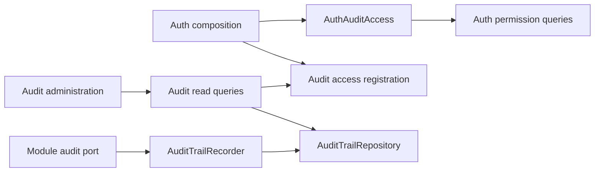
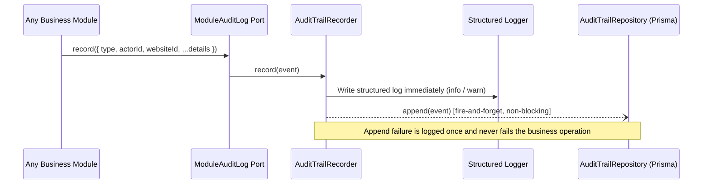

# Audit trail

## 1. Overview

Audit owns the append-only website event trail, filtered reads, activity digests and retention. Auth owns identity and permissions. Modules retain their own event vocabulary, severity and retention policies.

## 2. Architecture and layer responsibilities

Both audit and auth use `domain/{models,errors,ports}`, `application/{commands,queries,contracts,services}`, `infrastructure/`, `presentation/`, a server-only `composition.ts` and an intentional server API in `index.ts`. Existing application view mappers stay at the application root. Each module contains only the adapters and presentation concerns it needs.

- Domain models define entry values, filters, subjects and explicit read scopes. `isAuditDetailValue` owns the detail format shared by event ingestion and persistence mapping.
- Application queries authorize through `AuditAccess` before reading entries or facets. `readAuditTrail` owns the shared listing workflow. The recorder and retention command use repository and clock ports.
- Infrastructure maps records, applies scope predicates and translates persistence failures. Auth's `AuthAuditAccess` implements the audit access port through existing auth queries.
- Presentation parses search parameters, loads authorized views and renders entries. Optional name resolution enriches an authorized view; it never grants access.

## 3. Architecture diagram

## 4. Main workflow

Auth's composition root calls `setAuditAccessAdapter(new AuthAuditAccess(getAuthQueries), resolver)` when loaded. The adapter lives in auth's `infrastructure/access`, alongside other authorization integrations rather than audit-trail writers. Its location follows ownership: auth supplies audit's port because auth already records events through audit, so audit importing auth at runtime would create a cycle. The adapter constructs no queries and captures no request identity. Its operations call `AuthorizeWebsiteAccess` or `ListAccessibleWebsites` with `audit.read`; existing auth services resolve the current actor and memberships.

Audit's composition root constructs its repository, recorder and shared readers lazily with `once`, matching auth's dependency and use-case factories. `getAuditQueries()` returns the shared readers; the existing `auditQueries` facade and `getAllWebsitesAuditTrail` alias remain compatible. `createAuditQueries(access, resolver?)` supports explicit access injection.

## 5. State and data flow

Registration is process-level wiring, never request state. Shared readers forward to the latest registered access adapter. Replacing access without supplying a name resolver preserves the previous resolver. Explicit query factories keep their supplied access; a supplied name resolver overrides registration, while an absent one follows registration. Before registration, every trail query refuses access and name resolution returns an empty list. Server startup loads auth before starting audit retention through `instrumentation-node.ts`.

Single-website queries parse and authorize the requested id independently of the website currently open. Across-website queries first discover readable websites, then resolve an explicit scope. Page, counts and member facets receive the same scope. A named website is independently authorized even when absent from a truncated selector.

## 6. Business rules and invariants

- A scope is one website, a nonempty authorized website allowlist, or explicitly the platform. An absent id never means platform scope.
- Only auth's platform authority can produce platform reach. Regular readers receive an allowlist derived from their own memberships and `audit.read`.
- Entries are appended. Only retention deletes them. Policies decide which module events enter the trail; auth events in reserved platform or unassigned scopes stay out.
- Both ingestion and persistence reads accept primitive detail values and string arrays. Nested objects and other arrays are omitted. Event contracts must still exclude secrets and personal content.
- The structured log is recorded before the trail append. Append runs without awaiting completion; repository failures are logged at their owning boundary and do not fail the business operation.
- Retention runs immediately on first startup call and then daily. The timer is unreferenced; repeated startup calls do not schedule another timer.

## 7. Errors and edge cases

Authorization, validation and infrastructure errors remain typed results. Empty allowlists are denied. Truncated website, member and event-type lists retain their signals. The digest fills quiet UTC days with zero counts. Unknown stored sources are excluded from listings; malformed stored actor data falls back to a system actor rather than dropping an entry.

## 8. Security and access control

Audit never imports auth. Auth depends on audit's public API and supplies the access adapter, preserving the acyclic module graph. Queries authorize before reading protected trail data; UI visibility and previously loaded views grant no authority. Repository predicates constrain entries and facets to the authorized scope.

Member names retain `ResolveMemberNames`' existing `website.read` authorization and current-tenant roster boundary; the names asked for are the people who acted and the people an entry concerns (`subjectId`, `memberId`).

What an entry names besides people (pages, maps, data sources and datasets, locations, services, resources) is resolved by the route, because audit may not import those modules: `src/app/_lib/audit-subjects.ts` builds the `resolveSubjects` function `AuditAdministration` takes. Each kind is looked up only when the reader holds that area's read permission (`page.read`, `datasource.read`, `booking.read`, `release.read`), so an absent kind means exactly "not yours to see" ("Für Sie nicht sichtbar"); an id the lookup lacks is "no longer exists" only when the list was read in full. In the platform-wide trail the entries name things by id. Entries are grouped under a heading per day (today, yesterday, the date) by the shared table's `groupHeading`, and each row shows the time of its day. Missing or failed enrichment does not widen that boundary: the screen falls back to its existing unnamed-member display.

## 9. Testing and verification

Audit tests cover filter parsing, scope resolution, denied reads, ingestion, digests, retention and presentation. Composition tests substitute a repository port fake to verify lazy construction, access registration, explicit adapters and log-before-append order. Record-mapper tests verify ingestion/read detail parity and malformed records without a database client. Auth adapter tests combine real auth and audit queries with repository fakes to cover tenant isolation, platform scope, membership revocation, truncated allowlists and propagated failures.

Run `npm exec -- vitest run __tests__/src/modules/audit __tests__/src/modules/auth` for these unit tests and existing auth coverage. Full type checks and database-backed verification require the generated Prisma contract and other referenced repository files; port-fake tests do not prove database behavior.

## 10. Extension points and constraints

Each entry is one compact row (event, area, actor, website in the platform-wide trail, time: relative on the day the trail was read, date and time before). Entry details use the shared responsive table's expandable row, spanning every column on desktop and the card width on narrow screens. The details control sits in the row's trailing actions cell, uses neutral text with an accessible expanded state; event severity keeps its separate indicator. Truncation notices sit above the entries panel; the filter form keeps the page size when applied.

Add event types to the owning module's exhaustive severity and trail policy tables. Wire `withAuditTrail` only in that module's composition root. Add permissions through auth's existing role vocabulary rather than duplicating role checks in audit.

Trail writes remain best effort: process termination can lose an in-flight append. Transactional completeness would require a separate persistence/behavior decision. Name resolution remains current-tenant scoped; naming actors across multiple websites requires an explicit authorized scope contract rather than broadening identity lookups implicitly.
