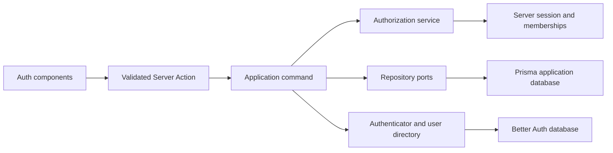
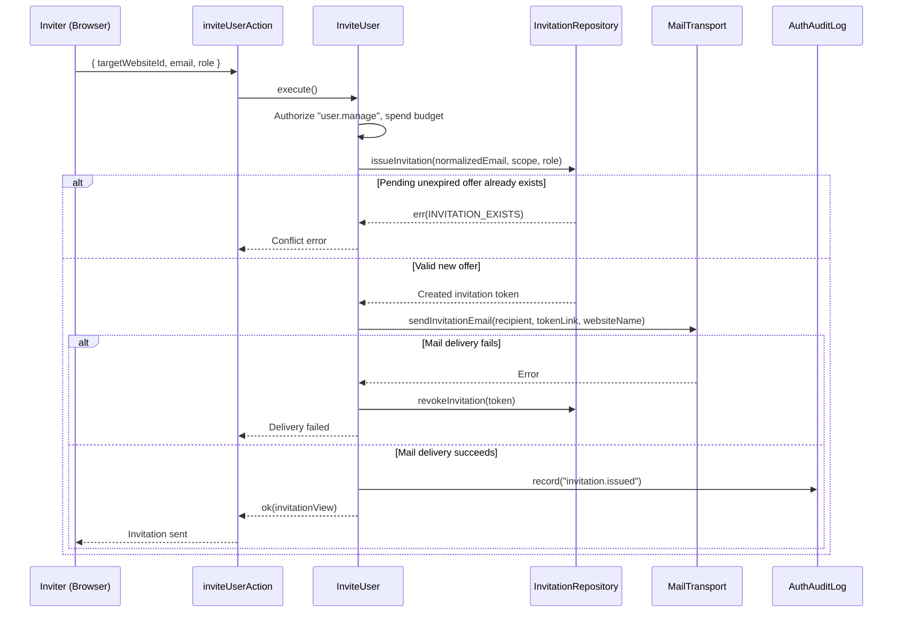
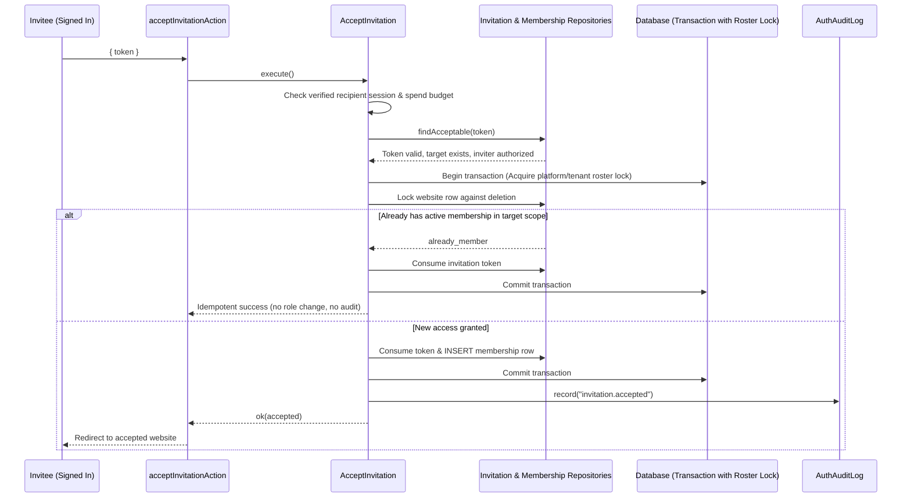

# Authentication and access management

## 1. Overview

Auth owns identity integration, invitation lifecycle, direct website memberships and platform administration. Better Auth owns accounts and sessions in a separate PostgreSQL database. Civo memberships, rather than provider roles, authorize application operations.

This checkout contains auth, website and audit modules and their generated Prisma contract. Other integration modules and parts of the application frame remain absent, limiting full application verification.

## 2. Architecture and layer responsibilities

- Domain models define tenant roles, platform scope, invitation validity, credential limits and session lifetime.
- Application commands and queries authorize before accessing protected data. Repository ports carry domain values and typed results.
- Prisma adapters own the application database; `PgUserDirectory` reads account identity from the authentication database. Persistence failures retain diagnostic causes and do not become empty results.
- `composition.ts` wires clocks, token generation, mail, repositories and session adapters. Server Actions validate unknown inputs, invoke use cases and invalidate affected presentation paths.
- Audit and auth share the same layered module layout and lazy dependency/use-case factories. Auth's composition root registers `AuthAuditAccess` and the existing member-name query with audit. The adapter delegates `audit.read` decisions to `AuthorizeWebsiteAccess` and `ListAccessibleWebsites`; audit owns trail scoping and never imports auth. See [audit.md](audit.md) for registration lifecycle, authorization guarantees and recording limits.
- Auth components map views into the shared responsive table. Hooks own form and mutation state; components do not decide server authorization.

## 3. Architecture diagram

## 4. Main workflow

`InviteUser` handles both website administration and platform administration. Website targets require current `user.manage` authority in that exact website, or platform authority. A manager may select any website they manage even when another website is currently open. Website targets must exist; website offers accept tenant roles only. A separate explicit platform target requires `platform.admin.manage` and never requires a website.

An existing account without target membership receives the same invitation as a new account. Account existence does not imply website access. Existing membership produces a distinct conflict. `issueInvitation`, also used by deployment bootstrap, serializes creation by normalized email and target scope. An unexpired pending offer produces a conflict regardless of role or inviter; its existing link remains valid. Offers in other website or platform scopes remain independent. A mail failure attempts to revoke only the newly created offer and always returns the mail failure; a failed cleanup does not replace it, because the repository's persistence boundary already logs that failure once (observability.md). Invitation email identifies the inviting person and target website, or platform administration.

`PreviewInvitation` validates token shape, lifecycle and scope before reading public website and inviter display names. Its view includes the recipient address, offered role, expiry, display names, and whether the intended verified account is signed in. It exposes no account identifiers, tenant identifier, secret hash or full website object.

`AcceptInvitation` charges the client budget before looking up tokens. It checks lifecycle, scope, website existence and current inviter authority before account setup. A new recipient creates their account, verifies the address and signs in before accepting access. Account setup leaves the invitation open and grants no membership. An existing account must be the signed-in intended recipient and have a verified address; invitation acceptance never changes its name or password. The verification and sign-in links preserve the invitation return path.

### Invitation acceptance and membership locking

`loadAcceptableInvitation` owns the token, lifecycle, website-existence and inviter-authority checks. The command owns account setup, verified recipient identity and access completion. Consumed offers bypass inviter-authority checks because they grant nothing; the command still confirms the same verified account and the transaction confirms that account still holds access. Credential and invitation constructors share the domain email validator.

Authenticated completion consumes the invitation and grants the offered access in one application-database transaction. Platform then website roster locks serialize the operation with authority revocation and access edits. Lifecycle is reread after locking; database time rejects an invitation that expired while waiting. The website row is locked against deletion until commit. Concurrent acceptance has one winner. A failed membership write rolls back consumption. If a newer membership already exists, accepting the old offer preserves that membership rather than restoring the offered role.

Acceptance has three repository outcomes, surfaced as `accepted`, `already_member` and an invalid link. `already_member` is returned when the verified signed-in intended account already holds any role in the offer's scope (or is already a platform administrator for a platform offer): nothing is granted, widened or overwritten, the offer is consumed if it was still open, and no `invitation.accepted` event is recorded because access did not change. It is also returned when the same link is opened again after that account consumed it, so a double click or reload is idempotent and shows a distinct message. A consumed link answers every other caller, including anonymous or different accounts, an unverified account, and the same account after its access was removed, with the single generic invalid-link error, so consumed links cannot be probed. Confirming a consumed link needs no inviter authority because it grants nothing.

## 5. State and data flow

### Personal account settings

With authentication enabled, the protected header renders an account avatar with a keyboard-accessible menu showing the person's name, email, profile settings link, and sign-out action. `/profile` composes the shared `DataPanel`, field, button, avatar, and unsaved-changes components. The route is unavailable when authentication is disabled; the disabled account adapter also rejects direct profile actions.

`GetOwnProfile` and `UpdateOwnProfile` resolve account ownership from the current server actor. They do not require website membership. Better Auth reads and writes the same authenticated account and checks that its session identity matches the authorized actor. Only the display name and photo are editable; email and roles are excluded from the action contract. The direct HTTP `/update-user` endpoint is disabled so profile mutations cannot bypass application validation and the per-account write budget.

Photos accept PNG, JPEG, or WebP up to 512 KiB, within the framework's default action body limit. Presentation bounds file inputs before reading their bytes; domain validation checks the declared type against file signatures. For the existing account row, a storage adapter uploads validated bytes through the shared `ObjectStore`, using an actor-owned prefix and an injected random identifier. Upload permissions remain on the server. The provider's image field holds the public object URL, never file bytes or signed URLs. The UI explains that photos are public. The previous photo is removed after the account update; a failed account write removes the new upload. Cleanup failures are logged without undoing a committed profile update and can leave an unused object for operational cleanup. Concurrent profile edits use the provider's last-write-wins semantics.

Profile writes record an account-level security event without names, addresses, or image URLs. Root layout revalidation refreshes account-dependent screens and the header after saving.

The profile photo chooser previews only selections that meet file-type and size rules. Invalid selections retain their field error and block submission until cleared or replaced. The form uses the shared `DataPanelSaveFooter` (unsaved marker, saved notice, form-level refusal); Save is disabled while unchanged. `/profile` is an `AdminPage` whose breadcrumb leads back to websites through the same unsaved-change guard as other navigation.

An `Actor` is meaningful only for its resolved tenant. The tenant hint selects among existing memberships; it grants no membership. Login reads the hinted membership or the oldest membership directly, so it does not depend on a capped enumeration of all websites. Platform administrators resolve explicit website permissions through the same permission vocabulary and resource tenant comparison, rather than a universal authorization bypass.

The actor provider records trusted platform authority as `bootstrap` or `membership`. This provenance stays in the server-side actor and is not part of the browser view or mutation input. Platform role writes recheck membership-based authority while holding the platform roster lock. A queued mutation from an administrator already revoked by another administrator is refused. Verified accounts configured as bootstrap administrators receive the same platform indicator and filter behavior as stored platform administrators. Removing their configured authority requires a deployment configuration change; the access dialog reports that boundary explicitly.

Global user administration is available to managers as well as platform administrators. Shared scope resolution derives a manager's website allowlist from that manager's own current memberships. Global user identities, membership summaries, website names, role filters, counts and invitations are limited to that allowlist before pagination. A target user's unrelated website memberships are neither returned nor editable. Platform administrators may list all accounts; website lists still require explicit target membership even for platform administrators.

React request memoization collapses actor reads only within a request. Provider cookie caching is disabled. New requests resolve current memberships; invalid or future-dated session timestamps fail closed against the absolute lifetime ceiling.

Provider verification, reset and existing-account callbacks register mail delivery with Next.js `after()`. Neither rendering nor starting the transport happens before the response. Request locale is resolved before registration for verification and reset mail; existing-account notices retain the configured default locale. Delivery failures, including unexpected rendering or transport throws, produce one log containing the email kind and a stable application error, without transport messages, recipients, links or causes. Administrative and bootstrap invitation delivery remains awaited: a failed send must revoke its newly created offer before returning failure.

The authentication pool reuses the existing `DATABASE_POOL_TIMEOUT_SECONDS` and `DATABASE_STATEMENT_TIMEOUT_SECONDS` budgets. Their defaults are 10 seconds for connection acquisition and 30 seconds per statement; idle connections expire after 30 seconds. `AUTH_DATABASE_POOL_SIZE` continues to size this separate pool. No new environment variables are required.

## 6. Business rules and invariants

- A tenant is its website: the schema requires `Website.id = Website.tenantId`.
- A person can hold roles in several websites. Each `(actorId, tenantId, role)` membership is unique.
- Website access is directly assigned. No organisation ownership or inherited organisation access appears in the available model.
- Platform administration exists only in the reserved `platform` scope. User-supplied invitation roles exclude `platform_admin`.
- Complete role replacement, additive grants and removals use the same per-tenant transaction lock. Removing the final website administrator is refused without writing.
- Website access changes identify one explicit target, recheck the actor's current authority under the roster lock and compare the editor's expected roles before writing. Stale edits fail rather than overwrite a newer role set. Managers cannot edit their own website role set or platform roles.
- Baselines compare only recognized tenant roles, matching what the editor can read. Unknown stored roles cannot permanently block an edit. Exact replacement still removes obsolete rows, using the role snapshot already read under the roster lock rather than rereading it after grants.
- Direct access decisions invalidate pending offers for the affected account and scope within the same transaction. An old invitation cannot undo a later revocation or demotion.
- Pending offers do not outlive their inviter's authority. A website role write that leaves a person without `user.manage` (decided from the domain permission table via `rolesWithPermission`, never a hardcoded role) deletes that person's open offers issued in that website in the same transaction, unless they also hold a platform membership. Revoking a platform membership deletes the open platform-scope offers the person issued, only when a membership row was really removed. Deployment bootstrap offers (`BOOTSTRAP_INVITER_ID`) are untouched. Acceptance still rechecks authority as the final guard, so a configured bootstrap administrator who is demoted loses nothing beyond re-issuing offers.
- Tenant-scope membership writes (replacement, removal, additive grant) take the same `FOR KEY SHARE` lock on the `Website` row as acceptance, after the roster locks, and change nothing when the website is gone. The platform scope has no website row. This prevents a write racing website deletion from leaving orphan memberships.
- Invitation acceptance rechecks the inviter's current platform or target-website management authority. Revoked authority invalidates the pending offer; the original act of sending does not preserve authority indefinitely. Deployment bootstrap offers remain valid only while the recipient is still configured; a verified configured inviter remains authorized through current configuration.
- Transactions begin queries through the transaction handle. Transient retries repeat the whole transaction, without repeating external mail delivery.
- Every read budget in `application/auth-limits.ts` (or `MAX_TENANT_MEMBERS` for a roster) reports reaching it instead of failing or cutting silently: roster and filtered people (`isTruncated` on the user listings), websites a selector names and the websites one manager manages (`WebsiteOptions.isTruncated`, `UserManagementScope.isTruncated`, `InvitationListing.isTruncated`), platform administrators read for a listing (`listPlatformAdmins` returns `isTruncated`), employees and resolved names (`EmployeeListing`, `MemberNameListing`). Screens show a warning for it. A manager's website allowlist is a purpose-built read (`findTenantIdsWithRoles`), so a manager of many websites keeps working. Only per-person access sets (`listMembershipsOf`) still fail explicitly, because an incomplete access list shown to an editor would hide grants.
- User filtering limits distinct people before loading their roles. Existing roster and platform-filter budgets still bound cross-database identity joins; their warnings explicitly identify partial results. Text search applies after this cap and cannot discover omitted identities. Excessive per-page access sets fail explicitly rather than hiding grants from an editor.
- Directory pagination keeps the total even when the requested page is empty. Both user listings clamp to the final valid page.
- Case-insensitive email lookup fails closed when legacy accounts share the same normalized address, rather than selecting an arbitrary account owner.
- Name-resolution limits count distinct requested identities. Display truncation preserves graphemes and never changes persisted data, addresses, identifiers or tokens.

## 7. Errors and edge cases

Unknown, malformed, expired, accepted, revoked and invalid-scope invitation links reveal no useful distinction. Missing website targets are rejected. Infrastructure failures remain typed failures and reach the owning error boundary or mutation feedback.

Account creation and application membership writes span separate databases and cannot commit in one local transaction. The explicit verification/sign-in step avoids a distributed claim: account setup can be retried and never consumes an offer. Only authenticated membership completion consumes it, atomically with the application-database grant. Existing-account signup responses are deliberately indistinguishable in the identity provider, so they are never used as proof that a caller owns an existing account.

Membership and invitation records have no website foreign key because reserved scopes share their tenant column. Acceptance checks website existence and locks its row during the grant. The available website model has no disabled state; lifecycle behavior for any future disabled state must be added at that trusted boundary. Website deletion cleanup and reassignment outside this module require separate review; this refactoring does not change those workflows.

## 8. Security and access control

Every protected use case independently checks the actor and permission. Shared scope helpers authorize explicit website targets against current memberships. The global view does not confer global mutation authority. The client never supplies authority provenance. No tenant role grants platform administration. Account ownership, invitation type and scope are validated on the server independently of form controls.

Invitation tokens retain 256 random bits and are stored only as SHA-256 hashes. Token validation never trims, truncates or normalizes secrets. Audit events contain identifiers, counts and stable event codes rather than invitation secrets, passwords or recipient email addresses. `membership.roles_changed` carries the new `roles` and, when the editor supplied a compared baseline, `previousRoles`; `membership.removed` carries `removedRoles` under the same condition; `invitation.created` and `invitation.accepted` carry the offered `role` (a tenant role or `platform_admin`). `platform_admin.revoked` and `invitation.revoked` are recorded only when something was actually removed.

Auth pages whose URLs carry single-use tokens (`/accept-invitation`, `/email-verified`, and the sign-in and reset-password pages, whose return path or query can hold one) are served with `Referrer-Policy: no-referrer` in every locale (`next.config.ts`, see request-pipeline.md), on top of the global `strict-origin-when-cross-origin`, so neither path nor query is sent to any site, including same-origin requests.

### Accepted decisions and known limits

- Holding a valid invitation link proves control of the mailbox. An attacker holding a leaked link can therefore create the invitee's account with their own password before the invitee does. This is accepted and mitigated by single-use, hashed (SHA-256), expiring tokens, the `no-referrer` policy above, and the verified-email gate: account setup grants nothing, and access is only granted after the address is verified and the same account signs in and accepts.
- Invitation emails interpolate inviter and website names as escaped plain text. No further mitigation is applied.
- Email normalization is `trim().toLowerCase()` in JavaScript (`normalizeEmail`) at every write and comparison in the application database. Account lookup in the authentication database compares `lower("email") = lower($1)` in Postgres. The two agree for ASCII addresses and may differ for non-ASCII case folding, because `EMAIL_PATTERN` is deliberately loose. `Invitation.email` has only a length CHECK (`Invitation_email_rule`), no CHECK that it is lowercase or trimmed; the application is the only writer and normalizes first. No migration was added for this.

## 9. Testing and verification

Tests mirror the module: `__tests__/src/modules/auth/{domain,application,infrastructure,presentation}` follow the same sub-folders as `src/modules/auth`; shared fixtures live in `application/support`. Unit tests cover domain boundaries, invitation lifecycle, verified recipient identity, revoked inviter authority, duplicate offers, distinct scopes, platform targeting and elevation denial, access commands, pagination, trusted authority provenance and shared table interactions. Typed in-memory fixtures exercise application behavior. PostgreSQL integration suites contain atomic invitation consumption and grant, failed-grant rollback, concurrent pending creation and acceptance, deleted targets, role writes, last-administrator protection and concurrent platform revocation scenarios.

The integration suites must run against a migrated database and generated Prisma contract before release. On 2026-10-29, `npm run db:generate` failed with `CONTRACT.SOURCE_LOAD_FAILED`: no files matched `prisma/schema/**/*.prisma`. Generated `src/lib/db/contract.json` and `contract.d.ts` are absent. Type checking and database-backed tests cannot establish ORM correctness until those sources and artifacts are restored. Production compilation also requires the missing modules and a working SWC native binding. Passing isolated component tests does not establish a complete Auth end-to-end journey.

Regression tests reproduce deferred-mail, unknown-role-baseline and concurrent-bootstrap failures against the pre-refactor implementation. A competing bootstrap issuer now reports an existing pending offer as skipped using the same atomic creation decision as ordinary invitations; it no longer performs a separate preflight read. Tests retain wrong-account, unverified-account, revoked-inviter, last-administrator, stale-baseline and partial-save behavior.

Useful commands are `npm run typecheck`, `npm run lint`, `npm run test:integration`, `npm run test:architecture`, `npm run build`, `npm run db:generate` and `npm run db:migrate:check`. Run focused suites with `node node_modules/vitest/vitest.mjs run <paths>`; the `npm test` script already includes the entire source test tree.

## 10. Presentation architecture and constraints

`ResponsiveTable<Row>` composes typed columns over one row dataset. Container capacity, selected from column requirements, controls table versus card presentation. Both layouts retain the same DOM, data, sort controls, row actions and mutation state. Fetching, search, filters and pagination remain with the caller; optional selection and bulk controls compose through columns and the surrounding panel.

`UsersAdministration` is the one page component for both scopes and renders the whole `AdminPage` (heading, notices, panels); its `scope` prop is `{ kind: 'website', websiteId, globalUsersHref }` or `{ kind: 'global', websiteUsersHref }`. `loaders/load-users-administration.ts` is the one loader: it reads the website roster (`ListUsers`) or the cross-website listing (`ListPlatformUsers`) and shapes both as rows of people with access per website, so the table, filters and access editor never branch on the data source. Only the scope decides what is read and which controls are offered. Presentation folders: `actions`, `components/<feature>`, `dto`, `email`, `guards`, `hooks`, `i18n`, `loaders`, `messages`, `navigation`, `password`, `schemas`.

Both user pages (`websites/users` and `websites/[websiteId]/users`) use the same Suspense fallback, `UsersPageSkeleton` in `src/components/skeletons` (built from the shared admin skeletons): a heading with the invite action, the people panel and the open invitations below it. Both invite pages (`<list>/invite`) use `InviteUserPageSkeleton`.

Both scopes use one Auth user table, identity columns, role filters, platform indicator, website access editor and invitation wizard. Inside one website the page shows and changes only that website's access: rows list all of its roles without a cross-website details row, and the access dialog offers neither adding another website nor platform roles; it points to the global user page instead (every manager may open it). Global rows show only authorized website grants; the access dialog edits the same scoped memberships and can add websites the viewer manages. Each website save is an independently authorized command. When several websites are edited, the dialog explicitly reports committed changes and remaining failures, advances its baseline after each commit and does not replay completed writes on retry. Pending mutations disable editing and prevent duplicate saves. Invitation type and target flow through one validated server lifecycle.

Identity rows include the account photo with initials as fallback. Across websites, access summaries show at most two roles from the first website; additional roles or websites expand across the table's full width. An empty list distinguishes "no match" (filters active, with a reset link) from "nobody yet" (with the invite action). Platform privileges remain a separate indicator, and an empty membership summary means no direct website roles. The website filter uses the same “All websites” wording as audit.

Inviting is the page's main action and opens its own route (`websites/[websiteId]/users/invite`, `websites/users/invite`): a wizard with the steps person (email), access (role; target website or platform only across websites) and review. The step lives in the address (`?step=`); `?role=` preselects a role. A sent invitation returns to the list with `?invited=1`, which shows a notice above the panels; the form keeps nothing, and the invitation appears among the open invitations. A repeated invitation still reaches the server-side pending-invitation check. Withdrawing an open invitation asks for confirmation first. Window focus and visible-tab returns refresh the listing with a one-second coalescing interval. Accepted invitations grant their offered role atomically; pending invitations grant no access before acceptance.

Website management links live in each access card's header and pass through the shared unsaved-change guard. Last-administrator refusal is a typed `auth.last_admin` conflict from the locked write; changed authority or role baselines remain separate refused writes. A matching editor baseline does not bypass last-administrator protection.

Do not infer inherited organisation access or ownership transfer rules from UI terminology. Do not collapse website grants and platform privileges into a generic role. Review website consumers and execute database and full browser verification before treating this partial checkout as release-ready.

## 11. Infrastructure audit disposition (2026-10-29)

| Finding                                                        | Disposition                                                                                                                                                                                                                                                                                                                                        |
| -------------------------------------------------------------- | -------------------------------------------------------------------------------------------------------------------------------------------------------------------------------------------------------------------------------------------------------------------------------------------------------------------------------------------------- |
| 1. Awaited mail creates an account timing signal               | Fixed: defer starting all provider mail until `after()`. Administrative invitation delivery retains its compensation semantics. This removes transport latency from responses; it is not a proof of constant-time authentication.                                                                                                                  |
| 2. Ineligible tenant hints fall back to the oldest membership  | Preserved: existing tests explicitly require this selection policy. Explicit website use cases reload and authorize memberships in the requested website. Tenant-wide operations can still select an unexpected owned website; changing fallback to denial requires a product decision.                                                            |
| 3. Unknown roles make every editor baseline stale              | Fixed: compare recognized tenant roles and reuse the locked snapshot for exact replacement. Unit coverage passes; real PostgreSQL regression coverage was added but requires the missing schema and contract.                                                                                                                                      |
| 4. Unbounded pool acquisition and statements                   | Fixed with the existing database timeout settings and a 30-second idle timeout. `pg` already had an idle timeout by default; the missing acquisition and statement limits were the important gaps.                                                                                                                                                 |
| 5. Over-age provider sessions are not revoked                  | No current authorization bypass found: protected use cases resolve the actor and enforce the absolute ceiling; HTTP session endpoints are unavailable. Provider-side revocation remains defense in depth and must be revisited before exposing direct provider session consumers.                                                                  |
| 6. Mail locale differs by message purpose                      | Preserved: verification/reset messages follow request locale; unsolicited existing-account notices use the default locale. Locale is not an authorization input. A recipient-preference policy would require a product and storage decision.                                                                                                       |
| 7. Case-insensitive account lookup lacks a matching index      | Potential performance issue, not a reason to remove case-insensitive or duplicate-account protection. An expression index needs a separate reviewed auth-database migration; schemas and query plans are unavailable here.                                                                                                                         |
| 8. Advisory-lock hash collisions                               | Preserved for deployment compatibility. A collision serializes otherwise unrelated work; it does not merge records or grant access. Changing the lock key during a rolling deploy could break mutual exclusion.                                                                                                                                    |
| 9. Listed offers can be unusable; unknown roles inflate totals | Remaining data-quality concern. Acceptance independently checks current lifecycle, website and authority; listing cannot promise a later grant. Unknown-role rows are filtered after pagination, so totals can disagree. Verify stored constraints and fix the read predicate with real database coverage after restoring the schema and contract. |
| 10. Mail logs expose transport causes                          | The configured SMTP adapter already sanitizes transport errors. The provider delivery logger used the wrong signature and lost useful context. Fixed the signature and now log only a stable error and message kind, regardless of transport implementation.                                                                                       |
| 11. Non-API provider failures are silent                       | Fixed: unexpected non-API failures log once at their adapter mapping boundary, while typed results retain the original cause. Provider messages and causes are excluded from logs. Directory failures now follow the same policy.                                                                                                                  |
| 12. Member totals and role counts use separate snapshots       | Preserved as advisory summary data. No authorization or last-administrator decision uses these counts; those decisions execute under transaction locks. A consistent summary snapshot remains a separate persistence improvement.                                                                                                                  |
| 13. Invitation must match the signed-in verified account       | Already enforced in the application command before repository acceptance. Wrong-account and unverified-account regression tests pass.                                                                                                                                                                                                              |
| 14. Bootstrap authority must reflect current configuration     | Already enforced by `resolveInvitationAuthority`: system offers require the recipient to remain configured; other configured inviters require their own verified account. Transactions still recheck stored authority when bootstrap authority is false.                                                                                           |
| 15. ORM and mailer typing was unverified                       | Typecheck was executed; it fails on missing modules and generated contracts. Mailer types produced no diagnostics, but the complete build and ORM query typing remain unverified.                                                                                                                                                                  |

## 12. Previous auth refactor verification (2026-10-29)

- Auth unit suites: 44 passed, one failed; 342 tests passed and eight composition tests failed because `src/lib/db/contract.json` is absent. Concurrent roster-mapper changes were preserved, with their original truncation tests retained.
- Regression proof: restoring the saved pre-refactor implementations reproduced four failures across provider-mail wiring, unknown-role baselines and competing bootstrap issuers. The corresponding tests pass with the changes applied.
- Scoped ESLint: domain, application, Better Auth, PG, mail, presentation and the new focused unit tests passed with zero warnings. Full-repository lint failed with 425 errors and 14 warnings, including unresolved persistence and other module types.
- Typecheck failed on absent modules and generated contracts. Auth PostgreSQL integration suites failed during import, before any tests ran. Contract generation failed because no schema sources matched its configured pattern.
- Production build reached compilation outside the Windows sandbox, then failed with 62 missing-module errors. Browser end-to-end checks were not run.
- Architecture and ESLint rule tests: 585 passed and 20 failed; five suites failed, including missing-contract imports and existing rule-fixture failures.
- Changed source, tests and documentation passed Prettier checks. The global dead-code check failed on existing unused and internal-only exports; public contracts were retained as required by this refactor.
- `AI_RULES.md` was regenerated from 24 canonical rule files without editing those rules. At that time, its check failed because `docs/rules/observability.md` referenced the absent `docs/architecture/audit.md`; that document is now supplied by the audit integration refactoring.
