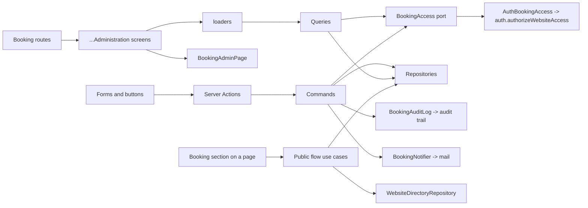
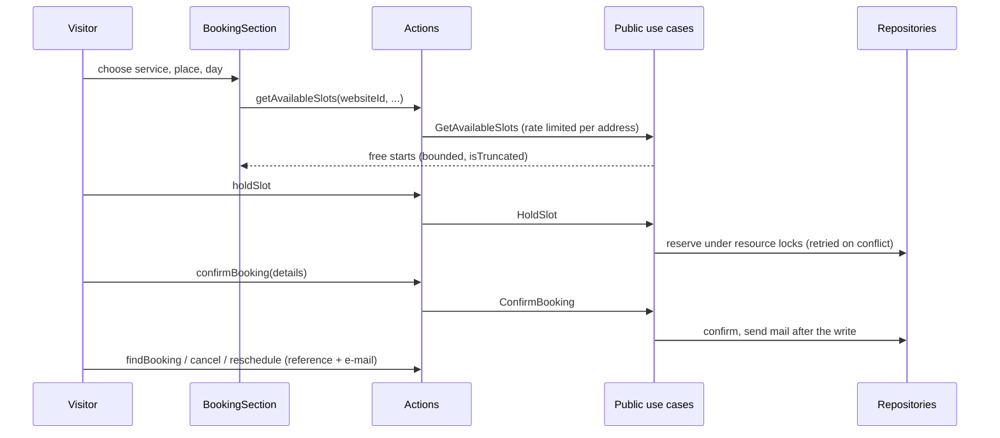

# Booking

## 1. Overview

Booking owns appointments: the locations a website offers them at, the services that can be booked there, the resources a service needs (rooms, desks, devices, and the employees who serve), the visitor's journey from choosing a time to a confirmed booking, "my booking" for changing or cancelling it, and the managers' and employees' side of the same bookings. Auth owns who may do what in which website; the component platform owns where the booking section appears on a page; release owns what is published. Booking never decides who a person is and never renders a page.

Two audiences share one module and one set of rules:

- **Visitors** have no actor. The website is read from the page being rendered, a booking is reached by its reference and the e-mail address it was made with, and what they repeat is limited per client address.
- **Signed-in people** (managers, employees, viewers) act inside one website. Every request names that website, and auth decides again, per request, whether the person holds the permission in it.

## 2. Architecture and layer responsibilities

Booking uses the layers and file roles of auth, audit and media: `domain/{models,errors,ports,...}`, `application/{commands,queries,contracts,services}` with `booking-dependencies.ts`, `booking-limits.ts`, `rate-limits.ts` and `booking-view-mappers.ts` at the application root, `infrastructure/`, `presentation/`, a server-only `composition.ts`, an intentional server API in `index.ts` and a browser-safe `client.ts`.

- **Domain.** Pure rules, grouped by the concept they hold: `time/` (instants, local dates, zones, intervals), `scheduling/` (the slot engine, weekly hours, occupancy), `lifecycle/` (the booking's states and what each allows, holds), `assignment/` (who may serve a unit, how fit is ranked), `policies/` (change and customer access), `impact/` (what a change would leave without an employee or outside the hours), `holidays/` and `models/`. `ports/` holds the repositories and the module's access, audit, notifier, identity and team-directory ports.
- **Application.** Commands and queries, one use case per file, with services of one job each (`find-booking`, `load-bookable`, `limit-actor`, `parse-*`, `persist-change`, `retry-on-stale`). `contracts/` holds inputs, views and constraints; `reader-views.ts` is what the screens' loaders read with.
- **Infrastructure.** `access/auth-booking-access.ts` delegates the website's authority to auth. `prisma/` holds the repositories and their record mappers; `transactions/` holds the multi-statement reads and writes (the booking write, resource locks, session capacity, the notices a write leaves, the service listings, lookups and writes); `notification/`, `identity/` and `audit/` hold the adapters for mail, the member directory and the audit log.
- **Presentation.** `actions/`, `schemas/`, `dto/`, `forms/`, `hooks/`, `loaders/`, `messages/`, `cache/`, `routes.ts`, and components by feature: `locations/`, `services/`, `resources/`, `team/`, `bookings/`, `calendar/`, `employee/`, `public/` and `shared/`. Every administration page is a Server Component named `<Thing>Administration` that reads through a loader and frames itself in `BookingAdminPage` (the heading, its main action and the content; the way between areas is the layout's bar, not the page's).

## 3. Architecture diagram

`composition.ts` builds everything lazily (`once`): `getBookingCommands()` and `getBookingQueries()` give the use cases, and nothing is constructed (no limiter store, no mail settings) until the first request. There are two dependency sets on purpose. The protected use cases (managers, employees) get the access port and none of the visitor's side; the public flow gets the website directory and the client address and no access port.

## 4. Main workflow

**Authorizing a website.** Every protected use case starts with `access.authorizeWebsite('<permission>', input.websiteId)`. The adapter requires a signed-in actor, validates the id, and asks auth whether the actor holds the permission in that website (a platform administrator reaches every website). The answer is an actor whose tenant is that website, so every later scope, audit event and rate-limit subject belongs to the authorized website, whichever website the session has open. A stranger and a missing website get the one `forbidden` answer.

**Booking as a visitor.**

A hold keeps the slot for `HOLD_MINUTES`. Every repository writer takes resource advisory locks and checks occupancy, including employees with one place, before writing. Shared sessions also check capacity under their session lock. The current emitted contract and migrated database have no booking exclusion constraint; direct SQL writers must obey the same protocol until a reviewed constraint migration adds that additional guarantee. Holds that ran out stop blocking by the clock alone; a sweep keeps the stored state in step.

**Moving around.** The workspace (`/bookings/<websiteId>`) is reachable on its own, without the website's administration, and sits under one bar like a website does (`BookingWorkspaceNav` in the route layout, the same `SectionBar` and `SectionNav` as the website bar): the workspace's name (which opens the other workspaces, as a website's name opens the other websites, and always lands on the overview of the one chosen), one tab per area (overview, calendar, bookings, locations, services, resources, team), a "My work" dropdown for a manager who also serves, and a "back to website" link at the far edge. The app header carries no booking link: the website's bar has a "Bookings" tab into the workspace, and the platform bar (websites, audit, users) has no bookings entry either. A person who works in a website through its bookings alone (an employee) cannot open that website (`loadBookingOnlyWorkspaces`): with no website to open at all, `/websites` sends them straight to their one workspace, or to the hub when there are several; with some websites of their own, the other ones are rows of the same table on the first page, with the name and one "Bookings" link and nothing else (`ElsewhereWebsite`), and the switcher in a workspace's name lists them as well. A person who only serves gets the employee pages as the tabs. `forms/workspace-nav.ts` builds the tabs from what the person may do and says, from the address, which tab is current and which location is in view; services, resources and the team open on that location, so changing area never asks again. A page about one location offers a switch to another (`LocationScope`) without leaving its area, and a trail up (`BookingAdminPage`'s `scope`): with several locations the area (where one is chosen) › the location › the page; with one, the area's list › the page.

**Setting up (managers).** A location comes first, and services, resources and the team belong to one. The bar makes that visible: until the first location exists, every area that needs one is shown but switched off (with the reason as its title), and the overview shows the guide through the setup with the one action that does each step. Every "add" button offers the locations to add at (`AddAtLocation`): none leads to making a location, one goes straight there, several ask which. The guide reads `GetBookingSetup` and is gone once everything exists. The overview keeps its shape before the first location (zero figures, empty states, the locations table empty) and fills in as the setup does: today's figures, today's bookings in the rows of the bookings list, the week ahead as a chart, and the locations with their hours today.

**Forms and lists.** A location's exceptions are a responsive table; one is made or changed in a dialog and only joins the list once the server's own rules (`parseLocationInput`) accept it, so there is no blank row to forget. Templates, copying a day and the holiday import also ask in dialogs, so nothing on the page moves. Floating panels that belong to a button (the date calendar, action menus) are `position: fixed` (`useAnchoredPosition`), so an `overflow-hidden` card cannot cut them off. The app keeps left screens mounted but hidden; `BookingAdminPage` wraps its page in `FreshOnReturn`, so coming back to a page (the create form) starts it over. A field that offers what exists and adds what does not (a category, documents to bring, qualifications) is a combobox whose list ends in "Add …" (`SuggestField`, `TagField`, `useCreatableChoice`), never a text box with a button beside it. The service wizard has a resources step only where the location has resources (`serviceStepsFor`): one cannot be made mid-form without losing what was typed. Every wizard's review ends in the same `ReviewNotes`, and a step opened from the review ("Edit" on a row, or a refused save) carries `back=review`: finishing it offers one button, back to the review (`useReturnsToReview`). A review reads the form's values itself, when it is mounted (`getValues`), never in the form that shows it: the React compiler remembers a `form.getValues()` call made there for as long as `form` is the same object. A new location has a services step only where other locations have services (`ListOfferableServices`, `wizardStepsFor`): the chosen ones are taken over, one `adoptService` after the other, once the location exists, and the location's page says how many were refused. A manager's question for a free time that has no answer says why (`SlotEmptiness`, from `whyNoSlots`): the place is closed, the service needs an employee nobody is set up as, something it needs is missing, or everything is taken; the team page it points to says how a member gets the role and then a calendar. The calendar and the bookings list share one frame: a panel whose header carries the period and what moves it, and one strip of filters (the states as chips, the rest as quick menus or fields); the calendar's boxes say what fits their room (`CalendarEntryContent`: a month cell, the list, and a time grid by the appointment's length and the column's width), fold the rest into "+ more", and a week keeps columns readable by scrolling sideways on a narrow screen. Every empty state of the module is `BookingEmptyState` (icon, title, why and what to do; `panel` inside a list, `page` in place of a screen). **Wizard or not.** A wizard is for making something that has several parts the person would otherwise skip or get wrong, and that does not exist yet: a location, a service, a resource (and a new location's services step). Everything else is one form or one choice: an employee's calendar is made by choosing the member in a dialog ("Add employee") and then filling in one form with its sections side by side (hours across the whole width, absences, qualifications); the preferences, the employee's own calendar and the settings are one form each, saved from one footer. An edit of one part of a wizard-made thing opens that part alone, and from a wizard's review it returns to the review. **The employee's area** is built from the same pieces as the manager's: the start is tiles, the next appointment and two panels like the workspace overview; the day plan, open bookings and messages are the module's table in a panel with its filters in one strip (messages by day as group headings, a day with nothing planned shows a full progress bar, not an empty one); what a manager changed on the calendar is a message in the inbox like any other (`calendar_changed`, with the parts that changed, written in the same transaction as the change: `writeCalendarNotice`), not a notice of its own. Working hours (the calendar's, set with a manager) decide when someone can be booked; preferred times, locations and services only order the open bookings they are shown, and each page says so. The preferences are the services and a part of the day only: where a person works is not a preference (a calendar has one location and a manager sends them elsewhere), so the fit of an open booking is `very-good` when everything they said fits, `good` when some of it does and `possible` otherwise, and the preferences page has no location choice (the column was dropped in migration `preferences_without_locations`). The website's first-steps list, its overview tile and the booking guide all ask `isBookingSetupComplete`, so booking is "done" only with a location, services, resources and a team. The booking segment has no `loading.tsx`: every page has its own Suspense fallback of its own shape, and a second, generic one in front of it would show two skeletons in a row. Loading skeletons exist per screen kind (list, overview, calendar, locations, detail, adopt, cards, form) in `components/skeletons/booking-*`, in `AdminPage`'s rhythm. **A skeleton draws what every viewer has in every state, and nothing else.** The heading's buttons are drawn only where every viewer who can open the page has them (a location's services and resources, a team member's move and remove: `actions`); a "New …" button, "Mark all read" or a setup guide depend on the viewer's rights or on the data, so they appear with the screen, which moves nothing because the heading's height comes from its title and text.

**Managing and serving bookings.** Managers list, filter and open bookings, create them for walk-ins, move, cancel, close and assign them. Employees see their plan, take open bookings that fit them, hand them back, and set preferences that only order what they are offered. A change a manager makes to an employee's calendar is told to the employee as a message; their own change tells nobody. A booking that becomes confirmed with an employee on it (made by staff, or a hold confirmed) tells that employee it is theirs, like any assignment.

## 5. State and data flow

A booking runs `held` -> `open` or `assigned` -> `completed`, `cancelled` or `no-show`; a hold that runs out becomes `expired`. What each state allows is one table in `lifecycle/`. Every stored row carries the tenant and the website it belongs to, and every repository statement pins both from the authorized scope. The scope is built from the authorized actor (`scopeOfActor`), never from the request.

Writes that touch several rows run in one transaction. Writers of one resource queue behind an advisory lock (`lockResources`, built on `@lib/db`'s `advisoryLock`, which hashes to 64 bits), in id order, and conflicts are retried (`retryTransient`). A save is an `UPDATE ... WHERE` on the version the editor read (`...Stale` otherwise); a stale save reads the booking again and decides anew (`retryOnStale`).

## 6. Business rules and invariants

- A tenant is its website: one id. The website of a request is authorized by auth; nothing else the request says reaches a query.
- A visitor sees no one else's booking: a reference that does not exist, one of another website and one whose e-mail does not match all answer "not found".
- The customer's name, e-mail and phone are shown only to people who may manage bookings (`booking.manage`); viewers and employees see when and what.
- A service is bookable at a location only where it is switched on there, and only within its notice, horizon and cancellation rules; a manager's cancellation does not need the customer's deadline.
- Changing opening hours, a resource or an employee's calendar first shows which bookings it would leave outside, and is refused until a manager has seen them. Nothing is cancelled or moved by such a change.
- Deactivating a service reviews the bookings it reaches; nothing is cancelled that the manager did not choose, and the chosen ones end in the same transaction as the closing.
- An employee's preferences order open bookings and candidates; they never add or remove one.

## 7. Errors and edge cases

| Situation                                                 | Result                                                                                                                                        |
| --------------------------------------------------------- | --------------------------------------------------------------------------------------------------------------------------------------------- |
| Not signed in / no permission in the site                 | The one `forbidden` answer, audited by auth                                                                                                   |
| Website id missing or malformed                           | Validation error on `websiteId`                                                                                                               |
| Booking, location, service or resource of another website | "Not found", the same as a missing one                                                                                                        |
| Two visitors want the same time                           | The database refuses the second; the journey says the time is gone                                                                            |
| Hold ran out                                              | `booking.booking_expired`; the journey offers the times again                                                                                 |
| Save on a changed version                                 | `...stale`; the form keeps the input and offers to reload                                                                                     |
| A bounded list had more than it names                     | `isTruncated`; the screen says the list is partial, nothing is cut silently                                                                   |
| Rate-limit store down                                     | Search and holding fail open (reads/short-lived); everything that mails, looks a booking up, changes one or is a signed-in write fails closed |

## 8. Security and access control

Authorization is the first call of every protected use case, through the `BookingAccess` port; the lint rule `authorization-flow` and the architecture test "authorization categories" enforce it. The permissions are `booking.read` (see), `booking.read.own`, `booking.claim.own` and `booking.profile.own` (an employee's own area), `booking.manage` (act on bookings and see customers) and `booking.configure` (locations, services, resources, team); `page.update` lets the builder offer the website's services. The screens draw only what the person may use (`BookingMay`), which is display, never protection.

Server Actions parse input with Zod schemas that name the website and the fields they accept and drop everything else; the client's tenant, role or price is never read. Rate limits are per client address (visitors) or per signed-in person (writes); `rate-limits.ts` states for each policy whether it fails open or closed. Cache invalidation is expressed once (`invalidateBookingAdmin`); availability is never cached.

## 9. Testing and verification

Tests live under `__tests__/src/modules/booking`: `domain/` (time, scheduling, lifecycle, assignment, impact), `application/` (use cases against fakes and the harness in `support/`), `infrastructure/` (repositories and write transactions, integration tests against the database) and `presentation/` (schemas, forms, hooks, screens, accessibility). The shared wizard is tested in `__tests__/src/components/shared/wizard.test.tsx`. `find-booking.test.ts` pins that a booking is looked up in the authorized scope only.

## 10. Extension points and constraints

- **A new protected use case** starts with `access.authorizeWebsite('<permission>', input.websiteId)`, takes `websiteId` in its input, and builds its scope with `scopeOfActor`. Its action schema names `websiteId`.
- **A new multi-step form** uses the shared `Wizard` (`src/components/shared/wizard.tsx`): the module supplies the steps, the fields and the actions; the data-sources module reuses it the same way.
- **A new list or table** uses `DataPanel`, `ResponsiveTable`, `FilterBar` and `Pagination` from `src/components/shared`, and says when it is cut (`isTruncated`).
- **Release.** Booking is read live, not frozen into a release: a published page holds only the booking block's props (`serviceId`, `category`), which the release freezes with the page, while services, locations, hours and bookings are read at the time a visitor looks. A service that was deactivated since the page was published is simply not offered. The builder reads the choices for the block through `GetBookingChoices` (`page.update`). If a release should ever pin a booking setup, that is a new port on the release module's side, in the style of its map and data-source sources, not a read from booking's tables.
- Constraints: no calendar library outside `calendar-adapter.client.tsx`; no module imports another module's tables; German public holidays are a table in `domain/holidays`, not a service.

## 11. Screens and conventions added in the consistency passes

- **Lists share one frame.** A list is a `DataPanel` with a filter strip in sections (chips and, on the bookings page, the period tabs; then the search and selects as a GET form), the shared table, and `Pagination`. A list that is held in a form (the exceptions of a location, the blocked periods of a resource, the absences of an employee) pages with `PaginationButtons`, which looks and reads like `Pagination`.
- **Blocked periods and absences** are edited like a location's exceptions (`shared/periods-editor.client.tsx`): a short table, a dialog that checks a period with the server's own rules before it joins the list (so the list never holds a blank row), and a confirmation before one goes.
- **Hours inside the place's hours.** The weekly editor takes `bounds` (the location's week) for an employee or a resource: what lies outside is shaded, a range cannot be drawn on, moved or stretched out of the stretch it is in (`limits` of `changeHoursRange` and `intervalAt`), and a day the location is closed on cannot be opened. The server still checks.
- **Manager's booking details** are a dialog over the list (`InfoDialog`), so the table keeps its width: the staff changes sit beside the places they change, and the booking's own actions (reschedule, mark completed, mark no-show, cancel) are one "Actions" menu. The calendar's list view is the module's own table, not the library's.
- **The employee's area.** "My work" is shown to a manager only once they are on a team (`hasCalendar`); an employee always has their pages. The start page leads a new employee to the preferences (`EmployeeSetupGuide`). The day plan draws the working day: a dot per appointment, the breaks of the working hours as striped rows (`workday` of the plan, the gaps between the day's windows), and what the employee does with an appointment: record that it took place or that nobody came (`CompleteOwnBooking`, `MarkOwnBookingNoShow`, `booking.claim.own`, after the start only), or give it back. Moving and cancelling stay with the managers.
- **Wizard or not** and the rest of the employee-area conventions are as described in section 4.
- **Bookings that wait for an employee hold the team's room.** A service that is assigned later (`manual`, `open`) is booked on a slot that proved a qualified employee is free, but the booking pins nobody down. So that two such bookings cannot be made for one time with one employee to serve them, the scheduling question carries the open units of the location (`OpenDemand`, `loadOpenBookings`, `openDemandsOf`): each is the employees who could take it, free for all of it, and the slot engine matches them together with the new booking's own demands (`matchResources`), so a unit promised to an employee leaves one fewer. A room with two places and one employee therefore still takes one such booking at a time; a service that needs only the room takes two. Units of rooms are always held; a booking made before its requirements were kept counts for nothing.
- **The bookings list's period** is one select in the filter form, as the audit trail's is (`PeriodFilter`: any time, today, the next 7 or 30 days, or a range typed by hand, which shows the two date fields); it travels as `from` and `to`.
- **Working at another location for some days** (`CoverageSpell`, `BookableResource.coverage`, migration `employee_coverage`). A person keeps one calendar at one location (EX-19); a manager sends them to another location from one day to another and on those days they are bookable there and not at home. It is the one place where "where" is decided, so nothing can hold a person in two places: `isWorkingAt` says where a person is on a day, `servesLocation` lets a location use an employee who is sent there on some days, and `workingWindowsOf` (the schedule the engine, the assignment rules, the open bookings and the impact analysis all read) gives a person's own hours inside the hours of the location they are at, for the days they are there. Hours, absences and qualifications are the person's own wherever they are. Spells may not overlap and cannot name the person's own location (`parseCoverage`, `coverageOverlap`); only managers set them (the employee sees them read only on their profile). Saving a change of cover asks which bookings it leaves without the employee, once for each place the person is or will be used (`previewCalendar`, `findResourceImpact` with `placed`), and the employee is told like for any change (`coverage` is a part of the notice). A location's team lists the people sent to it (`listVisiting`, `TeamVisitors`); open bookings at a covered location are offered only on the days the person is there. The day plan reads the hours of the location the person is at that day.
- **When the person is no longer there, their bookings are open again: one rule everywhere.** An absence, new hours, being sent to another location, leaving the team and moving to another team all end in the same step: the change is saved only once the manager (or the employee, for their own absence or hours) has seen the bookings it reaches (`impactAcrossPlaces`, asked once for each place the person is or will be used), and then `withdrawFromBookings` takes the person off every one that is confirmed and has not begun (`withdrawResource`): the unit is open, the booking stays confirmed, nothing is cancelled, the employee is told in the same write ("unassigned", BD-11) and each booking is audited. It applies to every assignment mode, because it is a fact and not a hand-back (`planRelease` is about what a person may give back); who serves next is then the usual question: a manager assigns someone, or an employee claims it where the service says employees may (`open`). A booking that has begun stays with the person, and with more bookings than one answer carries the rest are reported as truncated and stay (the save is refused until acknowledged). So a "conflict" is not a state anyone has to resolve: an employee who enters a day off cannot be left with a clash only a manager can see, and a manager cannot forget one. New bookings cannot clash in the first place: open units count against the team (`OpenDemand`). Leaving the team (`RemoveTeamMember`) switches the calendar off and never deletes it (`isActive`, calendars hold history); moving (`MoveTeamMember`) does that and gives the member a new calendar at the other location with the same qualifications and that location's hours, since a calendar never changes its location. A member without an active calendar is a candidate again. Both are two buttons at the heading's far edge of the employee's page (`TeamMemberActions`, like the other pages' actions) and a menu on their row in the team's table (`TeamRowActions`), with the same `MembershipDialogs`. Qualifications are tags on each person's own calendar, so removing or moving one person takes nothing from anyone else or from the service; a service only that person was qualified for simply has no free times until another employee holds the tag. Their preview is every booking of the calendar that has not begun (`previewLeavingTeam`).
- **The employee is told where they work.** A person sent to another location sees a warning of its own on the start page and the day plan, today or in the next two weeks (`CoverNotice`), and the open bookings page says at which places they are offered bookings: their own location, and others only on the days they are sent there. The preferences only rank what is offered.
- **A form starts from the calendar it shows.** `TeamMemberForm` is keyed by the calendar's version, so a page read again after somebody saved starts the form from what is stored; otherwise the form would show old hours under the new version and saving would undo the change (a manager would overwrite what the employee just entered). Location, service and resource forms are keyed the same way. The websites list has one table: a website's row leads to its bookings ("Bookings", next to "Manage"), and a website only worked in through bookings is a row with just that link. The three bars (platform, website, workspace) share one loading skeleton (`SectionBarSkeleton`).
- **"My work" is all or none.** The employee's six pages (start, open bookings, day plan, preferences, messages, profile) are for people who hold the employee role; roles that only read (administrator, editor, viewer, platform administrator) have none, and a manager sees them only once they are on a team. To be on a team a manager who is also an employee adds themselves as a candidate like anyone else.
- **Retention.** Bookings carry a citizen's name and e-mail, so they are not kept for ever: once a day (and at server start) `pruneBookings` (a service: no actor, no website to authorize) deletes every booking that ended more than `BOOKING_RETENTION_DAYS` ago (365 by default, 30 to 3650), with its units and the messages about it, and the messages about calendars that are as old. It is started from `src/instrumentation-node.ts` beside the audit trail's retention (`startBookingRetention`, `retention.ts`), works across all websites and has no actor. Dated exceptions of a location, absences and cover spells are not deleted: they hold no personal data about a citizen, are a few entries, and rewriting them would change the version a manager's open form is checked against; screens show the upcoming ones.
- **Names in the audit trail.** A platform administrator's trail spans every website, so for them a member is named from their account, not from the roster of their own website (`ResolveMemberNames`); anyone else is named only within their own website, and a person who left is "former member".
- **Open decisions.** A "conflict" tab for bookings that clash for reasons other than the person (opening hours that changed), an on/off switch and names for exceptions, and "last changed by" need a product decision and a change of the model before they can be built.
