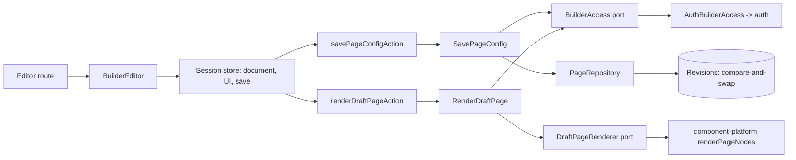
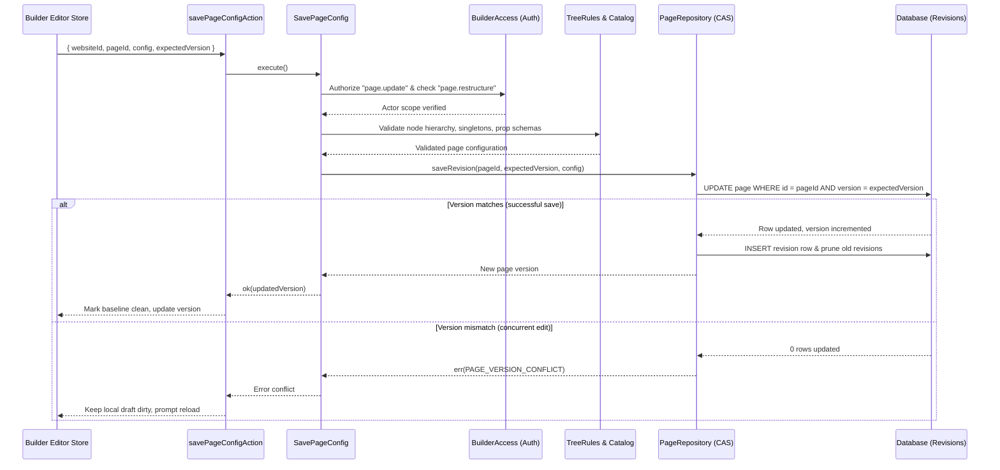
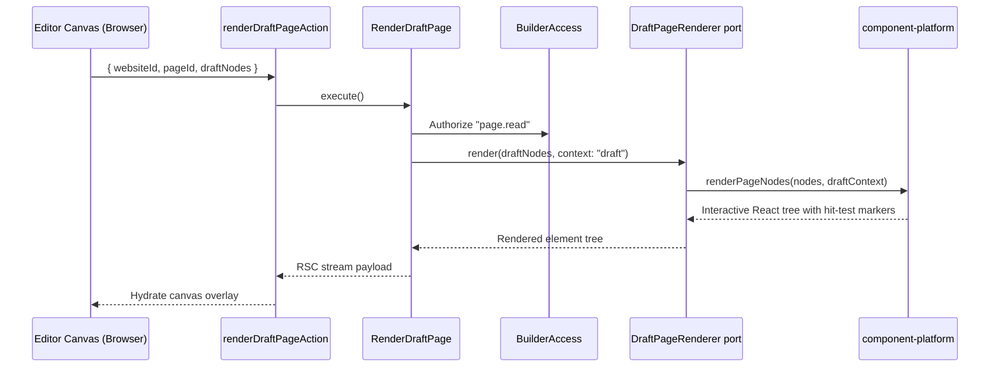

# Builder

## 1. Overview

Builder owns a website's draft pages and the page editor: creating pages, loading an editing session, saving a page as a new revision, rendering an unsaved draft for the canvas, and the facts other modules need about drafts (titles, dataset usage, every page for a release). The component platform owns which components exist and how they render, release owns frozen snapshots, media owns files, and auth owns identity and permissions.

## 2. Architecture and layer responsibilities

Builder uses the same layers as auth, audit and website, with `builder-dependencies.ts`, `builder-limits.ts`, `rate-limits.ts` and `builder-view-mappers.ts` at the application root, a server-only `composition.ts`, an intentional server API in `index.ts` and a browser-safe `client.ts`.

- **Domain.** `models/` (`Page`, `PageConfig`, `PageNode`, revisions, the outline, the component catalog and descriptor) and four folders for the rules that act on a page: `tree/` (pure tree operations, queries and drop placement), `history/` (`document-history`: undo and redo as a value), `rules/` (`page-save-checks`) and `ports/`. The domain never generates randomness and contains no React.
- **Application.** Commands `CreatePage`, `SavePageConfig` and `CreateSystemPage`; queries `GetEditorSession`, `ListPages`, `RenderDraftPage`, `ResolvePageTitles`, `ListDatasetUsage`, `ListMediaUsage` (which components show each uploaded file, for the media screen) and `ListPagesForRelease`. Services: `findPage`, `mayRestructure`, `withinActorLimit`.
- **Infrastructure.** `access/auth-builder-access.ts` delegates to auth. `prisma/` holds the page repository and mapper; `transactions/page-writes.ts` creates a page with its first revision and saves a revision. `component-platform/` holds two adapters: the descriptor provider (the catalog built from the platform's component definitions) and the draft renderer.
- **Presentation.** Actions and schemas, loaders (`load-builder-pages`, `load-builder-editor`), and the editor: a per-session store (`state/`), drag and drop (`dnd/`), canvas, palette, properties panel with one control per prop type, and toolbar components.

## 3. Architecture diagram

## 4. Main workflow

`GetEditorSession` authorizes `page.update` (a read-only role is not handed the editor) and returns the page, the component catalog and whether the actor may restructure. The browser seeds one isolated store from it. Edits are reducers over the document; a burst of typing is folded into one undo step. Saving sends the whole draft, and `SavePageConfig` stores it as a new revision.

### Save revision workflow (compare-and-swap)

The canvas shows what visitors will see because `RenderDraftPage` renders the draft through the component platform's real pipeline, in `draft` mode (nodes carry markers for hit testing and drag and drop). The element tree travels to the client through the RSC payload.

The toolbar's preview is a second view of the same pipeline: `RenderDraftPage` takes `isPreview` and renders in `published` mode with `isPreview` on the `RenderContext`. It therefore shows what a release would publish (no labelled sample data: an unbound list is empty, a failing source is an error; blocks switched off are left out; no editing marks), while a saved map is still read from its stored settings because no release has frozen it yet. The viewport controls (desktop, tablet, phone) apply in both views. In the preview the booking journey can be walked through, but nothing is reserved or booked (`isPreview` on the journey simulates the hold and the confirmation, and "my booking" is hidden).

### Draft rendering workflow

Website provisioning seeds pages through `CreateSystemPage`, and the publisher reads every page through `ListPagesForRelease`; both are exported for trusted module-to-module use.

The page list (`/websites/[websiteId]/builder`, `BuilderPagesAdministration`) has no inline form: its header action and empty state lead to `/websites/[websiteId]/builder/new` (`builderRoutes.create`), where `CreatePageWizard` asks for title and path (the path follows the title until edited), shows a review step and calls `createPageAction`. The step lives in `?step=` (`useWizardSteps`), unsaved entries are guarded by the wizard's `UnsavedChangesProvider`, a taken path returns to the first step on its field, and success replaces the wizard with the new page's editor. The list address is parsed with the shared `pageParamsSchema`, and page links come from `pageHrefOf` (`@lib/pagination`).

## 5. State and data flow

- **Server:** a page has a monotonically increasing version; each save writes a revision row and prunes old ones in the same transaction.
- **Client:** one store per editing session (never shared between sessions or requests), split into the document (with history), UI state and save state. Thunks take their dependencies injected, so tests run them with fakes. The tree that was sent becomes the saved baseline, so edits made while a save is in flight stay dirty.

## 6. Business rules and invariants

- A saved page contains only registered components nested the way the catalog allows, and a component that may appear once on a page appears once.
- Without `page.restructure`, the tree shape (ids, types, nesting, order) must be identical to the stored page, and only the props the catalog lists for that component, plus the visibility toggle, may differ. A restricted editor fails closed: an unregistered type allows no props.
- Only editors who can restructure must produce a clean tree. A restricted editor is not locked out of a page that still holds a since-removed component.
- Saves are compare-and-swap on the version: a stale editor matches no row and surfaces as a version conflict; the draft is kept.
- Draft rendering takes the website from the stored page, never from the request. Unregistered component types render a placeholder, since stored pages outlive removed components.

## 7. Errors and edge cases

| Situation                                      | Result                                                       |
| ---------------------------------------------- | ------------------------------------------------------------ |
| Another person saved a newer revision          | Version conflict, the editor keeps its draft                 |
| Edit exceeds the actor's scope                 | Refused and recorded as a security signal                    |
| Page path already taken                        | Mapped from the unique violation                             |
| Website of another tenant                      | Absent: "not found"                                          |
| Stored page no longer parses at release time   | Reported per page (`config_invalid`); other pages still load |
| Website with more pages than the release bound | Answered from the first pages, flagged `isTruncated`         |
| Rate limit exceeded on save or render          | Rate-limited error, draft kept                               |

## 8. Security and access control

- Every actor-facing use case authorizes through `BuilderAccess.authorizeWebsite(permission, websiteId)`: `page.read`, `page.create`, `page.update`; `page.restructure` is decided by `mayRestructure` from the actor's memberships in the page's own website, on the server. Hiding a control is never the check.
- `CreateSystemPage` and `ListPagesForRelease` have no actor by design. They are `@authorization` tagged, listed in the architecture tests, and take a tenant or website id only from a stored record.
- Saving and rendering a draft spend a per-person rate-limit budget.

## 9. Testing and verification

The editor's client provider includes `builder`, `componentPlatform`, `map` and `media`, because descriptor-driven controls can mount controls owned by those modules. `builder-editor-i18n.test.tsx` renders the real editor with a selected hero and exercises its media picker in both languages. `npm run i18n:check` includes that regression alongside catalog checks. Switch controls align their labels and controls in one row; visibility also explains whether the component is shown or hidden, without discarding settings.

Tests live under `__tests__/src/modules/builder`, with `support/builder-world.ts` building a page and catalog:

- `domain/`: tree operations, drop placement, document history, edit scope, outline, dataset usage, singleton components.
- `application/website-scope.test.ts`: use cases refuse a website the actor does not belong to.
- `presentation/`: editing thunks, drag controller, shortcuts, palette, property controls, loaders and canvas pieces.

## 10. Extension points and constraints

- A new component appears in the editor by being defined in the component platform; builder only reads its descriptors. See [component-platform.md](./component-platform.md).
- A new prop control is one component in `properties/controls/` plus a case in `property-control.tsx`.
- Any new way to change a page must go through `SavePageConfig`, so edit scope and versioning cannot be bypassed.
- Builder and the modules it consumes (release, data sources) must not form a cycle: cross-module data a screen needs is handed in by the route as readers.
