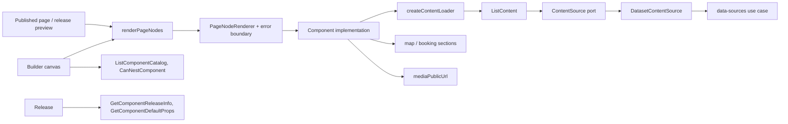
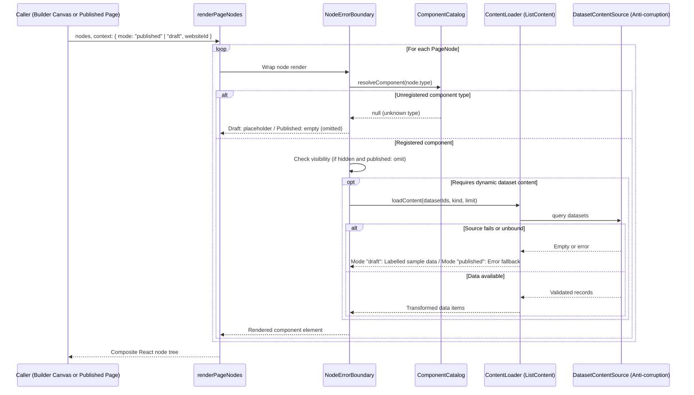

# Component platform

## 1. Overview

The component platform owns the catalog of page components (what exists, what props each takes, how they nest, which version they are at), the content contracts that data-driven components show, and the single pipeline that renders a page's node tree for visitors, the builder canvas and the release preview. Builder edits trees of these components, release pins their versions, data sources supplies the records, media resolves uploaded images, and map and booking supply the sections of their components. The platform has no actor and no database: it is code plus data read through ports.

## 2. Architecture and layer responsibilities

Layers and file roles match the other modules, with `component-platform-dependencies.ts`, `component-platform-limits.ts`, `rate-limits.ts` and `component-platform-view-mappers.ts` at the application root, a server-only `composition.ts`, an intentional server API in `index.ts` and a browser-safe `client.ts` (catalog types and constants for the builder's panels).

- **Domain `components/`.** One `*.component.ts` per component, grouped as `content`, `layout`, `civic` and `smartcity`. `define-component.ts` declares the props (their order is the order the properties panel shows), the nesting rules, an `at most once per page` flag and the data binding. `component-registry.ts` builds an immutable registry and rejects an inconsistent set once, at start-up (duplicate type, nesting rule naming a missing component, dataset prop without a declared kind). `platform-registry.ts` builds it once on first import. `component-versions.lock.json` records each component's version and fingerprint.
- **Domain `content/`.** One `*.content.ts` per content kind, with a field schema each. `content-definitions.ts` is the single registry: a kind exists exactly when it has a contract there. `list-scale.ts` is the one definition of how much of a dataset a kind shows (`LIST_LIMITS`, the initial limit, the maximum offset). `select-content.ts` ranks "relevant" records against a canonical instant.
- **Ports.** `ContentSource` returns a window of records of a kind for a dataset of a website, with three distinguishable failures: not found, not mapped, source failed.
- **Application.** Queries only: `ListContent`, `ReadTrendWindow`, `ListContentCategories`, `ListComponentCatalog`, `CanNestComponent`, `GetComponentReleaseInfo`, `GetComponentDefaultProps`. `component-platform-limits.ts` resolves a requested limit and offset to the bounds of the kind's scale.
- **Infrastructure.** `data-sources/dataset-content-source.ts` is an anti-corruption adapter: data-sources' failures become this module's kinds, a malformed dataset id is "not found", and every mapped record is validated against the kind's contract (the record id is authoritative over a mapped `id` field). It receives data-sources' use case as a function from `composition.ts`.
- **Presentation.** `page-renderer/` (the renderer and its error boundary), `components/{content,layout,civic,smartcity}/` (each block with an optional `*.client.tsx` for the interactive part), `shared/` for module-specific pieces, `messages/` and the `i18n` catalog (`componentPlatform` namespace). Generic pieces live in `src/components` ([README](../../src/components/README.md)): the show-more text comes from `shared/page-parts.client.tsx`.

## 3. Architecture diagram

## 4. Main workflow

`composition.ts` builds dependencies and queries lazily (`once`): `getComponentPlatformQueries()` for use cases and `renderPageNodes(nodes, context)` for rendering. The renderer is handed its services (content loader, map and booking sections, media URL) from there, so presentation never imports the composition root or another module.

Rendering one node: resolve the component by type, isolate its failures behind an error boundary that shows only a translated fallback (no message, no stack), drop it from a published page when `visible` is false, and on the canvas mark it for hit testing. No node renders behind Suspense: a published page must be complete HTML for visitors without JavaScript, and the canvas measures nodes by their rendered DOM. An unregistered type is a placeholder on the canvas and absent for visitors.

`ListContent` reads the primary dataset first, then further ones, drops blanks and repeats, bounds the window by the kind's scale and namespaces record ids by dataset position when there are several datasets. What a failing or unbound source means depends on the render mode:

| Mode        | Nothing bound        | Source fails         |
| ----------- | -------------------- | -------------------- |
| `published` | empty list           | error state          |
| `draft`     | labelled sample data | labelled sample data |

A published page never shows sample data: invented events must not reach citizens. In draft the sample badge names the cause.

## 5. State and data flow

The module keeps no state. `RenderContext` (website, mode) is derived by the server and is the only source of the website; component props are authored by editors and never name one. The content loader opts the render out of prerendering (`connection()`), because "upcoming" depends on the current time; data-sources caches the raw API responses.

## 6. Business rules and invariants

- Every list is bounded. A request's limit is its own when a whole number, otherwise the scale's initial one, always clamped to the scale's bounds; an offset is a whole number from 0 up to `MAX_LIST_OFFSET`.
- A component's `version` must be raised whenever its props or data binding change. `npm run components:lock` records the fingerprint, and `__tests__/architecture/component-versions.test.ts` fails when props changed under an unchanged version. Releases that pinned the old shape are then offered the update.
- A content kind the platform renders must exist in data-sources (checked at compile time in the adapter); a kind data-sources adds needs nothing here until a component renders it.
- Registry inconsistencies are programmer errors that fail at start-up, not runtime conditions.

## 7. Errors and edge cases

| Situation                                     | Result                                                                                                 |
| --------------------------------------------- | ------------------------------------------------------------------------------------------------------ |
| Dataset missing, unmapped or wrong kind       | Published: error state. Draft: sample data naming the cause                                            |
| A record fails its contract                   | Dropped by the adapter, which logs how many were rejected, skipped or truncated; the rest still render |
| A component throws while rendering            | Fallback in its place; the rest of the page renders                                                    |
| Stored page names a removed component         | Placeholder on the canvas, invisible to visitors                                                       |
| Unreadable dataset when collecting categories | The editor is offered none; it still works                                                             |
| Visitor moves a chart too often               | `rateLimited`; see section 8                                                                           |

## 8. Security and access control

Every query is `@authorization public`, each with its reason: the catalog is code and contains nothing per tenant, and content is rendered for pages anyone may read, scoped to the rendering website. `ListContentCategories` is called only by the editor route after it authorized the page.

`ReadTrendWindow` serves visitors of a published page (through `readTrendWindowAction`). It scopes the dataset to the website, serves only the published view, never sample data, and spends a per-client-address budget (60 a minute). That policy fails open when the limiter's store is down and skips an address it cannot determine: a chart that stops updating costs more than the gap in protection.

Error boundaries and the "section unavailable" state show visitors no detail of why.

## 9. Testing and verification

Tests live under `__tests__/src/modules/component-platform`: `application/` (content listing with its published and draft rules, limits, component texts), `domain/` (field schemas, dataset props, series selection), `booking-definition` and the split news and events block. The version lock is checked in `__tests__/architecture`. Adapters that cross into data-sources, map and booking are tested through their ports with fakes.

## 10. Extension points and constraints

- **A new component:** one `*.component.ts` in the right group, registered in `component-definitions.ts`, an implementation in `presentation/components/`, translations for its texts in both locale files, then `npm run components:lock`.
- **A new content kind:** one `*.content.ts` and one line in `content-definitions.ts`; the kind must also exist in data-sources.
- **Another module** reaches the platform only through `index.ts` (server) or `client.ts` (browser). Builder gets descriptors through `ComponentPlatformDescriptorProvider`, release through `ComponentPlatformCatalog`; both are adapters in those modules.
- **Limits** of how much a kind shows belong in `list-scale.ts` and nowhere else; the builder's Limit control and the use case read the same definition.
