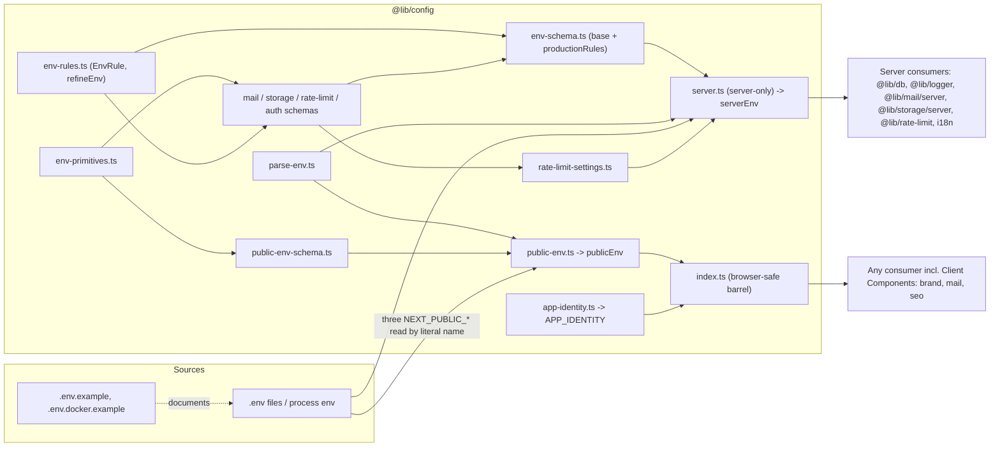
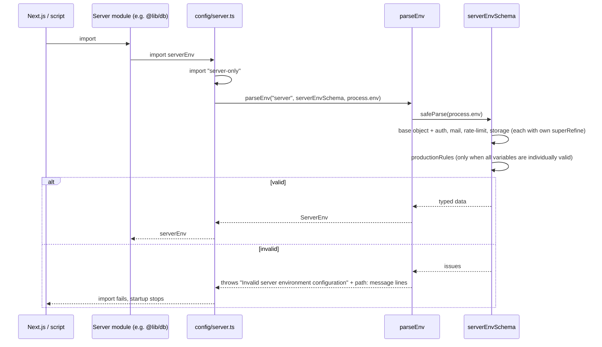

# Configuration (`@lib/config`)

## 1. Overview

`@lib/config` is the single, typed entry point to the application's environment variables and to the product's own identity. It exists so that:

- every variable is validated once, when its module is first imported, and a bad start fails with a message naming every variable at fault (never its value);
- secrets can never reach a browser bundle, because the module that holds them cannot be imported by client code;
- cross-variable requirements ("required once X is enabled", "https in production") are declared as data next to the schema they belong to, not as scattered conditionals;
- no other code reads `process.env`.

The trigger is the first import of `serverEnv` (from `@lib/config/server`) or `publicEnv` (from `@lib/config`), which usually happens while the Next.js server starts. The outcome is a typed `ServerEnv` or `PublicEnv` object, or a thrown `Error` that stops startup. The module also exports `APP_IDENTITY`, the product's name and default theme for places that cannot read CSS variables.

Scope: authentication variables are composed into the server schema but documented separately later. Mail, storage and rate-limit schemas are only summarised here; see [mail.md](mail.md), [storage.md](storage.md) and [rate-limiting.md](rate-limiting.md).

## 2. Architecture and Layer Responsibilities

`@lib/config` is a shared library (`src/lib`) with no dependency on modules. Files under `src/lib/config/`:

| File                                                                      | Responsibility                                                                                                                                                                                                                    |
| ------------------------------------------------------------------------- | --------------------------------------------------------------------------------------------------------------------------------------------------------------------------------------------------------------------------------- |
| `env-primitives.ts`                                                       | Reusable Zod building blocks: `booleanFlag`, `commaSeparatedList`, `integerSetting`, `httpUrl`, `postgresUrl`. Pure Zod; safe in a browser bundle.                                                                                |
| `env-rules.ts`                                                            | The `EnvRule<Env>` shape (`path`, `violated`, `message`), `envRuleIssues` and `refineEnv`, which attaches a rule table to a schema through `superRefine`.                                                                         |
| `env-schema.ts`                                                           | The server schema: base variables (`NODE_ENV`, `DATABASE_*`, `LOG_LEVEL`, `AUDIT_RETENTION_DAYS`, `BOOKING_RETENTION_DAYS`), composition of the domain schemas, and `productionRules`. Exports `serverEnvSchema` and `ServerEnv`. |
| `mail-env-schema.ts`, `storage-env-schema.ts`, `rate-limit-env-schema.ts` | Each domain's object schema, its rule table and its own `superRefine`, so it validates on its own.                                                                                                                                |
| `auth-env-schema.ts`                                                      | The authentication domain's schema; out of scope for this document.                                                                                                                                                               |
| `parse-env.ts`                                                            | `parseEnv(label, schema, source)`: `safeParse`, then one error listing `path: message` lines.                                                                                                                                     |
| `server.ts`                                                               | Imports `server-only`, runs `parseEnv('server', serverEnvSchema, process.env)` and exports `serverEnv`, plus config types and `resolveRateLimitSettings`.                                                                         |
| `public-env-schema.ts`, `public-env.ts`                                   | The `NEXT_PUBLIC_*` schema and the validated `publicEnv`.                                                                                                                                                                         |
| `rate-limit-settings.ts`                                                  | `resolveRateLimitSettings(env)`: turns validated rate-limit variables into `RateLimitSettings` (`{ enabled: false }` or the store, secret, timeout and client-address settings).                                                  |
| `app-identity.ts`                                                         | `APP_IDENTITY`: product name, company, literal colours and default theme choices.                                                                                                                                                 |
| `index.ts`                                                                | The browser-safe barrel: `publicEnv`, `PublicEnv`, `APP_IDENTITY`.                                                                                                                                                                |

Responsibility split: the schemas own _shape_ (types, defaults, coercion); rule tables own _relationships between variables_; `parseEnv` owns _reporting_; `server.ts` owns the _trust boundary_ and the only whole-object read of `process.env`. Consumers (`@lib/db`, `@lib/logger`, `@lib/mail/server`, `@lib/storage/server`, `@lib/rate-limit`, `src/i18n/request.ts`) import validated values and never validate themselves.

## 3. Architecture Diagram

The barrel never imports `server.ts` or `env-schema.ts`; that is what keeps secrets out of client bundles.

## 4. Main Workflow

Start-up validation of the server configuration:

1. A server module imports `serverEnv`. If it is imported from a Client Component, `import 'server-only'` turns that into a build error.
2. `server.ts` passes `process.env` to `parseEnv`. Next.js loads the `.env*` files before this runs; `prisma.config.ts` and `prisma/seed.ts` load `dotenv/config` themselves.
3. `serverEnvSchema` is `serverEnvBaseSchema.and(authEnvSchema).and(mailEnvSchema).and(rateLimitEnvSchema).and(storageEnvSchema).superRefine(refineEnv(productionRules))`. Each domain schema already carries its own `superRefine(refineEnv(rules))`.
4. On failure `parseEnv` throws a single `Error`; each issue is rendered as `  - <path>: <message>`, never the rejected value.
5. The public side is separate: `public-env.ts` builds an object from the three `NEXT_PUBLIC_*` variables by literal name (`process.env['NEXT_PUBLIC_APP_URL']` and so on) because the bundler inlines each reference; reading the whole object would be empty in the browser.

Verified behaviour of the two-pass reporting: with `NODE_ENV=production`, an invalid `DATABASE_URL` and `AUTH_ENABLED=false`, a run of `parseEnv` listed the `DATABASE_URL`, rate-limit and storage problems but not the production-only `AUTH_ENABLED` rule; the production rules appear once the variables are individually valid, as `parse-env.ts` documents.

## 5. State and Data Flow

- **Creation.** `serverEnv` and `publicEnv` are module-level constants evaluated at first import and cached by the module system. There is no reload; changing a variable needs a restart.
- **Flow in.** Raw strings from the environment, coerced by primitives (`integerSetting` uses `z.coerce.number().int()` with a default minimum of 1; `booleanFlag` accepts only the text `true` or `false`; `commaSeparatedList` trims and drops empty entries).
- **Flow out.** Typed objects. Domain code receives the pieces it needs: `@lib/mail` and `@lib/storage` take `MailEnv` and `StorageEnv` types, and `@lib/rate-limit` calls `resolveRateLimitSettings(serverEnv)`.
- **Public versus server.** `PublicEnv` has `NEXT_PUBLIC_APP_URL` (default `http://localhost:3000`), `NEXT_PUBLIC_MAPBOX_ACCESS_TOKEN` (optional, must start `pk.`) and `NEXT_PUBLIC_MAPBOX_STYLE_URL` (default `mapbox://styles/mapbox/light-v11`, Mapbox-hosted styles only). Everything else is server-only.
- **Identity.** `APP_IDENTITY` is a constant, not read from the environment. It holds literal copies of the `--civo-color-*` design tokens; `__tests__/src/lib/design-tokens.test.ts` pins them to the stylesheet. It is used by brand components, `@lib/mail` and `@lib/seo`.
- **Base server variables** (`env-schema.ts`): `NODE_ENV` (default `development`), `DATABASE_URL` (required), `DATABASE_POOL_SIZE` (10), `DATABASE_POOL_TIMEOUT_SECONDS` (10), `DATABASE_STATEMENT_TIMEOUT_SECONDS` (30), `LOG_LEVEL` (`info`), `AUDIT_RETENTION_DAYS` (365, bounded 30 to 3650), `BOOKING_RETENTION_DAYS` (365, bounded 30 to 3650).

## 6. Business Rules and Invariants

- **Rules are data.** Each `EnvRule` names the variable it is reported on, a `violated(env)` predicate that already folds in its own mode, and a message that never contains the offending value. `refineEnv` adds one `custom` issue per violated rule, in table order. To add a rule, add a row to its domain's table (`rate-limit-env-schema.ts`, `mail-env-schema.ts`, `storage-env-schema.ts`).
- **Where a rule lives.** A rule internal to one domain stays in that domain's file. Only rules that need `NODE_ENV` or compare domains belong in `env-schema.ts` (`configuration.md` rule).
- **Production rules** (`productionRules` in `env-schema.ts`): `AUTH_ENABLED` and `RATE_LIMIT_ENABLED` may not be `false`; `MAIL_PROVIDER` may not be `none`; `resend` is refused outside production; `MAIL_API_URL`, `UPSTASH_REDIS_REST_URL`, `STORAGE_S3_ENDPOINT` and a set `STORAGE_PUBLIC_BASE_URL` must be https, because they carry bearer credentials or signed URLs.
- **Always required.** The database and object storage have no off switch. Subsystems with an off switch (rate limiting, authentication) require their settings only while enabled; mail defaults to `MAIL_PROVIDER=none` and requires the chosen provider's settings.
- **Safe defaults only.** A default exists only where it is harmless (pool size, log level). Secrets never have one.
- **Domain detail.** The per-domain variables and rules are documented in the sibling documents linked above, not here.

## 7. Errors and Edge Cases

- **Invalid or missing variable.** `parseEnv` throws `Error: Invalid server environment configuration:` followed by one line per issue; a whole-configuration issue renders as `(configuration)`. The same function labels the public side `public`.
- **Value leakage.** `parse-env.test.ts` asserts that a rejected value never appears in the message.
- **Client import.** Importing `@lib/config/server` from client code is a build error (`server-only`), not a runtime failure against the browser's empty `process.env`. Tests mock `server-only` globally in `vitest.setup.ts`, so test code can import it.
- **Rule hazards.** Because rules run only on individually valid variables, a rule may rely on typed values; `productionRules` additionally guard with `nonEmpty` and `httpUrl.safeParse` where a malformed URL is already reported by the domain's rules, so the same mistake is not reported twice.
- **Second failure point.** `resolveRateLimitSettings` still throws if a required setting is missing after validation; this is a type-narrowing guard that the validation rules should make unreachable.
- **Outside the module.** `prisma.config.ts` reads `process.env['DATABASE_URL']` directly (it runs outside the application) and `migrations/apply-auth-migration.ts` reads its own variable; `src/instrumentation.ts` reads `process.env.NEXT_RUNTIME` under an explicit lint exception because Next.js inlines that exact form.

## 8. Security and Access Control

- Secrets live only in `serverEnv`. Its `server-only` import is the enforcement, not convention.
- `NEXT_PUBLIC_*` values are intentionally public. The Mapbox schema accepts only `pk.` tokens and Mapbox-hosted style URLs. `npm run gen -- env --public` refuses names containing `SECRET`, `PASSWORD` or `PRIVATE`, and non-prefixed names for public variables.
- Error messages name variables, not values; rule messages are written the same way.
- ESLint forbids `process.env` outside `src/lib/config/public-env.ts` and `src/lib/config/server.ts` (`eslint/config/restrictions.mjs`), and additionally in domain and application code.
- `.env*` is gitignored except `.env.example` and `.env.docker.example`, which carry placeholders only (`change-me`, `REPLACE_WITH_...`). The real `.env` was deliberately not inspected for this document.

## 9. Testing and Verification

| Concern                                                             | Test file                                                                       |
| ------------------------------------------------------------------- | ------------------------------------------------------------------------------- |
| Schema defaults, coercion, production rules, mail and public schema | `__tests__/src/lib/config/env.test.ts`                                          |
| `EnvRule`, `envRuleIssues`, `refineEnv`                             | `__tests__/src/lib/config/env-rules.test.ts`                                    |
| `parseEnv` reporting, no value leakage                              | `__tests__/src/lib/config/parse-env.test.ts`                                    |
| Client/server split (`server-only`, barrel free of server config)   | `__tests__/src/lib/config/server-boundary.test.ts`                              |
| Storage schema and rules                                            | `__tests__/src/lib/config/storage-env.test.ts`                                  |
| Rate-limit schema and settings                                      | `__tests__/src/lib/rate-limit/rate-limit-env.test.ts`, `default-wiring.test.ts` |
| `APP_IDENTITY` colours pinned to CSS                                | `__tests__/src/lib/design-tokens.test.ts`                                       |

Gaps: no dedicated test for `env-primitives.ts` (covered indirectly through schema tests), and no test found for `scripts/commands/env.ts`. The coverage threshold for `src/lib` is 100% according to `src/lib/README.md`; this was not checked.

Verification status: the five files in `__tests__/src/lib/config/` were run together with the `@lib/db` unit tests; all of them passed (125 tests passed in the combined run; the seven failures in that run were in `@lib/db` files that need the missing generated contract, see [persistence.md](persistence.md)).

## 10. Extension Points and Constraints

- **Add a variable.** Follow [adding-an-environment-variable.md](../conventions/adding-an-environment-variable.md). `npm run gen -- env <NAME> [--public] [--type string|number|boolean|url] [--default ...] [--optional]` (`scripts/commands/env.ts`) inserts an entry into the right section of `.env.example` and prints the Zod line to add; it does not edit the schema. A server variable goes into its domain's schema file (or `serverEnvBaseSchema` for a general one); a public variable into `publicEnvSchema` **and** the literal object in `public-env.ts`.
- **Add a cross-variable rule.** Add a row to the domain's `EnvRule` table; use `productionRules` only if it needs `NODE_ENV` or spans domains.
- **Add a domain.** Create `<domain>-env-schema.ts` with an object schema, a rules table and a `superRefine(refineEnv(rules))`, then `.and(...)` it in `env-schema.ts` and add its type to `ServerEnvShape`.
- **Local and container files.** `.env.example` (application, grouped in numbered sections, `[docker]` marks values that must match `.env.docker`) and `.env.docker.example` (read by Docker Compose services; `npm run dev` does not read it). The generator relies on the numbered `Public` section banner in `.env.example` and fails with instructions if it is missing.
- **Constraints.** Keep `index.ts` free of anything that imports `server.ts`. Keep primitives and schemas free of Node built-ins. Do not read `process.env` elsewhere. Never put a secret behind `NEXT_PUBLIC_`. Give a variable a default only when the default is safe.

Related: [persistence.md](persistence.md), [mail.md](mail.md), [storage.md](storage.md), [rate-limiting.md](rate-limiting.md), [logging.md](logging.md), `src/lib/README.md` (`@lib/config`).
