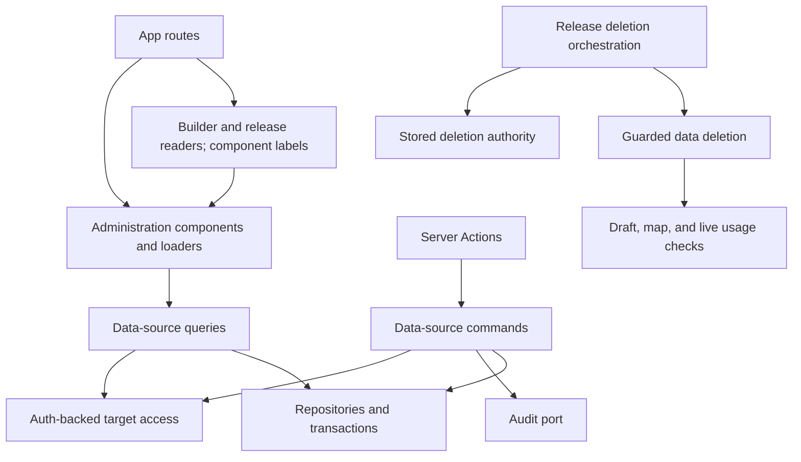

# Data sources

## 1. Overview

Data sources connects a website to REST/JSON APIs, discovers record fields, and maps datasets to the component platform's canonical content kinds. Auth owns target website permissions; audit records mutations; release owns the checks that protect data referenced by drafts, saved maps, or the published snapshot.

## 2. Architecture and layer responsibilities

- `domain/` owns configuration, safe outbound addresses, pagination, discovery, mapping, identifiers, errors, and ports.
- `application/` owns independently authorized commands and queries. Bounds live in `data-sources-limits.ts`; resource loading lives in `services/`.
- `infrastructure/` supplies tenant-scoped Prisma repositories, transactions, live/cached connectors, hashing, credentials, and audit adapters.
- `presentation/` owns actions, schemas, DTOs, loaders, form definitions, hooks, and components grouped into `sources`, `datasets`, `mapping`, `setup`, and `shared`.
- `composition.ts` lazily builds dependencies, commands, and queries, following auth, audit, and booking. Its existing `dataSourceQueries` facade remains lazy for established server consumers.

Shared UI is indexed in [the component README](../../src/components/README.md). Every screen is framed by `DataSourcesAdminPage`, which mirrors `BookingAdminPage`: breadcrumb, one heading with its main action at the far edge, then the content. Lists are a `DataPanel` around `ResponsiveTable` with the shared `EmptyState` as the table's empty state, like pages, users and releases. Nothing is edited inline: the source form, the dataset form and the field mapping are each a `Wizard` with the step in the address, and each list row only links to them. Screen skeletons live in `src/components/skeletons/`.

## 3. Architecture diagram

The app composition boundary supplies neighbour readers and their addresses to the usage loader. Data sources has no runtime dependency on builder or release, keeping the module graph acyclic.

## 4. Main workflow

1. `/data` loads a clamped page of sources with bounded datasets and website-wide setup facts. It shows the setup guide above a table of sources (name and address, status, dataset counts, last check); `forms/setup-guide.ts` derives the guide, and only the first open step gets a button.
2. `/data/new?step=…` guides source creation through connection (name, address, authentication), records and pagination (usually nothing to change), and review. No API request happens until saving. The stored config is the normalized, validated one, records path and pagination included.
3. Saving a new source tests its connection at once. A healthy source goes straight on to its first dataset (`/data/<source>/datasets/new`); a failed test lands on the source's page, which names the problem. After editing a source the person returns to its page `/data/<source>?test=1`: the connection panel runs the test by itself once (only while the source is untested) and removes `test` from the address. The page shows the connection facts and a table of the source's datasets, found through the list query for the page that holds the source. A dataset can be added after a successful test.
4. `/data/<source>/edit?step=…` is the same wizard prefilled ("Bearbeiten" in the connection panel of the source's page, permission `datasource.update`). The submitted settings are laid over the stored config (`domain/config/rest-connection-settings.ts`): path, method, request body and pagination settings without a form field stay as stored. The form shows the base URL without query or fragment (they can carry a token); sending that shown address back keeps the stored one. A changed connection clears the last test, and saving returns to the source's page with `test=1`.
5. `/data/<source>/datasets/new?step=…` and the corresponding `<dataset>/edit` route share the basics, endpoint, and review wizard. An existing dataset's canonical kind is read-only because the update contract supports name, slug, and path changes.
6. Saving a new dataset opens its mapping wizard `/data/<source>/datasets/<dataset>/mapping?step=…`; saving an edited dataset returns to its source. From a source's page, "Map fields" opens the same route.
7. Mapping step one reads the source's fields as it opens (reload reads them again), proposes a first mapping from the field names (`forms/suggest-assignments.ts`; only for a dataset with no saved mapping) and names the required targets still unassigned. Moving on needs every required target covered; step two lists the assignments and the record they produce from the sample. Saving validates required targets, performs a live dry run before persistence, and returns to the source's page.
8. Removing a source or a dataset is a dialog on its page that first says which pages and saved maps still use the data; the deletion itself is handed in by the route because only release can check them. The usage the screens show is read from the same three places the deletion guard checks: draft pages (builder), saved maps (map) and the live release; a map list longer than one read is reported as incomplete.

## 5. State and data flow

The address owns the wizard step (`@hooks/use-wizard-steps` for the source and dataset forms); react-hook-form owns the values across the source and dataset steps, and the mapping hook owns the assignments across the mapping steps. Only the step's fields remount, avoiding uncontrolled inputs being reused for a different field. Server validation returns to the owning step and focuses its invalid control after the wizard heading. A shared unsaved-changes provider protects link navigation and unload; browser Back/Forward has the shared guard's documented limitations.

Mapping assignments have an explicit saved baseline. Existing transforms and additional assignments from one source field to multiple targets survive saves. Saved or edited fields remain visible when a later discovery sample omits them. Successful saves immediately reconcile assignments and clear dirty state.

Raw connection config and credentials never enter list DTOs. Display endpoints omit query strings and fragments. Runtime credential names use `DATASOURCE_<source-id>_API_KEY` or `DATASOURCE_<source-id>_BEARER_TOKEN`, replacing hyphens in the id with underscores. The provider reads these through `readServerSecret` at the server configuration boundary; the startup schema does not retain dynamically named keys.

## 6. Business rules and invariants

- Every protected operation uses current permission in the target website. The selected website's tenant or role cannot substitute for that decision.
- Existing-resource operations authenticate before reading routing metadata, authorize the stored website before loading contents, and verify returned ownership. Forbidden resources remain indistinguishable from missing resources.
- Public mapped reads remain website-scoped and require no actor.
- Bounded lists return `isTruncated`; partial usage is never described as unused. Compatible dataset choices propagate truncation through builder and map.
- Setup facts are independent of the visible source page. Readiness uses domain-restored mappings, with explicit truncation when its bounded mapping sample is incomplete.
- Source creation and dataset creation use transaction handles and transient retry. Dataset creation and source deletion agree on the source advisory-lock key.
- Audit events remain after successful persistence, outside retry loops. Live connector calls are never retried as part of a database transaction.

## 7. Errors and edge cases

Expected failures retain stable codes and are translated at presentation boundaries. Optional usage reads can be unavailable or incomplete; the screen warns and does not infer absence. Loaders use the shared `orNotFound` policy.

Source deletion checks raw child ids, including records a domain mapper cannot represent. An incomplete child enumeration refuses deletion. Neighbour checks run outside a transaction connection; the final transaction locks the source and compares the complete checked id set before cascading. A child-set change returns `data_source.deletion_incomplete`. Successful removal returns all checked ids for cache invalidation.

Release preserves its id-only deletion contract. It obtains delete authority from data sources, budgets the trusted target actor, and invokes guarded deletion, which authorizes again. Truncated draft usage fails closed, as incomplete map usage already does.

## 8. Security and access control

Auth's `authorizeWebsiteAccess` owns membership and platform decisions. UI capability flags control affordances only; actions and use cases enforce authority independently. Tenant filters remain in repository statements, and transaction queries begin from their transaction handle.

Resolved header credentials remain server-only and are excluded from views, logs, audit entries, and cache keys. Stored connection URLs can contain query parameters; their configuration remains part of the existing raw-response cache identity. Existing outbound address, redirect, response-size, timeout, and credential policies remain in the connector.

The source lock protects child creation versus cascading deletion. It does not serialize builder, map, and release reference writers; the check/write race across those modules remains a separate consistency concern. DNS validation followed by `fetch` retains the connector's documented DNS-change limitation.

## 9. Testing and verification

Unit and component regressions live under `__tests__/src/modules/data-sources/`, following source responsibilities. They cover target authorization, malformed ownership, bounded choices, usage completeness, dynamic credentials, mapping preservation, wizard input retention, and server-error focus. Release adapter tests cover incomplete draft usage and deletion authority.

`data-source-persistence.integration.test.ts` requires the migrated PostgreSQL database configured by `DATABASE_URL`. It creates and removes only its own website fixture and exercises source position, nested truncation, setup mapping restoration, tenant scope, and concurrent child creation during deletion. It does not start an application or contact an external API.

Run the affected Vitest suites, touched-file ESLint, type checking, `npm run test:architecture`, `npm run i18n:check`, and scoped dead-code checks. A passing mocked transaction test does not establish real database concurrency behavior. Browser rendering requires separate verification.

## 10. Extension points and constraints

Keep source-specific rules in this module and use generic shared UI for presentation. Add connector kinds through the existing connector port; do not expose credentials or raw persisted config to client forms. Preserve independently authorized public server entry points and keep cross-module runtime wiring in composition or infrastructure adapters.

Spatial windows. A map asks for the records of the area it shows, so the read window carries optional `bounds` (west, south, east, north; validated by `createReadWindow`). APIs word an area condition differently, so a REST source can carry an optional `spatialFilter` in its config (`domain/config/spatial-filter.ts`): the request parameter (a query parameter for GET, a dot path into the body for POST) and a value template written with `{west}`, `{south}`, `{east}` and `{north}`, e.g. `where` = `in_bbox(geo_point_2d, {south}, {west}, {north}, {east})` (Opendatasoft), `$where` = `within_box(location, {north}, {west}, {south}, {east})` (Socrata) or `bbox` = `{west},{south},{east},{north}` (OGC API Features). The source form offers these as presets on its records step. The connector adds the condition to every page request (`withArea`); the corners are numbers formatted by the server, never text from a visitor. The area is part of the cache key of the raw response, and map snaps windows to a grid so neighbouring windows share an entry. The mapped-record view says whether the API was asked (`isAreaApplied`). A source without a spatial filter cannot be asked; the map then reads as many records as one read can page and applies the area itself (see map). Not every API can filter by area, so this is configured per source and never assumed.
