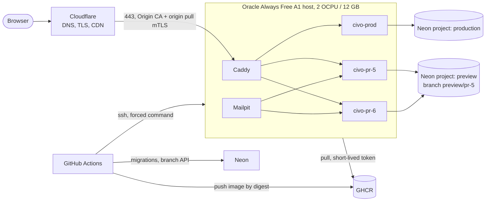

# Deployment architecture

How Civo reaches production and how every pull request gets a preview, on free tiers. Setup steps are in [`docs/deployment/`](../deployment/README.md); this page explains the design and its limits.

## What is deployed

Civo is one Next.js application (App Router, `output: standalone`) with no worker, queue or cron. It talks to four external services: Neon PostgreSQL (two databases: the application's and the authentication tables), Upstash Redis over REST (rate limits), S3-compatible object storage (Neon Object Storage) and a mail relay. `GET /api/health` is the liveness probe; it deliberately does not touch the database. The `Dockerfile` builds a hardened `runner` image (non-root, no package manager) and a `migrator` image.

## Topology

Each instance (`prod`, `pr-<n>`) is one container on a Docker network of its own. Caddy, and for previews Mailpit, join each network; instances never share one, so a preview cannot reach production or another preview, only the internet.

## Decisions

| Decision                                                    | Why                                                                                                                                                                                        | Cost of the choice                                                                                                |
| ----------------------------------------------------------- | ------------------------------------------------------------------------------------------------------------------------------------------------------------------------------------------ | ----------------------------------------------------------------------------------------------------------------- |
| One host, containers started by a script, no orchestrator   | The free allowance is one small ARM VM. Kubernetes or a second VM does not fit.                                                                                                            | No horizontal scale, no HA. A host failure is an outage until it is rebuilt (see operations).                     |
| `docker run` driven by `civo-remote`, Compose only for edge | Previews are created and removed dynamically; a Compose project per PR adds nothing.                                                                                                       | The script is the deployment logic and is shell. It is shellchecked and tested (`deploy/test/`).                  |
| Caddy resolves `civo-pr-<n>` by name                        | Routing needs no state: deploying or removing a preview never edits or reloads the proxy.                                                                                                  | An unknown or stopped preview answers 502.                                                                        |
| Cloudflare proxy, Origin CA certificate, no Tunnel          | A proxied wildcard record works on the free plan and needs no daemon. A Tunnel would not remove the edge-certificate limit below and would add a service to run.                           | Port 443 is open to the internet; it is restricted to Cloudflare's ranges and to Cloudflare's client certificate. |
| Preview host `pr-<n>.<domain>`, one label deep              | Cloudflare's free Universal SSL certificate covers the apex and first-level names only. `pr-5.preview.example.com` would need a paid certificate.                                          | Previews share the registrable domain with other records; keep that domain's wildcard record in mind.             |
| Image tagged by commit, deployed by digest                  | What runs is exactly what CI built. `latest` is never pushed.                                                                                                                              | None.                                                                                                             |
| Registry token passed per deploy over stdin                 | No registry credential lives on the host. The workflow token dies with the job.                                                                                                            | Rollback needs the previous image on the host, so the stopped previous container is kept.                         |
| Two Neon projects: production and preview                   | The free compute allowance (100 CU-hours) is per project. Previews in the production project could exhaust it and suspend production. A preview API key also cannot touch production data. | A second project to create once.                                                                                  |
| Preview branches are children of a blank `preview-base`     | No production data ever reaches a preview, and every PR runs the whole migration history from zero.                                                                                        | Previews start empty; use seeds or fixtures for demo data.                                                        |
| Migrations run from CI, before the container swap           | The host holds no owner credentials. A failed migration stops the deploy before anything changes on the host.                                                                              | Migrations must be backward compatible: old code runs against the new schema during the swap.                     |

## Release lifecycle

Production, on every push to `main`: CI on the commit, build the arm64 image, push it, migrate (`db:migrate:app`, `db:migrate:auth`), then `deploy-prod`. The host pulls the digest, starts the new container beside the live one, waits for its health check, and only then gives it the network alias the proxy resolves. The old container is disconnected, stopped and kept as `civo-prod-previous`. CI then checks the host's recorded release and `/api/health` through Cloudflare; on failure it calls `rollback-prod`, which redeploys the previous image the same way. Schema changes are never rolled back.

Preview, on every PR commit: image, a Neon branch `preview/pr-<n>` (reused if it exists, guarded by `neon-branches.sh assert-preview`), migrations over the direct connection, `deploy-preview`, a smoke test and one updated PR comment. On close or merge: `remove-preview` and `delete-preview`. A nightly sweep removes whatever a missed cleanup left.

Concurrency: production is one queue (`production-deploy`); each PR is one queue (`preview-<n>`) shared with its cleanup; on the host every mutating call takes one lock, which also makes the preview limit (`MAX_PREVIEWS`) race-free.

## Trust model

- `civo-remote` is the only thing a deploy key can run (sshd forced command, `restrict`). The **prod** key may deploy and roll back production; the **preview** key may deploy and remove previews. Neither can run anything else, and neither can reach the other's verbs.
- Arguments are validated against fixed patterns; the image must be a digest in the one configured repository; secrets travel on stdin only.
- The script and the key list are root-owned and installed by hand from `main`; no workflow replaces them. A pull request therefore cannot widen what the preview key may do.
- Anyone who can push a branch can run a workflow with the `preview` environment's secrets (the pull-request workflow file comes from the PR). That is the accepted boundary: those secrets reach previews only. Fork pull requests get no secrets and are skipped. `pull_request_target` is not used.
- Docker access is root-equivalent on the host; the forced command and the validation above are what stand between a leaked key and that.

## State and data

| What                                                      | Where                                   | Survives host loss?                                       |
| --------------------------------------------------------- | --------------------------------------- | --------------------------------------------------------- |
| Application data, sessions                                | Neon                                    | Yes                                                       |
| Uploaded files                                            | Object storage                          | Yes                                                       |
| Rate-limit counters                                       | Upstash                                 | Yes                                                       |
| Images                                                    | GHCR                                    | Yes                                                       |
| Runtime secrets (`prod.env`, `preview.env`), certificates | `/opt/civo/env`, `/opt/civo/edge/certs` | No. Keep copies in a password manager.                    |
| Release records (`releases.log`)                          | `/opt/civo/state`                       | No. Informational; GitHub run history has the same facts. |
| Preview mail                                              | Mailpit volume                          | No, and disposable.                                       |

A Docker volume is not a backup, and nothing that matters lives only in one.

## Free-tier facts (checked 2026-10-28 against the providers' pages)

- **Oracle Always Free.** Ampere A1: the first 1,500 OCPU-hours and 9,000 GB-hours per month, which for an Always Free tenancy is 2 OCPUs and 12 GB (not the older 4 / 24). Boot volume minimum 47 GB of 200 GB total block storage, five volume backups, 10 TB outbound per month, two VCNs. Outbound TCP 25 is blocked by default. Idle instances may be reclaimed: 95th-percentile CPU and network below 20% (and, on A1, memory below 20%) over seven days. A quiet deployment can meet that; there is no free-tier-safe way around it other than real load or accepting the risk and keeping the rebuild procedure current. Capacity in a region can be exhausted ("out of host capacity").
- **Neon Free.** 100 projects; per project 10 branches, 100 CU-hours of compute per month, 1 GB storage, 5 GB transfer, three root branches, computes suspend after five minutes idle. Out of CU-hours the compute is suspended until the next period; branch creation fails at 10 branches.
- **Cloudflare Free.** Universal SSL covers the apex and one subdomain level. Authenticated Origin Pulls with Cloudflare's shared certificate prove "a request came from Cloudflare", not "from my account"; the IP restriction in front of it is what narrows that. Rate limiting rules on Free can only match on path (and verified bot) and count per IP.
- **GitHub.** Actions and Packages are free for public repositories; private repositories draw on the plan's quota. Standard arm64 runners are free for public repositories only (not re-checked here). The image build therefore defaults to QEMU emulation on `ubuntu-24.04`.

Not verified in this session: Cloudflare's free-plan cache-rule and custom-rule counts, wildcard proxying on the current free plan, Neon's project-scoped API key availability, and Cloudflare Zero Trust billing requirements. Check them in the dashboards before relying on them.

## Known limitations

- Single host: no high availability, and the swap is near-zero-downtime, not zero (a request in flight on the old container at the instant it is stopped can fail).
- Previews share one preview storage bucket, one Upstash database and one mail catcher; their objects are not deleted when a PR closes.
- The emulated arm64 build is slow (tens of minutes); a native arm64 runner fixes that for public repositories.
- `/api/health` is liveness only, so "healthy" means "the process answers", not "the database is reachable".
