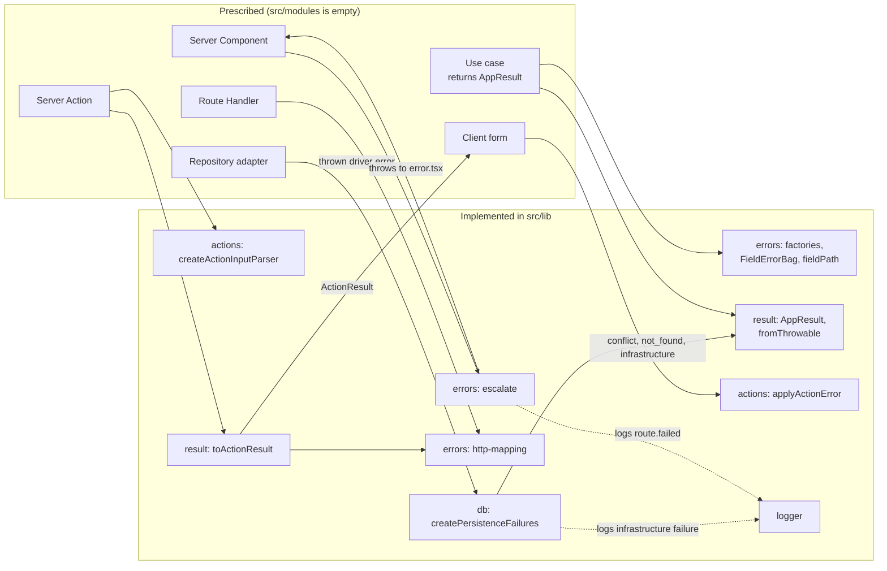
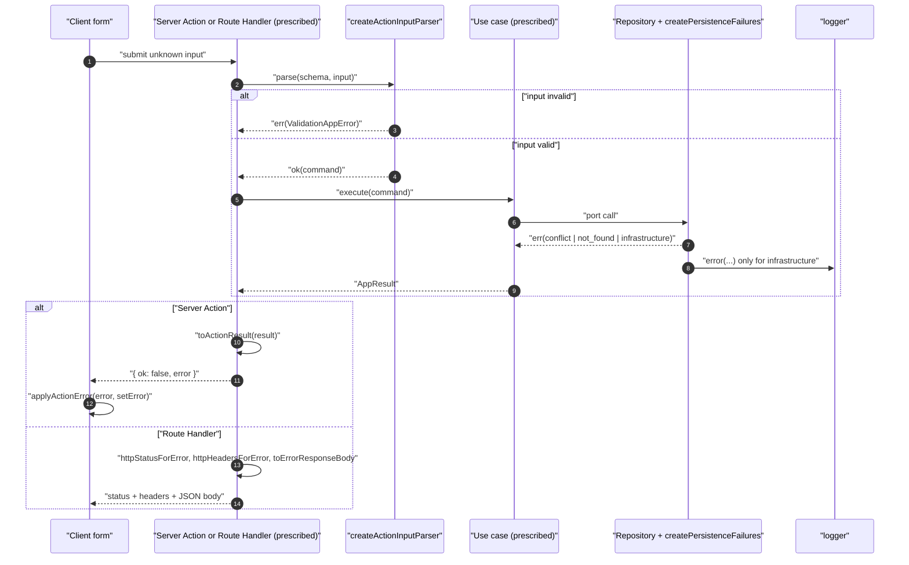

# Error Handling and Result Contract

## 1. Overview

Every expected failure that crosses a layer boundary in this repository is an `AppError`, carried inside a neverthrow `Result`. Shared code in `src/lib` defines the whole contract: the error shape, the constructors, the `Result` aliases, the mapping to HTTP, the serializable form a Server Action returns, and the helpers that put a failure back onto a form. The rules behind it are [`errors.md`](../rules/errors.md), [`api.md`](../rules/api.md), [`validation.md`](../rules/validation.md) and [`nextjs.md`](../rules/nextjs.md).

The contract exists so that a failure keeps one shape from the layer that detects it until the layer that presents it. A repository, a use case, a Route Handler and a form all agree on `kind`, `code`, `message` and, where relevant, `fieldErrors` and `retryAfterSeconds`. The `cause` stays on the server.

**Implementation status.** `src/modules` is empty. Everything below under `src/lib` is implemented and tested. The use cases, Server Actions and Route Handlers that would call it are only prescribed (by the rules, the conventions [`adding-a-use-case.md`](../conventions/adding-a-use-case.md), [`adding-a-server-action.md`](../conventions/adding-a-server-action.md), [`adding-a-route-handler.md`](../conventions/adding-a-route-handler.md), and the generator templates in `scripts/templates/`). Those parts are marked "prescribed" throughout. No file in `src/app` currently calls `toErrorResponseBody`, `toActionResult`, `escalate` or the action helpers; `src/app/api/health/route.ts` returns a plain success body.

Authentication errors are not covered here; the `unauthorized` and `forbidden` kinds are defined and mapped, but who raises them is documented with authentication later.

## 2. Architecture and Layer Responsibilities

| Layer | Component                                            | Responsibility                                                                                                                                                                                                                                                                                                             |
| ----- | ---------------------------------------------------- | -------------------------------------------------------------------------------------------------------------------------------------------------------------------------------------------------------------------------------------------------------------------------------------------------------------------------- |
| lib   | `src/lib/errors/app-error.ts`                        | The `AppError` discriminated union. Eight kinds: `validation`, `not_found`, `conflict`, `unauthorized`, `forbidden`, `rate_limited`, `infrastructure`, `unexpected`. Each has a stable `code` and a `message` safe to show; `cause` is optional. `validation` adds `fieldErrors`; `rate_limited` adds `retryAfterSeconds`. |
| lib   | `src/lib/errors/factory.ts`                          | One constructor per kind. `rateLimitedError` rounds the delay up and never goes below 1.                                                                                                                                                                                                                                   |
| lib   | `src/lib/errors/match-app-error.ts`                  | `matchAppError`: an exhaustive handler map, so a new kind fails compilation until every mapping handles it.                                                                                                                                                                                                                |
| lib   | `src/lib/errors/http-mapping.ts`                     | The only place a kind meets an HTTP status: `httpStatusForError`, `httpHeadersForError` (`Retry-After`), `toErrorResponseBody` (`ErrorResponseBody`, never the `cause`).                                                                                                                                                   |
| lib   | `src/lib/errors/field-error-bag.ts`, `field-path.ts` | `FieldErrorBag` collects every field problem in one pass. `fieldPath(...)` builds dotted paths (`children.0.props`); `ROOT_FIELD` (`_form`) keys problems that belong to no field.                                                                                                                                         |
| lib   | `src/lib/errors/escalate.ts`                         | Server-only. Logs an `AppError` once and throws `Error(code, { cause })` to the nearest `error.tsx`. Imported as `@lib/errors/escalate`, not through the barrel.                                                                                                                                                           |
| lib   | `src/lib/result/app-result.ts`                       | `AppResult`, `AppResultAsync`, re-exported neverthrow constructors, `fromThrowable`, `fromThrowableAsync`, `combine`, `combineAsync`.                                                                                                                                                                                      |
| lib   | `src/lib/result/action-app-result.ts`                | `toActionResult` converts an `AppResult` to the plain `ActionResult<T>` object a Server Action returns. `SerializedActionError` is an alias of `ErrorResponseBody`.                                                                                                                                                        |
| lib   | `src/lib/result/id-parser.ts`                        | `createIdParser` (a module supplies `isValid`, `brand`, `mapError`) and `parseValidIds`, which drops malformed ids instead of failing a whole lookup.                                                                                                                                                                      |
| lib   | `src/lib/actions/create-action-input-parser.ts`      | `createActionInputParser(code)` turns a Zod `safeParse` failure into a `ValidationAppError`.                                                                                                                                                                                                                               |
| lib   | `src/lib/actions/apply-action-error.ts`              | `applyActionError` writes a `SerializedActionError` onto react-hook-form fields.                                                                                                                                                                                                                                           |
| lib   | `src/lib/db/persistence-failures.ts`                 | `createPersistenceFailures`: the translator from thrown Prisma and driver errors to `conflict`, `not_found` or `infrastructure`. Logs infrastructure failures once.                                                                                                                                                        |

Other `src/lib` areas already produce `AppError` values: rate limiting (`rateLimitedError`, `infrastructureError`), storage (`StorageError`), mail (`mailDeliveryFailed`), pagination (`loadClampedPage` is generic over `E extends AppError`) and locale parsing (`parseLocale` returns `notFoundError`). See [`rate-limiting.md`](rate-limiting.md), [`storage.md`](storage.md), [`mail.md`](mail.md), [`pagination.md`](pagination.md) and [`persistence.md`](persistence.md).

Prescribed ownership across layers (from [`errors.md`](../rules/errors.md), [`boundaries.md`](../rules/boundaries.md), [`validation.md`](../rules/validation.md)): domain and application define error unions and return `Result`; infrastructure maps thrown errors before they leave it; only presentation converts to HTTP or UI shapes and only presentation imports Zod. Client Components may import `@lib/errors` because the barrel contains no server code.

## 3. Architecture Diagram

Solid arrows are dependencies that exist in `src/lib` code. Edges that start at a prescribed box describe the intended call, taken from the rules and from the generator templates, not from code that runs today.

## 4. Main Workflow

1. **Entry.** A Server Action receives `unknown` input, or a Route Handler receives an HTTP request. Both are untrusted. The generated Server Action calls a module-bound parser built with `createActionInputParser(<MODULE>_ERROR_CODES.validationFailed)` (`scripts/templates/presentation.ts`). Whether Route Handlers reuse that parser is not prescribed.
2. **Validation.** `schema.safeParse` runs. On failure the parser returns `err(validationError(code, 'The request input is invalid.', fieldErrors))`. Each Zod issue is filed under its dotted path, or `ROOT_FIELD` when the path is empty. No input value is copied into the error.
3. **Use case.** On success the command goes to the use case, which returns `AppResult` or `AppResultAsync` for expected failures. Domain code builds errors with the factories, or collects several field problems with a `FieldErrorBag`, whose owning module supplies the factory that gives the error its own `code` and `message`.
4. **Persistence.** A repository wraps its calls with the translators from `createPersistenceFailures` (`infraOnly`, `orConflict`, `requireRow`). A unique or exclusion violation becomes the module's `conflict`; a missed single-row write becomes `not_found`; anything else is logged once and returned as `infrastructure` with the thrown value as `cause` and a generic message.
5. **Presentation mapping.** The presentation layer maps once:
   - A Server Action ends with `toActionResult(result)`, which returns `{ ok: true, data }` or `{ ok: false, error }` where `error` is `toErrorResponseBody(result.error)`. The neverthrow instance is not serializable, which is why this plain shape exists.
   - A Route Handler answers with `httpStatusForError`, `toErrorResponseBody` as the JSON body, and `httpHeadersForError` (so a rate-limited error carries `Retry-After`). The convention requires `429` plus `Retry-After` for rate-limit refusals.
   - A Server Component that cannot recover calls `escalate(error)`. It logs `route.failed` with the error and `{ code }`, then throws `Error(code, { cause: error })` for the nearest `error.tsx`.
6. **Client.** The form calls `applyActionError(error, setError, codeFields?)`. Each field path gets `setError(path, { type: 'server', message: <first code> })`, and only the first gets focus. A `codeFields` entry can route a form-level code (for example a taken slug) to one field. The function returns the code to show as a form-level message, or `null` when something was placed on a field. The UI translates codes; the server returns no localized text.

## 5. State and Data Flow

Errors are plain, immutable objects created at the point of failure. There is no shared error state.

- **Created** by factories, by `FieldErrorBag.toError()` (which copies its arrays so the result does not alias the bag), by `createActionInputParser`, and by `createPersistenceFailures`.
- **Carried** inside `Result`. `fromThrowable` and `fromThrowableAsync` wrap a throwing third-party call at an infrastructure edge; the async version also catches a synchronous throw that happens before any promise exists.
- **Transformed once**, at presentation, into `ErrorResponseBody`: `{ code, message }`, plus `fieldErrors` only for `validation` and `retryAfterSeconds` only for `rate_limited`. `SerializedActionError` is the same type, so Route Handlers and Server Actions cannot drift apart.
- **Dropped**: `cause` never leaves the server. Two places see it: the logger (which reads `kind`, `code` and an `Error` cause's stack) and tests.

Ids are validated on the way in by `createIdParser`: `isValid` checks shape, `brand` is the only place the brand type is applied, and `mapError` supplies the module's own invalid-id error. `parseValidIds` removes duplicates, truncates to `limit`, and silently discards malformed ids.

## 6. Business Rules and Invariants

Implemented in `src/lib`:

| Kind             | HTTP status | Extra fields in the body                                                    |
| ---------------- | ----------- | --------------------------------------------------------------------------- |
| `validation`     | 422         | `fieldErrors`                                                               |
| `not_found`      | 404         | none                                                                        |
| `conflict`       | 409         | none                                                                        |
| `unauthorized`   | 401         | none                                                                        |
| `forbidden`      | 403         | none                                                                        |
| `rate_limited`   | 429         | `retryAfterSeconds` (and a `Retry-After` header from `httpHeadersForError`) |
| `infrastructure` | 502         | none                                                                        |
| `unexpected`     | 500         | none                                                                        |

- `retryAfterSeconds` is a whole number of at least 1 (`rateLimitedError`).
- `fieldErrors` maps a dotted path to a list of codes. The lib never puts input values into it.
- The `AppError` kind names what happened, not how it travelled; HTTP status codes live only in `http-mapping.ts`.
- `matchAppError` and the status map are `Record`/mapped types over the kind union, so adding a kind is a compile error until each is updated.
- A conflict is only a unique or exclusion violation. Foreign-key, not-null and check violations are deliberately infrastructure failures.
- An expected conflict or miss is not logged; every other persistence failure is logged once at the repository boundary.

Prescribed only (rules, not enforced by `src/lib`): error codes are stable and greppable; Zod messages used in schemas should be stable codes, because `createActionInputParser` copies `issue.message` into `fieldErrors` as given; Server Actions return codes, not localized text; unexpected errors are logged once at the boundary that handles them; the rate limit is enforced by the use case, not by the action.

## 7. Errors and Edge Cases

- **Root-level problem.** `applyActionError` ignores `_form` entries and returns `error.code` for the form-level message.
- **Code-only failure** (no `fieldErrors`): nothing is placed on a field and the code is returned.
- **Field with an empty code list.** The entry is skipped; because it counts as a field entry the function returns `null` even though nothing was shown. This is covered by a test and appears intentional, but a caller relying on a visible message should be aware of it.
- **Property names taken from data.** `FieldErrorBag` and the parser use a `Map` while collecting, so a path called `constructor`, `toString` or `__proto__` stays an ordinary field.
- **Synchronous throw before a promise.** `fromThrowableAsync` returns an `Err` instead of letting the exception escape the `Result`.
- **Unexpected throws.** `unexpectedError(code, message, cause)` wraps a caught throw that no caller can recover from; nothing in `src/lib` calls it yet. `escalate` is the route-level counterpart; it has no caller outside its test.
- **Error boundaries.** A lint rule (`ERROR_DETAILS` in `eslint/config/selectors.mjs`, applied to `error.tsx`, `global-error.tsx` and `route-error-panel.tsx`) forbids rendering `error.message`, `error.stack` or `error.cause`.
- **Forgotten mapping.** A kind added without updating `STATUS_BY_KIND` or the `toErrorResponseBody` handlers does not compile.

## 8. Security and Access Control

- `cause` and infrastructure detail never reach a response: `toErrorResponseBody` copies only `code`, `message` and the kind's extra field. Tests assert this for `infrastructure` and `unexpected`.
- `message` on infrastructure and unexpected errors must be generic. The diagnostic detail belongs in `cause`, and persistence logs name only the SQLSTATE, constraint and table, never the database `detail`, which can quote a row.
- `createActionInputParser` does not echo the offending input; a test checks this.
- Client validation is never trusted: the parser runs on the server.
- Authorization decisions, and who returns `unauthorized` or `forbidden`, are out of scope here; authentication is documented later.

## 9. Testing and Verification

All paths are under `__tests__/src/lib/`.

| Area                                           | Test files                                                                          |
| ---------------------------------------------- | ----------------------------------------------------------------------------------- |
| Factories, `matchAppError`                     | `errors/factory.test.ts`                                                            |
| HTTP mapping                                   | `errors/http-mapping.test.ts`                                                       |
| `FieldErrorBag`, `fieldPath`, `ROOT_FIELD`     | `errors/field-error-bag.test.ts`, `errors/field-path.test.ts`                       |
| `escalate`                                     | `errors/escalate.test.ts`                                                           |
| `Result` helpers, `toActionResult`, id parsing | `result/result.test.ts`, `result/action-result.test.ts`, `result/id-parser.test.ts` |
| Input parser and form application              | `actions/create-action-input-parser.test.ts`, `actions/apply-action-error.test.ts`  |
| Persistence translators                        | `db/persistence-failures.test.ts`, `db/persistence-failures.integration.test.ts`    |

The suites verify every kind-to-status mapping, that `cause` is absent from bodies, that Action and Route Handler bodies are identical, rounding of the retry delay, prototype-named paths, and the focus-first-field behavior. The integration test (`.integration.test.ts`) uses a separate Vitest config and was not run for this document.

Gaps that follow from the repository state: no test exercises a Server Action, Route Handler or use case end to end, because none exist. `escalate` is only tested with a mocked logger.

## 10. Extension Points and Constraints

- **New error kind.** Add it to `app-error.ts`, `factory.ts` and `index.ts`, then fix the compile errors in `http-mapping.ts` (`STATUS_BY_KIND` and the `toErrorResponseBody` handlers). Update this document and the README in `src/lib`.
- **New module.** Define its error codes and union in the domain, return `AppResult` from use cases, build repository translators with `createPersistenceFailures({ module, code, subject })`, and bind `createActionInputParser` to the module's invalid-input code.
- **New Route Handler or Server Action.** Map the result only at the edge: `toActionResult`, or `httpStatusForError` + `httpHeadersForError` + `toErrorResponseBody`. Follow the conventions linked in section 1. Do not import status codes into domain or application code.
- **Constraints.** Keep `@lib/errors` free of server-only imports (Client Components use it); keep `escalate` outside the barrel. Never put `cause` in a response. Do not add a second mapping from kind to status or body.
- **Related.** [`logging.md`](logging.md) for how errors are logged, [`request-pipeline.md`](request-pipeline.md), [`configuration.md`](configuration.md), [`i18n-and-seo.md`](i18n-and-seo.md) for code-to-text translation.
