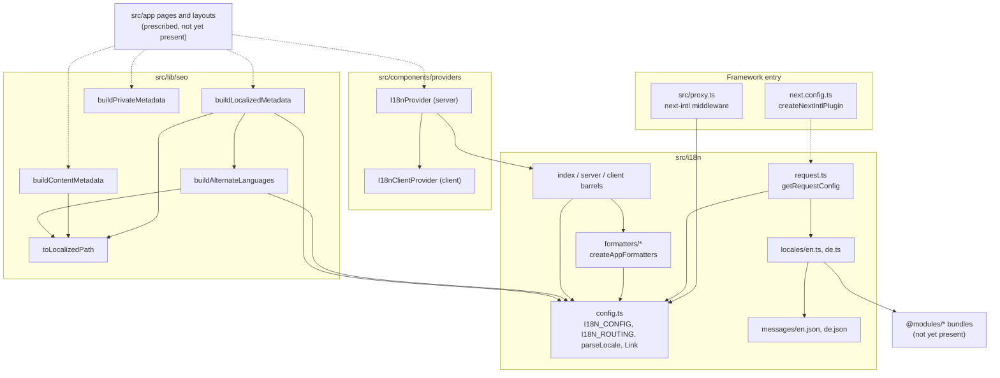
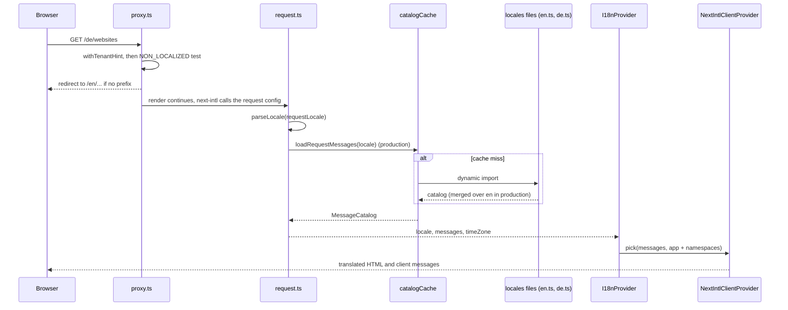

# Internationalization and SEO Metadata

Owning rules: [`i18n.md`](../rules/i18n.md), [`nextjs.md`](../rules/nextjs.md), [`react.md`](../rules/react.md). Procedure: [`adding-a-translation.md`](../conventions/adding-a-translation.md).

`npm run i18n:check` checks locale key/argument parity, component catalog references and the rendered builder client boundary. Catalog parity alone cannot detect a key missing from both languages or a namespace omitted from a client provider. Catalog-reference tests cover descriptor-driven labels, placeholders, options and item fields; the builder regression exercises the real selected-hero media picker in English and German. New cross-module controls need equivalent coverage at their owning client boundary.

`revalidateLocalizedPath` (exported by `@i18n/server`) takes a concrete navigation pathname without a locale prefix and invalidates every locale using the configured `getPathname`. Layout invalidation uses the authored route pattern, including `[locale]` and route groups, directly with Next's `revalidatePath` and the `layout` type. A concrete localized page URL and a filesystem layout pattern are separate cache targets.

> **Implementation status.** Locale plumbing, client providers, metadata helpers and localized App Router shells are implemented. Routes compose module presentation APIs; module catalogs are assembled under `src/i18n/locales`. Sections marked **Prescribed** describe usage conventions and examples.

## 1. Overview

The platform serves every page under an explicit locale prefix (`/en/...`, `/de/...`). This subsystem resolves that locale once per request, loads the matching message catalog, makes translations and locale-aware formatting available to Server and Client Components, and produces route metadata (canonical URL, hreflang alternates, `noindex`) that stays consistent with the routing.

- **Trigger:** an incoming HTTP request for a page, or a page/layout rendering that needs text, a formatted value, a locale-aware link or metadata.
- **Outcome:** the request is redirected or rewritten to a locale-prefixed path, components render in that locale with the request time zone, and search engines receive correct canonical and `hreflang` data.
- **Supported locales:** `en` (default) and `de`, declared once in `I18N_CONFIG` (`src/i18n/config.ts`).

Authentication (`src/app/api/auth`) is documented separately later and is out of scope here.

## 2. Architecture and Layer Responsibilities

| Layer           | Component                                                                | Responsibility                                                                                                                                                                                                                                         |
| --------------- | ------------------------------------------------------------------------ | ------------------------------------------------------------------------------------------------------------------------------------------------------------------------------------------------------------------------------------------------------ |
| Framework entry | `src/proxy.ts`                                                           | Builds the next-intl middleware from `I18N_ROUTING`; skips `/api` and `/trpc`.                                                                                                                                                                         |
| Framework entry | `next.config.ts`                                                         | Wraps the config with `createNextIntlPlugin()` (called without arguments, so next-intl's default request-config location applies).                                                                                                                     |
| Locale plumbing | `src/i18n/config.ts`                                                     | `I18N_CONFIG`, `I18N_ROUTING`, locale parsing (`parseLocale`, `normalizeLocale`, `isLocale`, `requireLocale`), `getMessageFallback`, and the locale-aware `Link`, `redirect`, `usePathname`, `useRouter`, `getPathname` created by `createNavigation`. |
| Locale plumbing | `src/i18n/request.ts`                                                    | `getRequestConfig`: resolves the locale, loads and caches the catalog, wires error handling and the time zone.                                                                                                                                         |
| Messages        | `src/i18n/locales/{en,de}.ts`                                            | Assemble one catalog per locale: the `app` namespace (`src/i18n/messages/{en,de}.json`) plus one namespace per module bundle, unmerged.                                                                                                                |
| Formatting      | `src/i18n/formatters/*`                                                  | `createAppFormatters` binds `@lib/utils` date/number helpers to a locale and time zone; `server.ts` and `client.ts` provide the request-bound variants.                                                                                                |
| Entry barrels   | `src/i18n/index.ts`, `server.ts`, `client.ts`                            | `@i18n` (shared, isomorphic), `@i18n/server` (`server-only`), `@i18n/client` (hooks and provider). Application code must not import `next-intl` directly (ESLint, `eslint/config/restrictions.mjs`).                                                   |
| Presentation    | `src/components/providers/i18n-provider.tsx`, `i18n-client-provider.tsx` | Server wrapper selects locale, messages and time zone; client wrapper renders `NextIntlClientProvider`.                                                                                                                                                |
| Shared lib      | `src/lib/seo/*`                                                          | Pure builders returning Next.js `Metadata`.                                                                                                                                                                                                            |

Ownership: `src/i18n` owns locale truth (supported locales, fallback, formatting). `@lib/seo` depends on `@i18n` for locales, never the reverse. Domain and application code must not import i18n at all except a small set of type-only vocabulary (`eslint/plugins/architecture/rules/boundaries/no-i18n-in-core.mjs`); they return stable error codes (`I18N_ERROR_CODES`, see [error handling](./error-handling.md)) that presentation maps to messages.

## 3. Architecture Diagram

Solid edges are imports verified in code; dotted edges are the plugin's convention-based lookup of `request.ts` and the prescribed page usage.

## 4. Main Workflow

1. **Proxy.** `proxy()` first rewrites the internal `x-civo-tenant` header from the path (tenancy is documented with the [request pipeline](./request-pipeline.md); only the locale interaction matters here: `tenantHintFromPathname` expects `/<locale>/websites/<id>`). Paths starting with `/api` or `/trpc` get `NextResponse.next` and no locale handling. Every other path goes to `handleI18nRouting`.
2. **Routing.** With `localePrefix: 'always'` and `localeDetection` enabled, next-intl redirects an unprefixed path to a locale chosen from the locale cookie or `Accept-Language`, falling back to `en` (this is next-intl's documented behaviour; the repository only configures it). The cookie lives one year with `sameSite: 'lax'`. `alternateLinks: false` disables next-intl's `Link` headers because hreflang is emitted through metadata instead.
3. **Request config.** `request.ts` awaits `requestLocale`, runs `parseLocale(...).unwrapOr(defaultLocale)`, loads messages via `loadRequestMessages`, and returns the locale, messages, time zone `Europe/Berlin`, `onError: handleIntlError` and `getMessageFallback`.
4. **Providers (prescribed wiring).** A layout is meant to validate the URL segment with `requireLocale` (which calls `notFound()` on failure) and pass the result to `I18nProvider` so the provider does not read request headers, which would make everything below dynamic (comment in `i18n-provider.tsx`). The provider picks the `app` namespace plus any requested ones, and `I18nClientProvider` hands them to `NextIntlClientProvider`.
5. **Rendering.** Server Components use `getTranslations`, `getAppFormatters`; Client Components use `useTranslations`, `useAppFormatters`. Navigation uses `Link` from `@i18n` (the only verified caller today is `src/components/brand/app-brand.tsx`).
6. **Metadata.** A page calls one `@lib/seo` builder.

## 5. State and Data Flow

- **Locale** is derived per request from the URL, never stored in application state. The only persisted trace is next-intl's locale cookie.
- **Catalog**: `loadRequestMessages` returns a fresh catalog per call outside production. In production it memoises a `Promise<MessageCatalog>` per locale in the module-level `catalogCache`; a failed load is evicted so the next request retries. Non-default locales are `deepMerge`d over the English catalog in production only, so a missing key falls back to English text instead of a raw key.
- **Type safety**: `MessageCatalog` is `typeof enMessages`. `de.ts` uses `satisfies TranslationSchema<MessageCatalog>`, and `src/types/next-intl.d.ts` augments next-intl's `AppConfig` with `Locale` and `Messages`, so keys are statically checked.
- **Client payload**: `I18nProvider` serialises only `pick(messages, unique(['app', ...namespaces]))` to the browser, never the full catalog (rule: only needed namespaces).
- **Formatting**: `createAppFormatters(locale, timeZone)` delegates to `formatDate`, `formatDateTime`, `formatRelativeTime`, `formatNumber`, `formatPercent`, `formatMoney`, `formatBytes` in `@lib/utils`. The client hook memoises by locale and time zone.
- **Mail**: `src/lib/mail/mail-locale.ts` reuses `getLocale()` and `parseLocale` to pick an email language, falling back to the default outside a request (see [mail](./mail.md)).

## 6. Business Rules and Invariants

- `en` is the schema source and default; every other locale must have identical keys. This is enforced at compile time by `satisfies TranslationSchema<...>` and by the `i18n:check` script (see section 9 for its status).
- Modules own one namespace each; catalogs are assembled without merging namespaces (`locales/*.ts`).
- URLs always carry the locale prefix (`localePrefix: 'always'`); paths passed to `@lib/seo` are locale-free and start with `/`.
- Platform pages use `buildLocalizedMetadata`: canonical is the page's own localized path, `alternates.languages` lists every locale plus lowercase `x-default` (the default locale), and Open Graph gets `locale` and `alternateLocale`.
- Untranslated customer content uses `buildContentMetadata`: one canonical URL in the default locale, no language alternates, absolute title, and the site name as brand.
- Private pages (behind sign-in or single-use links) use `buildPrivateMetadata`: title plus `robots: { index: false, follow: false }` and nothing else. The lint rule `architecture/metadata-conventions` requires every `page.tsx` to export `metadata`/`generateMetadata` built with one of the three builders (or an explicit `robots: { index: false }`) and forbids hand-built `canonical`.
- `toLocalizedPath` strips a trailing slash, so `('de', '/')` yields `/de`.
- Product names (`APP_IDENTITY.name`) are not translated; `buildLocalizedMetadata` uses it as `siteName`.

## 7. Errors and Edge Cases

- **Unknown locale in a route parameter:** `requireLocale` calls `notFound()`. In `request.ts` the same input silently falls back to `en`, so the two paths intentionally differ.
- **Catalog load failure:** logged with code `i18n.messagesLoadFailed` (see [logging](./logging.md)) and rethrown as `Error` with `cause`; in production the cache entry is removed.
- **Missing message or invalid key:** `handleIntlError` logs a warning with `i18n.missingMessage` / `i18n.invalidMessageKey`; other runtime errors are logged at error level. The visible fallback is `namespace.key`, prefixed with a warning sign in development.
- **Client side:** `I18nClientProvider` warns to the console in development only and ignores errors in production.
- **Outside a request:** `getLocale()` throws; only `resolveMailLocale` handles this.
- **`parseLocale` vs `normalizeLocale`:** `parseLocale` is exact (Zod enum); `normalizeLocale` lowercases and accepts `de-DE`/`en_US` by base tag. Both return `AppResult` with a not-found error and code `i18n.unsupportedLocale` (see [error handling](./error-handling.md)). `normalizeLocale`, `isLocale`, `getDirection` and `resolveMessageByCode` have no caller yet.

## 8. Security and Access Control

Locale values from URLs, cookies or headers are untrusted and are validated against a closed enum before use. `server.ts`, `request.ts` and the server provider import `server-only`, so server environment and loaders cannot reach a client bundle. The proxy skips locale handling for `/api` so API routes keep their own contracts. Locale routing grants nothing; authorization is documented separately. The private-metadata builder is a privacy control only for crawlers, not an access control.

## 9. Testing and Verification

| Test                                          | Covers                                                                                                           |
| --------------------------------------------- | ---------------------------------------------------------------------------------------------------------------- |
| `__tests__/src/lib/seo/seo.test.ts`           | `toLocalizedPath`, `buildAlternateLanguages` (including lowercase `x-default`), and all three metadata builders. |
| `__tests__/src/lib/mail/mail-support.test.ts` | `resolveMailLocale`, mocking `@i18n/server`.                                                                     |

Gaps visible from the repository: no tests exist for `src/i18n/*` (config, `loadRequestMessages` cache and fallback merge, `handleIntlError`, formatters) or the providers, and none for `src/proxy.ts`. `package.json` defines `i18n:check` as `vitest run __tests__/architecture/i18n-catalogs.test.ts`, but `__tests__/architecture` does not exist, so that check currently has no target. `vitest.config.ts` requires 100% coverage for `src/lib/**`, which includes `@lib/seo`.

Verification performed when writing this document: `npx vitest run __tests__/src/lib/seo/seo.test.ts` passed together with the pagination and mail tests (3 files, 44 tests).

## 10. Extension Points and Constraints

- **Add a locale:** extend `LOCALES` and `LOCALE_DEFINITIONS` in `src/i18n/config.ts`, add `locales/<locale>.ts` and `messages/<locale>.json`, and register a loader in `LOCALE_LOADERS` (`request.ts`). `scripts/lib/config.ts` keeps its own `LOCALES` list that must match.
- **Add a message:** follow [`adding-a-translation.md`](../conventions/adding-a-translation.md) (`npm run gen -- translation ...`).
- **Add a module namespace:** import the module's `en*`/`de*` bundles in both `locales/*.ts` and add the key to `messages`.
- **New metadata variant:** add a builder in `src/lib/seo`, export it from `index.ts`, and update the allowed names in `metadata-conventions.mjs`.
- **Constraints:** keep `@i18n` free of `@lib/seo` imports (the dependency runs the other way); keep `Link`/`redirect` from `@i18n`, not `next/link`; keep locale-free paths in `@lib/seo`.
- **Related:** [request pipeline](./request-pipeline.md), [configuration](./configuration.md) (`serverEnv`, `APP_IDENTITY`), [error handling](./error-handling.md), [logging](./logging.md), [mail](./mail.md).
