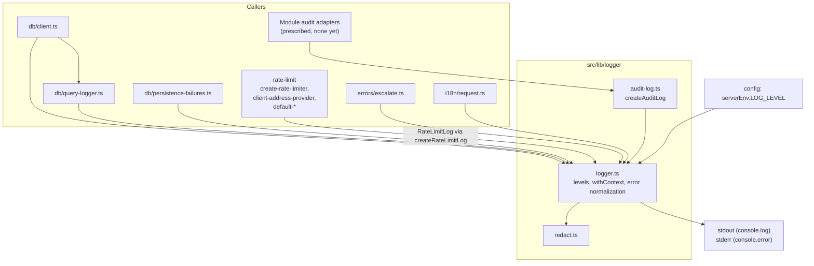
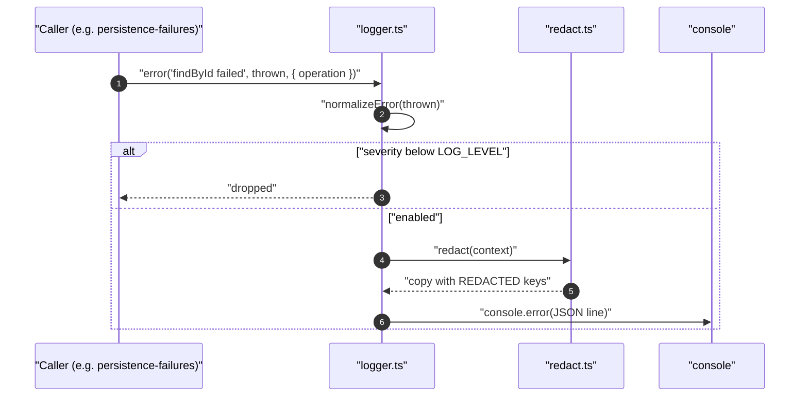

# Logging and Audit

## 1. Overview

`@lib/logger` is the single logging facility of the application. It writes structured, redacted, level-filtered JSON lines, and it is the only code allowed to call `console.*` on the server. The rest of the code depends on its interface, not on a logging vendor, so replacing the sink means editing `src/lib/logger/logger.ts` only. The owning rule is [`observability.md`](../rules/observability.md); credentials handling is in [`security.md`](../rules/security.md).

Callers are infrastructure and boundary code: the database client and its query middleware, persistence failure translators, the rate limiter, the i18n request config, and `escalate`. Domain code does not log. A module that must record business events does it through an audit port whose one implementation is `createAuditLog`.

**Implementation status.** `createAuditLog` is implemented and tested, but nothing in `src/` calls it yet: `src/modules` is empty and the generator template `scripts/templates/infrastructure.ts` is its only prescribed caller. Likewise no code sets `requestId` or `userId` in a log context. `observability.md` links to `../architecture/audit.md`, which does not exist yet.

Authentication logging (`src/app/api/auth` and its environment schema) is documented later.

## 2. Architecture and Layer Responsibilities

| Layer                | Component                                                      | Responsibility                                                                                                                                                                                                                                  |
| -------------------- | -------------------------------------------------------------- | ----------------------------------------------------------------------------------------------------------------------------------------------------------------------------------------------------------------------------------------------- |
| lib                  | `src/lib/logger/logger.ts`                                     | `logger.debug/info/warn(message, context?)`, `logger.error(message, error, context?)`, `logger.withContext(base)`. Server-only (`import 'server-only'`). Reads `serverEnv.LOG_LEVEL` once when the module loads. Emits one JSON line per entry. |
| lib                  | `src/lib/logger/redact.ts`                                     | `redact(value)`: a serializable copy with credential-like keys replaced.                                                                                                                                                                        |
| lib                  | `src/lib/logger/audit-log.ts`                                  | `createAuditLog(module, levels)`, `AuditRecorder`, `auditLevelOf`.                                                                                                                                                                              |
| lib                  | `src/lib/config`                                               | Supplies `LOG_LEVEL` (`debug`, `info`, `warn`, `error`; default `info`). See [`configuration.md`](configuration.md).                                                                                                                            |
| infrastructure (lib) | `src/lib/db/query-logger.ts`                                   | Prisma SQL middleware that logs each query through a `module: 'infrastructure.prisma'` logger. Registered by `src/lib/db/client.ts`.                                                                                                            |
| infrastructure (lib) | `src/lib/db/client.ts`                                         | Logs a dropped idle pool connection (`db.pool.idle_connection_failed`, warn) and a failed shutdown (`db.disconnect_failed`, error, then rethrows).                                                                                              |
| infrastructure (lib) | `src/lib/db/persistence-failures.ts`                           | Logs each non-conflict, non-miss repository failure once at error level. See [`persistence.md`](persistence.md).                                                                                                                                |
| lib                  | `src/lib/rate-limit/rate-limit-logger.ts`, `rate-limit-log.ts` | `createRateLimitLog` adapts the logger to the limiter's narrow `RateLimitLog` interface under `module: 'rate-limit'`; `createLogThrottle` bounds how often an event is written. See [`rate-limiting.md`](rate-limiting.md).                     |
| lib                  | `src/lib/errors/escalate.ts`                                   | Logs `route.failed` once before throwing to an `error.tsx` boundary. See [`error-handling.md`](error-handling.md).                                                                                                                              |
| i18n                 | `src/i18n/request.ts`                                          | Logs a failed locale catalog load, missing translations and invalid keys under `module: 'i18n'`.                                                                                                                                                |

Dependency direction: every caller imports from `@lib/logger`; the logger imports only `@lib/config/server` and `@lib/utils` (`isPlainObject`, used by `redact`). `rate-limit-log.ts` has no logger import of its own; it defines the interface and `rate-limit-logger.ts` binds it.

## 3. Architecture Diagram

## 4. Main Workflow

1. A caller invokes a level method, usually on a bound logger from `logger.withContext({ module })`. `bind` merges the base context under the call's own context, so call-site keys win.
2. `write` drops the entry if its severity (`debug` 10, `info` 20, `warn` 30, `error` 40) is below the minimum set by `LOG_LEVEL`. Dropping happens before any formatting, so callers log at `debug` unconditionally.
3. `serialize` runs `redact` on the context and `JSON.stringify`s `{ level, message, timestamp, context, error? }`. If serialization throws, the line is written with `context: '[Unserializable]'`.
4. `error` entries go to `console.error`; all others to `console.log`.
5. For `logger.error(message, error, context)`, `normalizeError` produces `{ name, message, stack? }`: an `Error` keeps its stack; an `AppError` is named by `kind` (as `name`) and `code` (as `message`), with the stack of an `Error` cause when there is one; anything else becomes `UnknownError` with a safe string form.

**Audit path.** `createAuditLog(module, levels)` creates `logger.withContext({ module })` once. `record(event)` splits `type` from the remaining fields and calls `auditLogger[level](type, details)`. The level is `levels[event.type]`, raised to `warn` when the event carries a non-empty string `errorCode`. The call is wrapped in `try/catch` and swallows any failure, because auditing must not fail the request it describes. Modules own their event types and levels; this function owns the mechanism.

**Database path.** `queryLogger()` implements the Prisma `SqlMiddleware` hooks `afterQuery` and `afterExecute`. Each logs `db.query` or `db.execute` at `debug` with `sql`, row or affected-row count, rounded `latencyMs`, `completed` and `source`. When `completed` is false it also logs `db.query.failed` or `db.execute.failed` at `warn`.

**Rate-limit path.** Limiter events (`rate_limit.rejected` info, `rate_limit.failed_open` and `rate_limit.client_unresolved` warn, `rate_limit.backend_failed`, `rate_limit.invalid_request` and `rate_limit.unexpected_failure` error, `rate_limit.disabled` info, `rate_limit.unavailable` error) pass through `createLogThrottle(clock, 10_000)`: the first event per key is written, later ones within the interval are counted, and the next written line carries `suppressed`. The tracker holds at most 512 keys and clears itself when full.

## 5. State and Data Flow

- **Process-level state.** The minimum severity is a module constant. The throttle's `Map` is per limiter or resolver instance. The logger itself holds no buffer.
- **Context** is plain data flowing one way: caller, then `redact`, then JSON. `LogContext` has optional `requestId`, `userId`, `module` and arbitrary keys.
- **Redaction.** `redact` returns a copy. A key is replaced by `[REDACTED]` when it contains `password`, `passwd`, `passphrase`, `token`, `secret`, `api-key` (also `api_key`, `apikey`), `private-key`, `authorization`, `cookie`, `credit-card` or `cvv`, in any case and at any depth. Cycles (an object that is its own ancestor) become `[Circular]`; nesting at depth 8 or more becomes `[Truncated]`; a `bigint` is written as text; a `Date` as ISO text (`Invalid Date` if invalid); class instances and other non-plain objects as `String(value)` without recursion.
- **Not redacted.** Redaction matches key names in the context, not values. The `error` field (`name`, `message`, `stack`) is not passed through `redact`, so error messages must not contain secrets or personal data.

## 6. Business Rules and Invariants

Implemented behavior:

- A log call never throws: serialization failures, unprintable values and audit failures are contained.
- The configured level is a minimum; entries below it are discarded before the sink.
- `console.*` is used only in `logger.ts` (ESLint disables `no-console` for that file). One development-only exception exists in a client component: `warnInDevelopment` in `src/components/providers/i18n-client-provider.tsx` calls `console.warn`, since the logger is server-only.
- Rate-limit log contexts are typed (`RateLimitLogContext`: `policy`, `reason`, `suppressed`) to carry only safe identifiers. Keys, addresses and user ids are never logged there.
- The query logger records `plan.sql` (parameterized text) and metadata, never bound parameter values.
- Persistence logs record the SQLSTATE, constraint and table, never the database `detail`.

Prescribed by rules: log at application and infrastructure boundaries, never in domain code; use `error` for unexpected failures, `warn` for recoverable anomalies, `info` for significant events, `debug` for diagnostics; log an unexpected error once, where it is handled; include request or correlation ids when available (not yet wired); audit entries carry ids, counts and codes only.

## 7. Errors and Edge Cases

- **Unserializable context.** Only the context is replaced with `'[Unserializable]'`; the entry is still written.
- **Weird thrown values.** `Object.create(null)` and other non-convertible values log as `UnknownError` / `[unprintable value]` instead of raising.
- **Audit failure.** `record` swallows the exception; no fallback line is written.
- **Log floods.** The rate limiter's throttle exists because a line per rejected request would be a denial of service of its own. Query logging has no throttle: at `LOG_LEVEL=debug` every query is a line.
- **Level choice for queries.** Failed queries warn independently of the `debug` line, so `LOG_LEVEL=warn` still surfaces them.
- **Wiring-level rate-limit events** (`rate_limit.disabled`, `rate_limit.unavailable`, the misconfigured-address error in `default-client-address-provider.ts`) are written directly rather than through the throttle.

## 8. Security and Access Control

Logs are a trust boundary: whatever enters a context may be stored and read by operators. Key-based redaction is a safety net, not a replacement for not logging secrets. The over-broad pattern is deliberate: a harmless key may lose its value, but a credential must not leak. Contexts that include user data should list ids and codes only. The `error.message` caveat in section 5 applies, notably to driver errors, which is why persistence logging extracts named diagnostic fields. Auth-related logging is documented later.

## 9. Testing and Verification

Under `__tests__/src/lib/`:

| Area                                                                                                        | File                                                                     |
| ----------------------------------------------------------------------------------------------------------- | ------------------------------------------------------------------------ |
| Logger output, `withContext`, redaction, cycles, depth, `bigint`, unserializable context, `AppError` naming | `logger/logger.test.ts`                                                  |
| `LOG_LEVEL` filtering                                                                                       | `logger/logger-level.test.ts`                                            |
| Audit level selection, error-code escalation to `warn`, never throws                                        | `logger/audit-log.test.ts`                                               |
| Query middleware: debug and warn lines, no bound parameters                                                 | `db/query-logger.test.ts`                                                |
| Pool and disconnect logging (needs the generated `src/lib/db/contract.json`, absent in this checkout)       | `db/client.test.ts`                                                      |
| Persistence failure logging                                                                                 | `db/persistence-failures.test.ts`                                        |
| `escalate` logs once and throws                                                                             | `errors/escalate.test.ts`                                                |
| Throttle and `createRateLimitLog`                                                                           | `rate-limit/rate-limit-log.test.ts`, `rate-limit/default-wiring.test.ts` |

Gaps: there is no test for the i18n logging in `src/i18n/request.ts`, and nothing tests that `redact` leaves the `error` field untouched. `requestId` propagation has no tests because nothing sets it.

## 10. Extension Points and Constraints

- **Change the sink or format.** Edit `logger.ts` only; keep the interface, the never-throw guarantee and server-only status.
- **New sensitive key.** Extend `REDACTED_KEY_PATTERN` in `redact.ts` and add a case to `logger.test.ts`.
- **New module audit.** Define the event union and a `levels` record for it (use `as const satisfies Record<Event['type'], 'info' | 'warn'>`, as the template does), then `createAuditLog('<module>.audit', levels)`. Document the events in `docs/architecture/audit.md` once it exists.
- **New logging caller.** Use `logger.withContext({ module })`, pass context objects, and log at a boundary rather than in domain code. For high-frequency events follow the rate limiter's throttle pattern.
- **Constraints.** Client Components cannot import `@lib/logger`. Keep `@lib/logger` free of imports from modules. Related: [`error-handling.md`](error-handling.md), [`rate-limiting.md`](rate-limiting.md), [`persistence.md`](persistence.md), [`request-pipeline.md`](request-pipeline.md).
