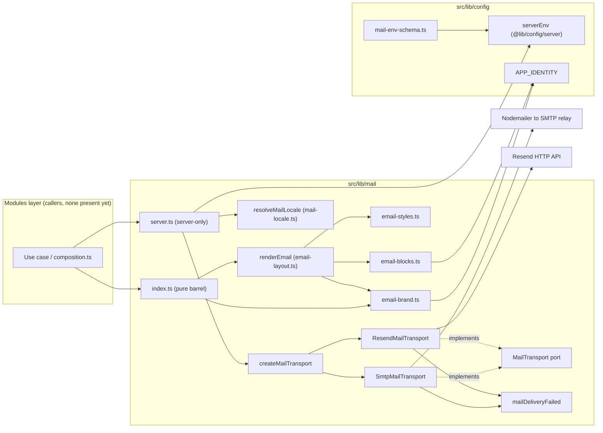
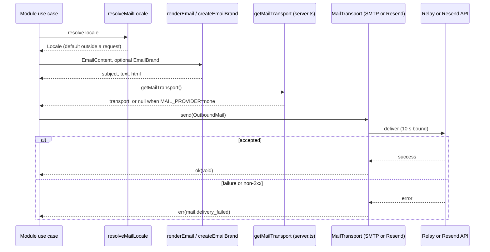

# Outgoing Mail (`@lib/mail`)

## 1. Overview

`@lib/mail` is the shared infrastructure for sending transactional e-mail. It solves two problems once, for every module that sends mail:

- **Delivery.** A `MailTransport` port with two adapters (SMTP through Nodemailer, and Resend over HTTP), chosen from `MAIL_*` environment variables, with one bounded send time and one delivery error.
- **Look.** `renderEmail` turns a small `EmailContent` object into a plain-text body and an inline-styled HTML body, drawn with an `EmailBrand` (the platform's look, or a website's).

Modules keep their own wording, subjects and recipients; they share only the layout and the way a message leaves the process. The trigger is always a module's use case that decides a message must be sent. Its expected outcome is a `Result` that is either `ok` or the single `mail.delivery_failed` infrastructure error.

Current state: the `src/modules` directory is empty in this repository, so there is **no production caller yet**. The only importer outside `src/lib/mail` is a test (`__tests__/src/lib/design-tokens.test.ts`, which pins `PLATFORM_EMAIL_BRAND` to the design tokens). The usage pattern below is the one described in [`src/lib/README.md`](../../src/lib/README.md). Sign-in mail is sent by the authentication module, which is documented separately later.

## 2. Architecture and Layer Responsibilities

Everything lives in the shared library layer (`src/lib`, alias `@lib`), which is generic and never imports a module (see [`docs/rules/boundaries.md`](../rules/boundaries.md) and [`docs/rules/shared.md`](../rules/shared.md)). The barrel `@lib/mail` is browser-safe and pure; the server-only entry is `@lib/mail/server`.

| Concern         | Path                                                                      | Responsibility                                                                                                                                                                                                                   |
| --------------- | ------------------------------------------------------------------------- | -------------------------------------------------------------------------------------------------------------------------------------------------------------------------------------------------------------------------------- |
| Public contract | `src/lib/mail/index.ts`                                                   | Exports `renderEmail`, `createEmailBrand`, `PLATFORM_EMAIL_BRAND`, `MailTransport`, `OutboundMail`, `MailAttachment`, `mailDeliveryFailed`, `MAIL_DELIVERY_FAILED` and content types. Does not export transports or the factory. |
| Server entry    | `src/lib/mail/server.ts`                                                  | `import 'server-only'`. `getMailTransport` (lazy singleton via `once`, reads `serverEnv`) and `resolveMailLocale`.                                                                                                               |
| Port            | `src/lib/mail/mail-transport.ts`                                          | `MailTransport.send(mail): AppResultAsync<void, InfrastructureAppError>`, `OutboundMail`, `MailAttachment`, and `MAIL_SEND_TIMEOUT_MS` (10 s).                                                                                   |
| Factory         | `src/lib/mail/create-mail-transport.ts`                                   | `createMailTransport(env: MailEnv)`: `null` for `none`, otherwise the adapter; `invariant` calls narrow types and `assertNever` rejects unknown providers.                                                                       |
| Adapters        | `smtp-mail-transport.ts`, `resend-mail-transport.ts`                      | Provider-specific delivery; map every failure to `mailDeliveryFailed`.                                                                                                                                                           |
| Error           | `mail-errors.ts`                                                          | `MAIL_DELIVERY_FAILED = 'mail.delivery_failed'` and `mailDeliveryFailed(cause)`.                                                                                                                                                 |
| Locale          | `mail-locale.ts`                                                          | `resolveMailLocale()` reads the request locale from next-intl, defaulting to `I18N_CONFIG.defaultLocale`.                                                                                                                        |
| Rendering       | `email-layout.ts`, `email-blocks.ts`, `email-styles.ts`, `email-brand.ts` | Layout assembly, HTML fragments, inline CSS, and brand resolution (details below).                                                                                                                                               |
| Configuration   | `src/lib/config/mail-env-schema.ts`                                       | Zod schema, `MailEnv` type and cross-variable rules; composed into `serverEnvSchema`.                                                                                                                                            |

Rendering is split by ownership. `email-brand.ts` is the only place a brand is built and the only place stored theme tokens are interpreted; `email-styles.ts` holds all CSS; `email-blocks.ts` holds the HTML fragments (preheader, logo, facts table, action, footer, localized strings); `email-layout.ts` assembles the document and the text body.

## 3. Architecture Diagram

Dependency direction is one way: callers depend on the barrel and the server entry; the factory is the only code that knows both adapters; adapters know the port and the error, never the layout.

## 4. Main Workflow

Intended send path (the lib-level pieces are verified by tests; the caller is hypothetical until a module exists):

1. The use case obtains the locale with `resolveMailLocale()`. Outside a request, or for an unsupported locale, it resolves to the default.
2. It builds an `EmailContent` (`locale`, `title`, optional `subject`, `greeting`, `facts`, `action`, `intro`, `outro`) in plain text.
3. It picks a brand: omitted for the platform look, or `createEmailBrand(theme)` for a website.
4. `renderEmail(content, brand)` validates the action URL, resolves `emailStyles(brand)`, and returns `{ subject, text, html }`.
5. The use case wraps this with the recipient into an `OutboundMail` (plus optional `MailAttachment`s) and calls `getMailTransport()`. A `null` result means `MAIL_PROVIDER=none`; the caller decides whether to fail or skip.
6. `transport.send(mail)` delivers it, returning `AppResultAsync<void, InfrastructureAppError>`.

`getMailTransport` is built on first call with `once`, so importing it needs no mail configuration at build time, and a throwing build is retried rather than cached (`src/lib/utils/function.ts`).

## 5. State and Data Flow

- **Configuration** is the only long-lived state: `MailEnv` is validated once by `serverEnvSchema` and consumed by `createMailTransport`. The transport instance is a process-wide singleton.
- **Content to message.** `EmailContent` (plain text) is the only input to rendering. Output is `RenderedEmail` (`subject`, `text`, `html`), which a caller combines with `to` into `OutboundMail`. No persistence, queue, or retry exists in this layer; a failed send is reported, not repeated.
- **Brand resolution.** `EmailBrand` holds literal values (hex colours, lengths, font stacks) because mail clients ignore CSS variables and `color-mix()`. `PLATFORM_EMAIL_BRAND` is built from `APP_IDENTITY`. `createEmailBrand` takes `EmailThemeInput` and looks each token (`radius`, `spacingScale`, `headingFont`, `bodyFont`) up in closed `Map`s; an unknown token yields the platform's choice. A primary colour is parsed with `parseHexColor`; text and link colours are derived with `readableForeground` and `readableCopy`.
- **Attachments** are text. SMTP passes them to Nodemailer as is; Resend receives them base64-encoded with `content_type`.
- **Locale** only selects copy owned by this layer (the link hint and the "Provided with" credit, German and English, German as fallback via own-key lookup) and the `lang` attribute.

## 6. Business Rules and Invariants

Confirmed in code:

- **Provider selection** (`mail-env-schema.ts`, `env-schema.ts`): `MAIL_PROVIDER` is `none` (default), `smtp` or `resend`. Any provider other than `none` requires `MAIL_FROM`. `resend` requires `MAIL_API_KEY`; `smtp` requires `MAIL_SMTP_HOST`; `MAIL_SMTP_USER` and `MAIL_SMTP_PASSWORD` must be set together. Settings that belong to an unselected provider are an error, not ignored.
- **Production rules** (`productionRules` in `env-schema.ts`): `MAIL_PROVIDER=none` is refused; `resend` is refused outside production; `MAIL_API_URL` must be `https` when `resend` is used in production.
- **Defaults:** SMTP port `1025` (Mailpit), `MAIL_SMTP_SECURE=false`, `MAIL_API_URL=https://api.resend.com/emails`.
- **Every send is bounded** to `MAIL_SEND_TIMEOUT_MS` (10 000 ms): SMTP applies it to connection, greeting and socket; Resend uses `AbortSignal.timeout`.
- **No credentials in the clear.** `SmtpMailTransport` sets `requireTLS` whenever it has both user and password, so a relay without STARTTLS is refused (unless `MAIL_SMTP_SECURE=true` already uses TLS). A local catcher without credentials is not forced to TLS.
- **Rendering safety.** Every dynamic value in HTML goes through `escapeHtml`; callers pass plain text. `renderEmail` calls `invariant(isValidUrl(action.url))`, so a non-`http(s)` action address throws. The display-only preheader is limited to 110 Unicode graphemes, including an ellipsis when shortened; the complete message remains unchanged. Brand values reach `style` attributes only through closed lookup tables.
- **Layout contract:** semantic `div`s with inline CSS, no layout tables, one column of at most 560 px; the facts list is the only table. Platform mail shows the logo (hosted PNG at `${NEXT_PUBLIC_APP_URL}/email/artemis-connect.png`); website mail shows only a credit line, in both text and HTML.

## 7. Errors and Edge Cases

- **One error.** All delivery failures become `mailDeliveryFailed(cause)`: an `InfrastructureAppError` with code `mail.delivery_failed` and a user-safe message. Modules that surface it map it to their own code and keep this one as the cause (per `src/lib/README.md`; the auth case is documented later). See [error-handling.md](./error-handling.md).
- **SMTP:** `describeFailure` replaces Nodemailer's error with `SMTP delivery failed` plus only the `code`, `responseCode` and `command` fields, because Nodemailer's message quotes the recipient and server reply. A thrown non-object yields the bare prefix.
- **Resend:** a non-2xx response gives `{ status }` as the cause; the body is never copied. A network failure or timeout passes the thrown value as the cause; the API key is only in the request header (a test asserts it is not in the error).
- **No provider:** `getMailTransport()` returns `null`; the layer does not decide whether this is fatal. Production configuration prevents it.
- **No request context:** `resolveMailLocale` catches the throw from next-intl's `getLocale` and returns the default locale (cron, background work).
- **Unsupported locale at render time:** copy falls back to German; keys such as `constructor` or `__proto__` are not treated as languages.
- **Invalid action URL:** `renderEmail` throws (a programming error, not an expected failure).
- Logging of failures is the caller's responsibility; this layer never logs and warns that `OutboundMail` may contain single-use links and must not be logged. See [logging.md](./logging.md).

## 8. Security and Access Control

- **Secrets:** `MAIL_API_KEY`, `MAIL_SMTP_USER` and `MAIL_SMTP_PASSWORD` exist only in `serverEnv`; `@lib/mail/server` is `server-only`, so a Client Component importing it fails the build. Configuration rules are in [configuration.md](./configuration.md).
- **Transport security:** STARTTLS or TLS enforced with credentials (SMTP); `https` enforced for the Resend URL in production because it carries a bearer key.
- **Injection:** HTML escaping, closed style tables, and `#rrggbb`-only colours keep stored website theme values out of markup and CSS.
- **Privacy:** error causes carry codes and statuses, never recipients or provider replies.
- Authorization (who may be mailed, and about what) is not a concern of this layer; callers decide.

## 9. Testing and Verification

Tests live under `__tests__/src/lib/mail/`:

| File                            | Covers                                                                                                                       |
| ------------------------------- | ---------------------------------------------------------------------------------------------------------------------------- |
| `mail.test.ts`                  | `createMailTransport` for `none`, SMTP, Resend; Resend base64 attachments.                                                   |
| `mail-support.test.ts`          | `mailDeliveryFailed`, factory invariants and unknown provider, `resolveMailLocale` fallbacks, `getMailTransport` built once. |
| `smtp-mail-transport.test.ts`   | Timeouts, STARTTLS rule, secure flag, auth only with both fields, attachments, error codes only.                             |
| `resend-mail-transport.test.ts` | JSON request with bearer key, status-only failure, request failure, key never in an error.                                   |
| `email-layout.test.ts`          | Escaping, markup constraints, preheader, action, facts, locale handling, brand in markup.                                    |
| `email-brand.test.ts`           | Platform brand, colour derivation, token tables, fallbacks.                                                                  |

Configuration is covered by `__tests__/src/lib/config/env.test.ts` (the `serverEnvSchema: mail` suite and production rules). `design-tokens.test.ts` pins the brand to the design tokens.

Execution on this documentation pass: the mail test files were run with `npx vitest run`. `mail.test.ts`, `mail-support.test.ts`, both transport tests, `email-layout.test.ts` and `env.test.ts` **passed**. `email-brand.test.ts` **failed to load**: it imports `@modules/website/...`, which does not exist because `src/modules` is empty. Its assertions, and the brand part of `design-tokens.test.ts`, are therefore unverified here. There is no end-to-end test against Mailpit.

## 10. Extension Points and Constraints

- **New provider:** add a class implementing `MailTransport` (apply `MAIL_SEND_TIMEOUT_MS`, return `mailDeliveryFailed` with a cause free of recipients and secrets), add a case in `createMailTransport`, extend the `MAIL_PROVIDER` enum and rules in `mail-env-schema.ts` (and the production rules if needed), and add tests. Follow [`docs/conventions/adding-an-environment-variable.md`](../conventions/adding-an-environment-variable.md).
- **New content element:** add the fragment in `email-blocks.ts`, its CSS in `email-styles.ts`, and wire it in `email-layout.ts`. Do not put colours or fonts outside `email-brand.ts`.
- **New theme token:** extend the `Map`s in `email-brand.ts`; the test walks the website's token lists against them.
- **New language:** add a key to the `Localized` records in `email-blocks.ts`; German must remain.
- **Constraints:** `@lib/mail` must not import a module; keep the barrel free of server-only code; keep a single error code; do not add an SDK where `fetch` suffices (`docs/rules/dependencies.md`). Retries, queuing and recipient-level authorization are deliberately absent.
- Related: [configuration.md](./configuration.md), [error-handling.md](./error-handling.md), [logging.md](./logging.md), [i18n-and-seo.md](./i18n-and-seo.md), [storage.md](./storage.md).
