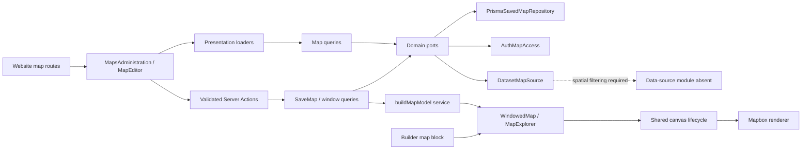
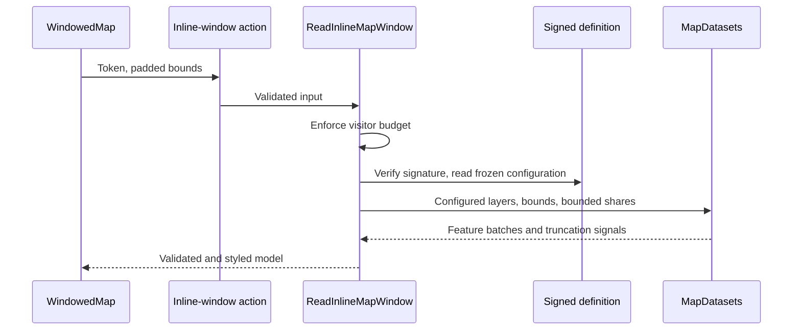

# Maps

## 1. Overview

Map owns reusable geographic visualizations for one website: their saved configuration, management screens, feature validation, visual encoding, and browser interaction. Editors can create separate maps for buildings, facilities, or measurements, select geographic datasets, and inspect a preview before saving. Builder's map component can reference a saved map or retain its existing inline configuration.

**Spatial windows:** `DatasetMapSource` asks data-sources for the window's area, widened to a 0.01° grid. A source with a spatial filter in its settings sends only that area (the map still checks it). For a source without one, the map reads as many records as one read can page (`READ_WINDOW_LIMITS.maxLimit`) only after the first read shows the area was not applied, keeps the records that touch the window and applies the limit afterwards; a larger dataset is flagged truncated. Whether an API can filter by area differs per API, so it is set up per source (see data-sources); `TODO.md` no longer lists it as open.

## 2. Architecture and layer responsibilities

The module follows the same domain, application, infrastructure, presentation, and lazy composition structure as [auth](./auth-access.md), [audit](./audit.md), and [website](./website.md).

| Layer          | Main files                                                                                                    | Responsibility                                                                                                                                                    |
| -------------- | ------------------------------------------------------------------------------------------------------------- | ----------------------------------------------------------------------------------------------------------------------------------------------------------------- |
| Domain         | [`saved-map.ts`](../../src/modules/map/domain/models/saved-map.ts), `geo/`, `features/`, `filters/`, `style/` | Configuration invariants, geometry validation, attribute profiling, filters, and visual encoding.                                                                 |
| Ports          | [`domain/ports/`](../../src/modules/map/domain/ports)                                                         | Website access, saved-map persistence, dataset windows, signed inline configurations, and audit events (including dropped features).                              |
| Application    | [`application/`](../../src/modules/map/application)                                                           | Authorized reads, saves and guarded deletes, signed published windows, protected previews, bounded dataset references, model assembly, limits, and rate policies. |
| Infrastructure | [`infrastructure/`](../../src/modules/map/infrastructure)                                                     | Auth delegation, Prisma storage, dataset adaptation and record normalization, and audit/log adapters.                                                             |
| Presentation   | [`presentation/`](../../src/modules/map/presentation)                                                         | Zod schemas, Server Actions, DTOs, loaders, map management, preview forms, renderer integration, and translated states.                                           |
| Composition    | [`composition.ts`](../../src/modules/map/composition.ts)                                                      | Lazily wires ports to auth, audit, data sources, persistence, clocks, and rate limiting.                                                                          |

The presentation components are grouped by the part of the screen they draw: [`components/canvas/`](../../src/modules/map/presentation/components/canvas) (the Mapbox host and the windowed map), `editor/` (the form and its preview), `explorer/` (legend, filters, feature list and details), `management/` (the list, the picker, the delete button) and `shared/` (the server sections that choose how a map is bound, and `MapsAdminPage`, the screens' frame).

The protected routes are `/websites/[websiteId]/maps`, `/maps/new`, and `/maps/[mapId]`. They mount `MapsAdministration` or `MapEditor`; loaders own the screen's data pipeline. Both screens share `MapsAdminPage`, the same heading, breadcrumb and unsaved-work frame as the data-source screens. The editor is the shared `Wizard` driven by `useWizardSteps`; the step lives in the address (`?step=`) and is read by the route.

The list shows a two-step onboarding checklist (create a map, place it) until a page places a map; its progress is computed from what exists, and only the open step has a button: "create", or "place", which opens the first map block still waiting for a map (`?select=<nodeId>` in the page editor) or the page list when there is none. Each row lists the components placing the map (each opening the editor with it selected) and the live pages, and carries "Open" and "Delete". A saved map no page places shows the shared `ReadyForUseNotice` above its form with the same target, the way data-source screens do; after the first save of a new map the editor lands there (`?created=1` keeps the "saved" message). Deleting uses the shared `DeleteWhenUnusedDialog`: while components or live pages still place the map it lists them instead of deleting, and a refusal from the server re-reads the screen.

The builder answers "which components place which map, and which map blocks still wait for one" (`listMapUsage`), the release answers which live pages place it (`listLiveMapUsage`); the map module cannot import them without a cycle, so [`map-screen.ts`](<../../src/app/[locale]/(protected)/websites/[websiteId]/maps/map-screen.ts>) hands those readers, the component labels, the builder links and release's guarded delete to the routes. Usage is shown only when both drafts and the live release could be read completely; otherwise it is "unknown" and the server check still decides. Management uses the existing `DataPanel`, `ResponsiveTable`, pagination (`MAP_LIST_LIMITS`), form controls, and unsaved-changes provider. Screen placeholders are built from `admin-skeletons` in `src/components/skeletons/`.

A map holds its own locations (a town hall, a library), dataset layers, or both; neither is required on its own. A location is added by finding its address through the shared `useAddressSearch`, the same search booking locations use: the pick becomes a new location named after the place, its coordinates are shown read-only, and the start area fits all locations. Only when no Mapbox token is configured (no address search) are coordinates typed in. A location can carry an optional description and link (`SavedMapLocation.description` and `href`, stored in the settings JSON, an empty text meaning none): they are what "show details" and "open link" use for it, as a dataset's points use its mapped description and link fields. What selecting a point shows is not chosen in a dropdown: the editor only decides whether details are shown at all (and a legend); the content comes from the description and link of a location or the fields of a dataset, and the details panel offers the link. Leaving the editor without saving discards its unsaved changes and the moved camera (the page stays mounted while hidden, and hiding runs the reset). The explorer lays the filters and legend beside the map only when there are any; otherwise the map takes the whole width. The appearance step offers only point styles that fit the content (a handful of own locations are markers or groups; circles and a heatmap need data), and keeps colour and size attributes, the density limit, filters and legend under "More options" for connected data only; the colour and size choices are the attributes the preview found, never typed names. The start area is never typed either: it follows the locations, or takes the preview's visible area.

The generic browser host is [`shared/map-canvas.tsx`](../../src/components/shared/map-canvas.tsx), backed by [`use-map-renderer.ts`](../../src/hooks/use-map-renderer.ts). It owns host creation, cleanup, loading state, and resizing without importing a business module. Until the first tiles are drawn a placeholder covers the host: a still of the starting view, requested from Mapbox's Static Images API ([`mapbox-static-image.ts`](../../src/modules/map/presentation/mapbox/mapbox-static-image.ts)) in the configured style, framed on the same bounds and padding as the live map and blurred under a frosted cover. The picture fades in when it has loaded and is dropped if it cannot load or the style is not a `mapbox://` one, which leaves the plain frosted cover; it uses the public token the map already ships to the browser. The cover it stays mounted and only fades its `opacity` (`will-change: opacity`, a CSS transition, none under reduced motion), so the fade runs on the compositor and tiles never pop in over a half-painted frame. Map-specific hooks translate models and interaction into renderer calls. Mapbox GL JS is loaded dynamically and stays behind `MapRenderer`.

## 3. Architecture diagram

Builder reaches both saved and inline map flows through the server-side `MapSection` supplied by component platform's composition root. Browser consumers use `map/client.ts`, including the saved-map picker. Infrastructure and other module internals are not part of the public API.

## 4. Main workflow

**Configure and save.** The editor loader reads the existing configuration and compatible dataset choices for the explicit website. The form keeps edits locally; the preview beside it is live (`useMapPreview`): about 700 ms after the last change whose settings pass the schema it draws the unsaved draft through `PreviewMapWindow` (one read of the 120-per-minute budget per draw; name and description changes draw nothing). The last good picture stays while the next one loads, preview loading has its own state and never locks the form, and a new model replaces the shown one without rebuilding Mapbox unless the start area changed. Before any valid draft an outlined placeholder of the map's height holds the space. Saving validates external input, authorizes `page.update`, checks any additional publication authority, spends an actor budget, validates the selected datasets against the website, and creates or conditionally updates the stored row. A successful write emits `map.created` or `map.updated`; a refused write emits no success event.

**Render and move a saved map.** A saved map is staged content, like a page draft. In the editor, `SavedMapSection` reads the draft through the protected query and moves it with `PreviewMapWindow` (authorized `page.read`). A published page never reads the stored row: the release froze it (see below) and the page draws that copy through the signed inline binding, so editing a map cannot change a live page before the next publish. The initial model uses the configured starting bounds. Mapbox reports viewport changes, and `useMapWindow` waits 250 ms after the latest movement before requesting a new batch with 15% padding on each side. Padding is clipped at world edges.

**Publish and delete.** A release freezes every saved map (`ReleaseSnapshot.maps`, schema version 2) next to the pages. `describeDraftChanges` compares them with the live release, so additions, edits and removals appear with badges in the publish dialog. The public renderer receives the frozen copies through `RenderContext.publishedMaps`, restored with `restorePublishedMaps`: a map that is private or no longer valid is left out and its block shows as unavailable. Rolling back restores the maps exactly as they were live. Deleting a map goes through release's `DeleteUnusedMap`, which refuses while a draft page or the live release still places it; the map module authorizes and records `map.deleted` itself.

**Render and move an inline map.** Component platform's [`loadMapBlock`](../../src/modules/component-platform/presentation/components/smartcity/map/load-map-block.ts) sends bound inline settings to `InlineMapSection` without preloading whole datasets. That Server Component signs the rendering website, mode, bindings, and bounded settings, then loads the initial area through `ReadInlineMapWindow`. Subsequent requests use `readInlineMapWindowAction` with the signed token and new bounds. An unbound draft still uses labelled sample content; an unbound published map remains empty.

Saved-map queries choose bindings and budgets from stored configuration; inline queries recover them from the verified server-issued token. The public browser selects an area, not arbitrary datasets or rendering settings. Both use the same window loader and browser debounce/padding behavior. The adapter must apply spatial selection before `offset` and `limit`; filtering an arbitrary first page afterwards would miss locations inside the requested area.

## 5. State and data flow

[`SavedMap`](../../prisma/schema/maps.prisma) stores name, description, JSON settings, website id, version, and timestamps. Feature data remains in datasets. Settings include layer labels, point display, color/size attributes, interaction, height, filter/legend visibility, starting bounds, a feature budget, and explicit public visibility.

The browser retains one current model rather than accumulating all previously visited areas. A new movement invalidates older requests immediately, including responses arriving during the next debounce. Failed refreshes retain the previous model and offer retry; successful empty results replace it. A windowed map keeps its canvas when the area has no features so visitors can continue moving. Replacing records does not refit the camera; selecting a location from the text alternative can explicitly request focus.

Filters, selection, and the text alternative operate over the loaded batch. Source normalization bounds primitive attributes, preserves defined canonical values, converts valid `Date` instants to ISO text, and strips description markup. Domain preparation validates geometry, profiles fields, drops invalid features, and records issues. Truncation and rejected records are separate signals shown through translated status messages.

## 6. Business rules and invariants

- A website may have at most 100 saved maps; each configuration has at most eight distinct dataset layers.
- A configured feature budget defaults to 500 and is capped at 1,000 across the whole map. Each layer receives a bounded share. `BuildMapModel` also bounds host-provided layers and features before profiling or serialization.
- Coordinates use `[west, south, east, north]`; values must be finite and ordered within valid longitude/latitude ranges.
- Creating a map takes a website-specific transaction advisory lock before checking the cap and inserting. Concurrent creates cannot independently pass the same cap check.
- Updating uses one `UPDATE ... WHERE websiteId, id, version` through `updateAndCount`, followed by a read from the same transaction. A stale version returns a conflict instead of overwriting another editor's work.
- Saved maps are **staged content**. Saving one changes only the draft; a release freezes the stored maps, and published pages and historical release previews draw the frozen copy with the visibility it had then. Rollback restores the earlier style and dataset selection with the release. Inline map settings stay in page JSON and are frozen with their page. The editor discloses this.
- A map may be deleted only while no draft page and no live page places it.

## 7. Errors and edge cases

Private, missing, or differently scoped maps are unavailable on published pages. Invalid input, stale versions, the website map cap, source failures, and rate refusals have stable codes. Server Actions return JSON-safe DTOs and serialized failures rather than infrastructure causes.

Large windows report `isTruncated`; the explorer asks visitors to zoom in. Missing tiles or renderer failure retain the text alternative. Invalid feature records are counted instead of silently being presented as complete data. Unmounting cancels pending timers and prevents late initialization or responses from updating a destroyed map.

## 8. Security and access control

Auth makes permission decisions for the explicit website using current server-side identity. Configuration reads and previews require `page.read`; saves require `page.update`. Making a map public, editing an already public map, withdrawing it, or deleting it also requires `release.publish` (`DeleteMap` checks this before asking the release guard). New editor configurations are private by default. UI permission flags only determine which controls appear; use cases independently authorize.

Every saved-map repository query includes `websiteId`. Dataset windows and ownership validation receive that same authorized or rendering website. Actual upstream dataset ownership and spatial filtering remain unverified until the missing data-source implementation is restored.

[`HmacInlineMapToken`](../../src/modules/map/infrastructure/crypto/hmac-inline-map-token.ts) signs inline definitions with purpose-bound HMAC-SHA256 using the existing `RATE_LIMIT_SECRET`, falling back to `AUTH_SECRET`; the secret must have at least 32 characters. Tokens authenticate configuration, not credentials. Payloads and token lengths are bounded, signatures use constant-time comparison, and decoded settings are validated again. Tokens have no expiry because published page snapshots may remain cached indefinitely; rotating the signing secret revokes existing tokens. A draft token independently requires `page.read` for its website on every window request, so possession never makes preview data public.

[`rate-limits.ts`](../../src/modules/map/application/rate-limits.ts) declares 120 window reads per minute. Signed published reads count trusted client addresses; unsaved protected previews count actors. Saves and deletions have separate 30-per-minute actor budgets; release's `DeleteUnusedMap` does not count a second time, since the map's deletion spends its budget before the guard reads any page. Policies deny on backend failure; client-address policies also deny when the address cannot be resolved. Shared [rate limiting](./rate-limiting.md) owns counter hashing and backend behavior.

Deletion integrates with [release](./release.md): `DeleteUnusedData` checks draft pages, saved map layers, and the maps the live release froze and its pages place before permitting dataset or source deletion; `DeleteUnusedMap` does the same for a map. Every saved map retains its source references, including private maps and public maps not yet placed on a page. If the bounded reference read cannot cover all stored maps, it refuses rather than authorizing an incomplete deletion check. Cross-module wiring stays in release's composition root and adapter.

## 9. Testing and verification

The inspected tests include:

- [`application/map-management.test.ts`](../../__tests__/src/modules/map/application/map-management.test.ts): signed published windows (budget before reads, no stored-map read, layer shares), guarded deletes, release listing, restoring frozen maps, write authorization, publishing authority, rejected datasets, optimistic conflicts, and audit ordering using port fakes.
- [`presentation/hooks/use-map-window.test.tsx`](../../__tests__/src/modules/map/presentation/hooks/use-map-window.test.tsx): padding, debounce, stale responses, empty batches, retry, and unmount behavior.
- [`map-canvas.test.tsx`](../../__tests__/src/modules/map/map-canvas.test.tsx) and [`map-explorer.test.tsx`](../../__tests__/src/modules/map/map-explorer.test.tsx): renderer lifecycle and accessible interactions.
- Geometry, filtering, style, model-building, and Mapbox-layer suites under [`__tests__/src/modules/map/`](../../__tests__/src/modules/map).

This documentation pass inspected implementation and test assertions; it did not execute application tests, database migrations, or browser checks. Port fakes cannot prove that a real source filters spatially before limiting, or that production persistence and renderer behavior work end to end.

## 10. Extension points and constraints

Change configuration invariants in the domain and update boundary schemas, editor controls, translations, and tests together. Change geographic source semantics through `MapDatasets` and its adapter without exposing credentials to the browser. Preserve website scope, total budgets, truncation signals, and cancellation behavior when extending window requests.

Saved-map binding is a versioned component-platform prop. In the page editor a component with a `map` field shows only the map picker (with links to configure the chosen map, create a new one, or manage maps) and its heading; its older inline settings stay stored and keep rendering but are no longer offered (`visibleFields`). Such a component waits for a map, not for a dataset, so the data-source guide no longer points at it. Follow [component versioning](./component-platform.md) when changing its stored shape. Inline settings remain in page snapshots while their signed transport shares spatial loading with saved maps. Any change to token lifetime or revocation must account for cached snapshots. Neither transport proves the missing upstream source actually filters before limiting.

Shared layout and control guidance stays in [`src/components/README.md`](../../src/components/README.md). Persistence and migration procedures belong to [persistence](./persistence.md); the generated saved-map migration adds its table, constraints, indexes, and website foreign key. Database application and source integration require their own executed verification before operational claims are made.
