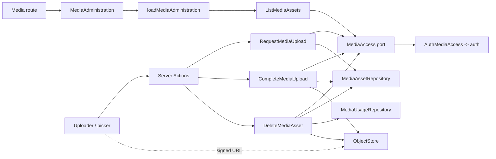
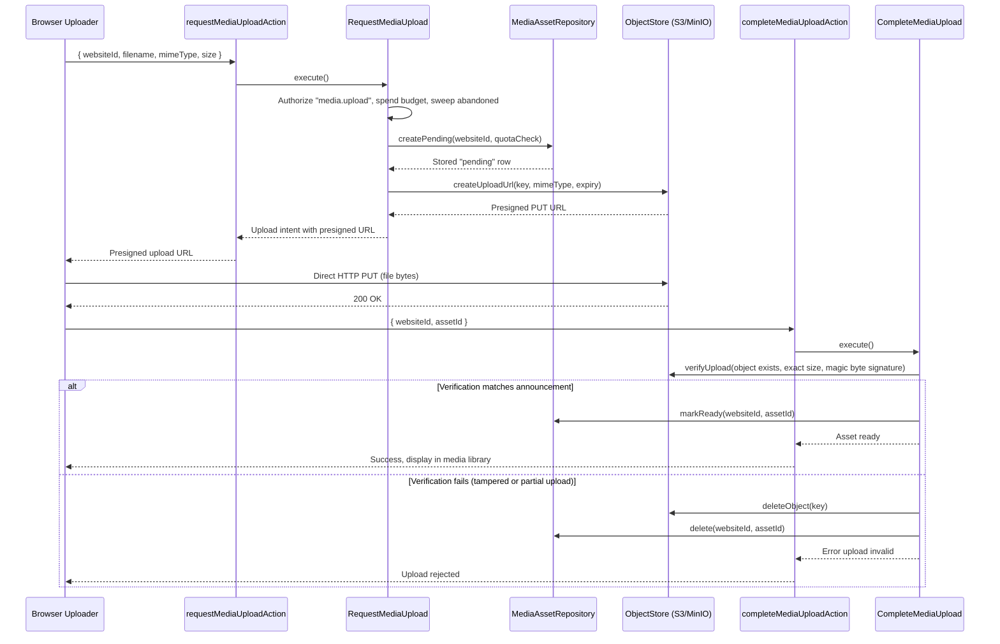
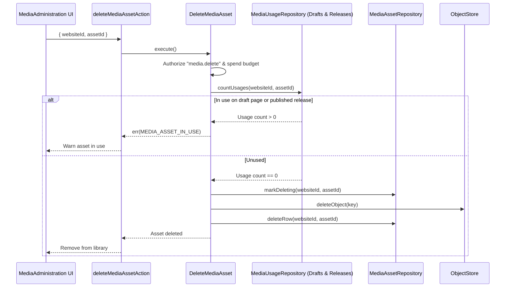

# Media

## 1. Overview

Media owns a website's uploaded files: asking permission to upload, verifying what was stored, listing the library, issuing a short-lived link to a private file, deleting, and the public address pages render an image from. Auth owns who may do this in which website. The object store itself is the shared `@lib/storage` abstraction (see [storage.md](./storage.md)). Builder's media control and the component platform's image rendering consume media through its public API only.

Only images are accepted. SVG is deliberately absent: it is markup that can carry script.

## 2. Architecture and layer responsibilities

Media uses the same layers and file roles as auth, audit and website: `domain/{models,errors,ports}`, `application/{commands,queries,contracts,services}` with `media-dependencies.ts`, `media-limits.ts`, `rate-limits.ts` and `media-view-mappers.ts` at the application root, `infrastructure/`, `presentation/`, a server-only `composition.ts`, an intentional server API in `index.ts` and a browser-safe `client.ts`.

- **Domain.** `media-asset.ts` holds the asset, its three states (`pending`, `ready`, `deleting`), the object key rule (`sites/<tenant>/media/<asset>`, built only from trusted ids, never from a file name), display-name sanitising and `parseUploadRequest`. `media-format.ts` is the accepted-type table with signature checks (`sniffMediaFormat`).
- **Ports.** `MediaAccess` (authorizes a website, see below), `MediaAssetRepository`, `MediaUsageRepository` (does a draft page or any release still use a file?) and `MediaAuditLog`.
- **Application.** Three commands (`RequestMediaUpload`, `CompleteMediaUpload`, `DeleteMediaAsset`) and two queries (`ListMediaAssets`, `GetMediaReadUrl`). Services are one job per file: `verifyUpload`, `markUploadReady`, `sweepAbandonedUploads`, `findMediaAsset`, `withinActorLimit`, `mediaStore` and the pure `resolvePublicMediaUrl`.
- **Infrastructure.** `access/auth-media-access.ts` delegates to auth's `authorizeWebsiteAccess`. `prisma/` holds the repositories and record mappers; `transactions/pending-upload-writes.ts` inserts a pending asset under a per-tenant lock so the open-upload quota cannot be overrun by simultaneous requests, retried as a whole on deadlock or serialization failure.
- **Presentation.** Actions, DTOs, `parse-media-input` schemas, `loaders/load-media-administration.ts` (page, search `q`, `visibility` chip and `sort` from the address) and `loaders/load-media-usage.ts`, hooks, `translation/translator.ts`, and two component families: `library/` (`MediaAdministration`: the shared admin frame with the "Bilder hochladen" header action, upload notices above the list, first-use steps while the library is empty, and the searchable, sortable file list with open/delete row actions) and `picker/` (`MediaPicker`, used by the builder's media control).
- **Upload on the library screen.** `MediaUploadScope` holds one upload for the screen: the header button (and the empty list's invitation) opens the file chooser, a review dialog lists the chosen files and asks whether they stay private, and `MediaUploadNotice` above the list reports progress, the number uploaded, or why it stopped.
- **Where a file is used.** The route hands in the builder's `listMediaUsage` (through `src/app/[locale]/(protected)/websites/[websiteId]/media/media-screen.ts`; media cannot import the builder, which imports the picker). The delete dialog (`DeleteWhenUnusedDialog`) lists the components of saved pages that still show the file, each opening the editor with that component selected. An incomplete or failed read is "unknown", never "unused". Releases are not listed: the server's usage check still refuses a file any release holds, and that refusal is shown beside the button and re-reads the screen.

## 3. Architecture diagram

## 4. Main workflow

**Upload** takes two server calls around a direct browser-to-store write.

1. `RequestMediaUpload` authorizes `media.upload`, validates the announced file, spends the rate-limit budget, sweeps abandoned uploads of that website, stores a `pending` row (quota enforced) and only then asks the store for a short-lived signed write URL for exactly that object. The row exists before the permission does, so every object that can ever appear in the store has a row that explains it. If issuing the permission fails the row is withdrawn.
2. The browser writes the file straight to the store.
3. `CompleteMediaUpload` verifies the stored object against the announcement (`verifyUpload`: exists, exact size and type, starts with the type's signature) and marks the row `ready` with a conditional write. Two tabs finishing at once: exactly one wins, the other sees `ready` and succeeds. A mismatch removes object and row; the client starts over. A missing object is a conflict and the row stays `pending`.

**Delete** cannot be one transaction (bytes and row live in two systems), so its order makes every partial failure harmless and retryable: refuse while the website still uses the file (a page being edited, or any release, since a rollback restores an old one); mark the row `deleting` (hidden everywhere from now on); delete the object; delete the row. Deleting again finishes a stalled job.

**Rendering** uses `resolvePublicMediaUrl(store, websiteId, assetId)`: no database read and no request, only the public bucket. The website is the one the server is rendering, so a page can only name its own website's files.

**Private files** are read through `GetMediaReadUrl`, a short-lived bearer link that is returned to the caller and never logged or stored.

## 5. State and data flow

`pending` -> `ready` -> `deleting`. Unfinished uploads past their lease and stalled deletions are claimed by a later sweep, which rides along with the next upload request of that website, a few files at a time. There is no job queue; a website that never uploads has nothing to clear. The sweep never fails its caller.

The library is a bounded page (`MEDIA_PAGE_LIMITS`), newest first by default, searchable by a part of the file name (a literal, case-insensitive match) and sortable by name or upload date; the picker shows the newest `MEDIA_PICKER_PAGE_SIZE` and points to the library when there are more.

## 6. Business rules and invariants

- A file's object key is derived from ids the server minted. Nothing a client sends becomes part of a key.
- The client's word about a file is never enough: type and size are checked against the stored object, and the type against the file's leading bytes.
- A file used by any draft page or any release is never deleted. The usage check errs towards "in use".
- At most a fixed number of unfinished uploads per website (the cheapest bound on what a client can queue).
- Cache-Control is signed into the upload, so a client cannot choose it.

## 7. Errors and edge cases

| Situation                                     | Result                                                                        |
| --------------------------------------------- | ----------------------------------------------------------------------------- |
| Announced file rejected (type, size, name)    | Validation error, nothing stored                                              |
| Open-upload quota used up                     | Conflict                                                                      |
| Stored object differs from the announcement   | Object and row removed, validation error                                      |
| Upload not finished when completion is called | Conflict; row stays `pending`, the client may retry                           |
| Delete of a file still in use                 | Conflict                                                                      |
| Database fails after the object was verified  | Row stays `pending`; completing again succeeds                                |
| Storage not configured                        | Uploads unavailable (`mediaUploadsAvailable()` is false)                      |
| Rate-limit store down                         | Every media policy fails closed: each reaches the store or signs a credential |

## 8. Security and access control

- Every use case starts with `access.authorizeWebsite(permission, input.websiteId)`: `media.upload`, `media.read`, `media.delete`. The website comes from the request or URL and is authorized against the actor's memberships; the session's current tenant is never used.
- `MediaAccess` yields an authorized scope; its tenant is the only one a use case reads or writes.
- Rate limits (per signed-in person, 60 a minute for request, complete and read-link, 30 for delete) all fail closed. Listing is one bounded page and is not limited.
- Security-relevant outcomes go to the module's audit port and, through `withAuditTrail`, to the website's audit trail.

## 9. Testing and verification

Tests live under `__tests__/src/modules/media`, with in-memory ports in `support/fakes.ts`:

- `domain/media-domain.test.ts`: key derivation, name sanitising, signature sniffing.
- `application/`: the two-step upload (`request-and-complete-upload`), `delete-list-and-read`, `sweep-abandoned-uploads`, `resolve-public-media-url`, `rate-limits` and `website-scope` (a website the actor does not belong to is refused).
- `presentation/`: the loaders (address parsing, usage), message keys, the upload schema, `upload-media-file`, and the library and picker components.
- `infrastructure/*.integration.test.ts`: the Prisma repositories and an end-to-end upload against a real database (`npm run test:integration`).

## 10. Extension points and constraints

- A new file type is one row in `media-format.ts` plus its signature check.
- Another module that needs a file's address calls `mediaPublicUrl` / `mediaUploadsAvailable` from `index.ts`; it never imports media's infrastructure.
- A module that stores references to files must be reflected in `MediaUsageRepository`, or deleting can break it.
