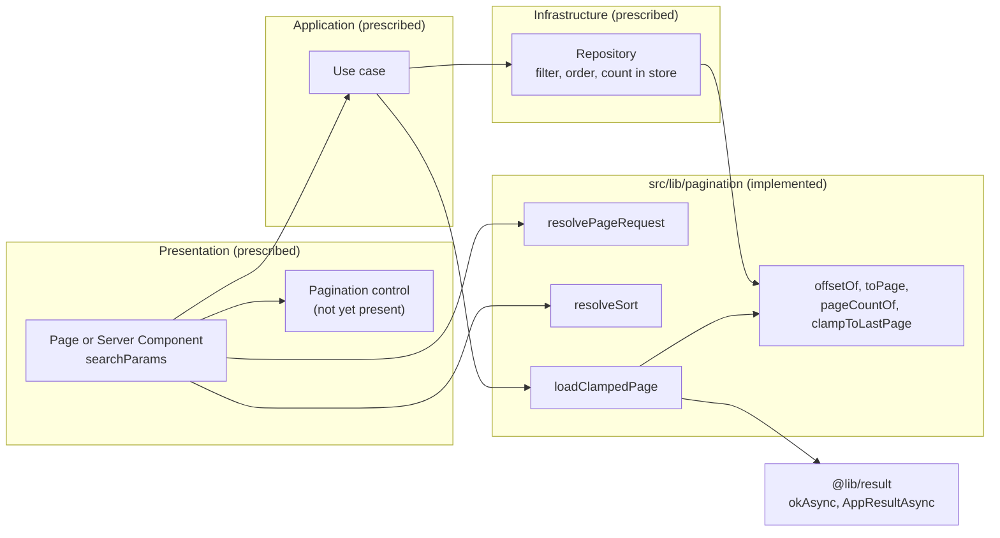
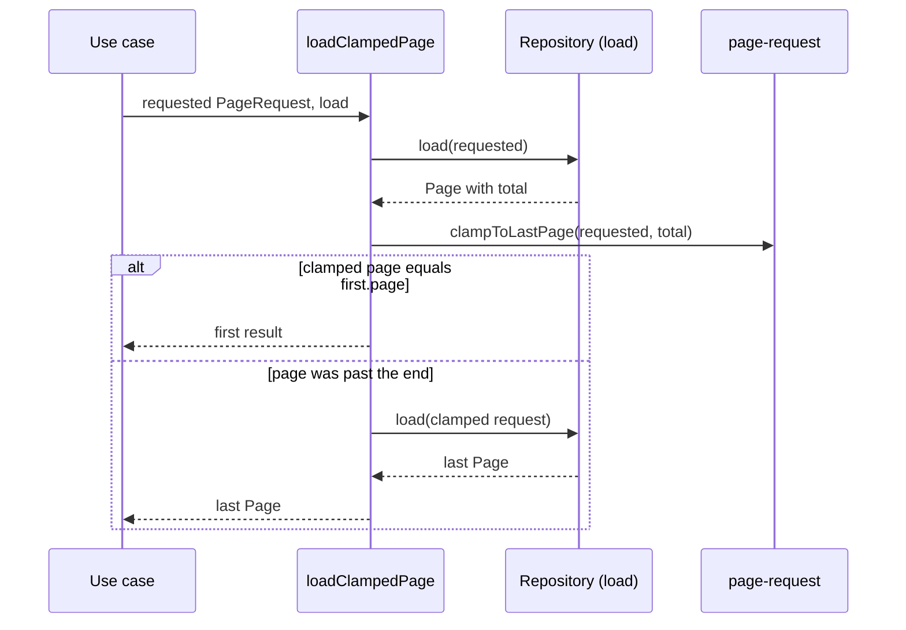

# Pagination

Owning rules: [`performance.md`](../rules/performance.md), [`persistence.md`](../rules/persistence.md), [`shared.md`](../rules/shared.md). Procedure: [`adding-a-repository.md`](../conventions/adding-a-repository.md).

> **Implementation status.** `src/lib/pagination` is implemented and tested. Its consumers are not: `src/modules` is empty, `src/app` has no pages, and the `<Pagination>` component named in `src/lib/README.md` (`@components/shared/pagination`) does not exist (`src/components` contains only `brand` and `providers`). Sections below mark what is **Implemented** (verified in code) versus **Prescribed** (stated in rules, conventions or the lib README, but without a caller yet).

## 1. Overview

`@lib/pagination` is a small, pure helper set for slicing and ordering a list that can grow. It exists so that every list in the product is bounded regardless of what a URL says, and so that the arithmetic (offset, page count, last-page clamping) and the untrusted-input handling are written once.

- **Primary actor:** a user changing the `page`, `pageSize` or `sort` query parameters of a list screen (hand-edited URLs included).
- **Trigger:** a Server Component or use case that renders or returns a paged list.
- **Outcome:** a `Page<T>` containing a bounded slice, the total count and the page count, always pointing at a valid page.

## 2. Architecture and Layer Responsibilities

All code lives in `src/lib/pagination/`, exported through the barrel `@lib/pagination` (`index.ts`). It is generic: no domain concept, no module imports. The only internal dependencies are `@lib/result` (`okAsync`, `AppResultAsync`) and `@lib/errors` (`AppError`, type only) in `load-clamped-page.ts`.

| Component                                                                                     | File                   | Responsibility                                                                                                                       |
| --------------------------------------------------------------------------------------------- | ---------------------- | ------------------------------------------------------------------------------------------------------------------------------------ |
| `resolvePageRequest`, `PageRequest`, `PageLimits`, `DEFAULT_PAGE_LIMITS`, `PAGE_SIZE_OPTIONS` | `page-request.ts`      | Turn untrusted values into a safe `{ page, pageSize }`. Defaults are 25 per page, maximum 100; selectable sizes are 10, 25, 50, 100. |
| `offsetOf`, `pageCountOf`, `toPage`, `clampToLastPage`, `Page<T>`                             | `page-request.ts`      | Arithmetic and the result shape a page control draws from.                                                                           |
| `resolveSort`, `formatSort`, `SortSpec`, `SortDirection`                                      | `sort.ts`              | Parse `field` / `-field` against an allowlist; write a spec back for links.                                                          |
| `loadClampedPage`                                                                             | `load-clamped-page.ts` | Wrap a store read so a page past the end answers the last page.                                                                      |

Responsibility split (rules and README, **Prescribed**):

- **Presentation (page / Server Component):** reads `searchParams`, calls `resolvePageRequest` and `resolveSort`, renders `Page<T>`, builds links with `formatSort`.
- **Application (use case):** wraps its repository read in `loadClampedPage`.
- **Infrastructure (repository):** takes a `PageRequest` (and a `SortSpec`), filters, orders and counts in the database using `offsetOf`, returns `toPage(items, total, request)`. Filtering, ordering and counting never happen in memory over an unbounded read (`src/lib/README.md`).

ESLint reports local re-implementations of `offsetOf` and `pageCountOf` (`docs/rules/shared.md`, `eslint/README.md`).

## 3. Architecture Diagram

Edges inside `src/lib/pagination` (`LCP` to `ARI`, `LCP` to `RES`) are verified in code; all edges involving Presentation, Application and Infrastructure describe the documented intent only.

## 4. Main Workflow

1. **Resolve the request.** The page passes the raw `page` and `pageSize` query values to `resolvePageRequest(raw, limits?)`. Each value goes through `toPositiveInteger`: strings are trimmed and converted with `Number`, and the result must be a safe integer of at least 1, otherwise the default applies (page 1, `defaultPageSize`). The size is capped with `Math.min(size, limits.maxPageSize)`. The function never throws.
2. **Resolve the sort.** `resolveSort(raw, allowedFields, fallback)` treats a leading `-` as descending and matches the remaining name against the allowlist with `find`; anything unknown returns `fallback`. The allowlist lookup means a query value is never used as a column name.
3. **Load.** The use case calls `loadClampedPage(request, load)`, where `load` is a function returning `AppResultAsync<Page-like, AppError>`. The repository reads with `offsetOf(request)` and `pageSize`, and builds the result with `toPage`.
4. **Clamp.** If the first result's `total` implies fewer pages than requested (items deleted since the link was made), `clampToLastPage` yields the last page and `load` runs a second time. If the clamped page equals the page already loaded, the first result is returned unchanged.
5. **Render.** The screen draws from `items`, `page`, `pageSize`, `total`, `pageCount`.

A failure from `load` (an `Err`) short-circuits through `andThen` and is returned unchanged; no second read happens.

## 5. State and Data Flow

No state is stored: every function is pure. Page state lives in the URL (`page`, `pageSize`, sort) and is re-derived on every request, so the address is the only source of truth for the current position. `loadClampedPage` is generic over the page type (`P extends Page<unknown>`), so fields the repository adds beside the standard ones survive the clamp (covered by a test using an extra `live` field). `Page<T>.total` counts every item matching the filters, not only the slice.

## 6. Business Rules and Invariants

- A list is never unbounded: size is at most `maxPageSize` (100 by default), even for `pageSize=100000`.
- Pages count from 1; anything that is not a whole safe number of at least 1 becomes page 1.
- An empty list still has one page: `pageCountOf(0, n)` is 1.
- A page past the end answers the last page, not an empty page or an error.
- Sort fields come from an allowlist; descending is `-field`; `formatSort` is the inverse of `resolveSort`.
- Paged queries need a deterministic ordering (`adding-a-repository.md`, step 8). The helpers do not enforce this; the repository must.

## 7. Errors and Edge Cases

- **Junk input** (`''`, `'abc'`, `'0'`, `'-2'`, `'1.5'`, `NaN`, arrays, objects) falls back to defaults; there is no validation error, so a hand-edited URL shows page 1.
- **Values that are too large** for a safe integer fall back to page 1 (tested).
- **Read failure:** propagated as the `AppError` from `load` (see [error handling](./error-handling.md)).
- **Concurrent deletion:** covered by the clamp and second read. The second read's `total` is not re-checked, so the result is whatever the second `load` returns.
- **Observed, not covered by tests:** `Number()` also accepts forms such as `'1e3'` and `'0x10'`, so these resolve to 1000 and 16. A page near `Number.MAX_SAFE_INTEGER` passes `Number.isSafeInteger`, but `offsetOf` multiplies it by the size and can leave the safe range; whether that matters depends on the database offset type, which is unverified here.

## 8. Security and Access Control

Page, size and sort values are untrusted client input and are sanitized at the first boundary by `resolvePageRequest` and `resolveSort`. The size cap bounds work per request (resource exhaustion), and the sort allowlist prevents injection of column names. The helpers carry no authorization; tenant and ownership scoping remain a repository responsibility ([persistence](./persistence.md), `persistence.md` rule).

## 9. Testing and Verification

`__tests__/src/lib/pagination.test.ts` covers `resolvePageRequest` (valid values, junk, huge values, size cap with custom limits), offset, page count, `toPage`, `clampToLastPage`, `resolveSort`/`formatSort` (allowlist, prototype-like names such as `constructor`, non-strings), and `loadClampedPage` (in-range page, past-the-end page, extra fields preserved). Not covered: the `Err` path of `loadClampedPage`, `PAGE_SIZE_OPTIONS`, and any real consumer, since none exists. `src/lib/**` is held to 100% coverage in `vitest.config.ts`.

Verification performed when writing this document: `npx vitest run __tests__/src/lib/pagination.test.ts` passed (run together with the SEO and mail tests: 3 files, 44 tests).

## 10. Extension Points and Constraints

- **New list:** declare its own `PageLimits` if the defaults do not fit and pass them to `resolvePageRequest`; define a per-list sort allowlist and fallback.
- **New repository method:** accept `PageRequest` and `SortSpec`, apply `offsetOf` and a deterministic order in the store, return `toPage(...)`. Follow [`adding-a-repository.md`](../conventions/adding-a-repository.md).
- **New use case:** wrap the read in `loadClampedPage`; see the [persistence](./persistence.md) document for repository conventions.
- **Contracts to keep:** `Page<T>` field names, 1-based pages, the never-throws behavior of `resolvePageRequest`, and the allowlist semantics of `resolveSort`.
- **Constraint:** `src/lib` must not import modules, so list-specific filters or sort fields stay in the owning module.
