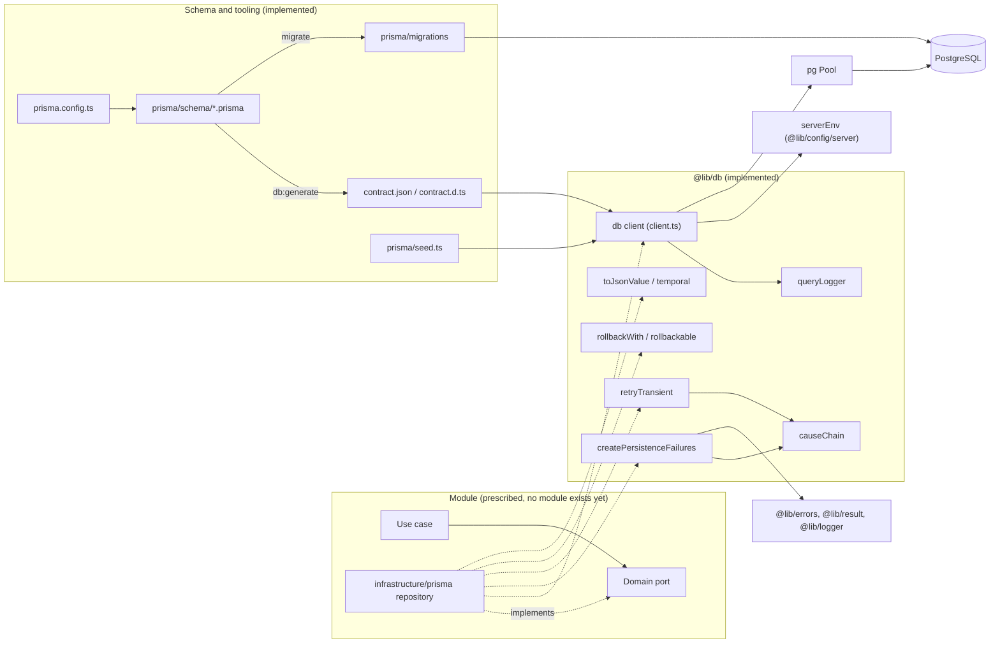
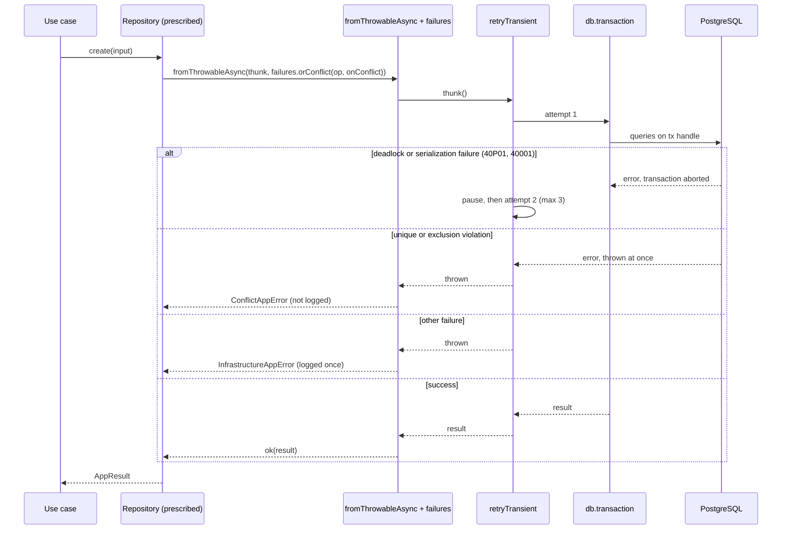

# Persistence (`@lib/db`, `prisma/`)

## 1. Overview

Persistence is everything between a module's repository and the PostgreSQL database: the Prisma client, the connection pool, the helpers that make transactions safe, the translation of driver errors into typed application errors, and the schema and migration tooling that defines what the database looks like.

It exists so that no module has to solve the same problems separately:

- one pooled, observable database client per process;
- one place where Prisma and driver errors are classified, so they never leave infrastructure;
- reusable answers to the two transaction problems that recur in repositories (a transaction the database aborts through no fault of the caller, and a transaction that must be undone on purpose);
- one schema, one migration workflow and one seed entry point.

The actors are repositories in a module's `infrastructure/prisma` folder (callers of `@lib/db`) and developers and CI (users of the schema, migration and seed tooling). The outcome of a repository call is an `AppResult` whose error is a typed `AppError`, never a Prisma exception.

> **Examples and conventions.** Auth, audit and website repositories use this infrastructure. Sections marked **Prescribed** describe the general repository convention; concrete implementations live in each module's `infrastructure/prisma`. Authentication tables and their SQL migrations are documented separately later.

## 2. Architecture and Layer Responsibilities

| Component                     | Path                                                         | Responsibility                                                                                                                                                                                                                                                                           |
| ----------------------------- | ------------------------------------------------------------ | ---------------------------------------------------------------------------------------------------------------------------------------------------------------------------------------------------------------------------------------------------------------------------------------- |
| Client singleton              | `src/lib/db/client.ts`                                       | Builds a `pg` `Pool` from `serverEnv`, wraps it with the Prisma 8 ORM Postgres runtime (`postgres<Contract>`), registers `queryLogger`, caches the instance on `globalThis` outside production, exports `db` and `disconnectDb`. The only file importing `@prisma/orm-postgres/runtime`. |
| Barrel                        | `src/lib/db/index.ts`                                        | The public surface: `db`, `disconnectDb`, `createPersistenceFailures`, `conflictConstraint`, `retryTransient`, `rollbackWith`, `rollbackable`, `toJsonValue`, `instantToDate`, `dateToInstant`.                                                                                          |
| Failure translators           | `src/lib/db/persistence-failures.ts`                         | `createPersistenceFailures` and `conflictConstraint`: the one place driver errors are classified and turned into `AppError`s.                                                                                                                                                            |
| Cause chain                   | `src/lib/db/cause-chain.ts`                                  | `causeChain` lists a thrown error and its `cause`s (at most four levels) so the driver error can be found under the runtime's wrappers. Internal; not exported from the barrel.                                                                                                          |
| Transient retry               | `src/lib/db/retry-transient.ts`                              | Re-runs a whole transaction after a deadlock or serialization failure.                                                                                                                                                                                                                   |
| Deliberate rollback           | `src/lib/db/rollback.ts`                                     | `rollbackWith` and `rollbackable`: end a transaction on purpose and return the refusal as a value.                                                                                                                                                                                       |
| Value helpers                 | `src/lib/db/temporal.ts`, `to-json-value.ts`                 | `Temporal.Instant` to `Date` conversions for Prisma 8; plain JSON for JSON columns.                                                                                                                                                                                                      |
| Query logging                 | `src/lib/db/query-logger.ts`                                 | Prisma middleware that logs every query through `@lib/logger`.                                                                                                                                                                                                                           |
| Schema                        | `prisma/schema/*.prisma`                                     | One file per domain, joined into one contract (see `prisma/schema/README.md`).                                                                                                                                                                                                           |
| Prisma config                 | `prisma.config.ts`                                           | Points Prisma at the schema glob, the emit directory `src/lib/db` and the migrations directory `prisma/migrations`.                                                                                                                                                                      |
| Seed                          | `prisma/seed.ts`, `prisma/seed/helper/*`                     | Stable seed entry point and the discovery helper for `<name>.seed.ts` modules.                                                                                                                                                                                                           |
| Repositories (**Prescribed**) | `src/modules/<module>/infrastructure/prisma/*.repository.ts` | Implement domain ports with `db`; translate failures; map records to domain models.                                                                                                                                                                                                      |

Ownership follows `docs/rules/persistence.md` and `boundaries.md`: Prisma stays in infrastructure, and `@lib/db` may be imported only from a module's infrastructure layer or from `src/lib`. `eslint/policy/checks-dependencies.mjs` (`checkPrismaContainment`) reports any `@prisma/*` import outside `src/lib/db` and any `@lib/db` import from another layer. Note that "only `client.ts` imports the runtime" is a comment convention in `client.ts`; the lint rule is broader and allows `@prisma/*` imports anywhere under `src/lib/db` (the failure translators import `@prisma/orm-family-sql/errors`).

The generated contract (`src/lib/db/contract.json` and `contract.d.ts`) is produced by `npm run db:generate` (`prisma contract emit`) and imported by `client.ts`. CI regenerates it and fails when the committed result is stale, so the contract is expected to be committed.

## 3. Architecture Diagram

Dashed edges are prescribed usage; solid edges are verified in code.

## 4. Main Workflow

### Start-up

Importing `@lib/db` evaluates `client.ts` once per process. It first imports `temporal-polyfill/global`, which installs a global `Temporal` only if the runtime has none (Node 24, pinned in `.nvmrc`, lacks it; Prisma 8's timestamp codec needs it). It then reads `serverEnv`, so invalid database configuration stops the application at import time. `createPool` builds the `Pool` with `DATABASE_URL`, `DATABASE_POOL_SIZE` (`max`), `DATABASE_POOL_TIMEOUT_SECONDS` (connection timeout), `DATABASE_STATEMENT_TIMEOUT_SECONDS` (`statement_timeout`), a fixed 30 s idle timeout and `application_name` `civo`. The pool is built here because the runtime's own `url` binding ignores the pool-size and pool-timeout connection-string parameters. An `error` listener logs a dropped idle connection at `warn` so it cannot crash the process.

### Prescribed write path

The sequence below combines the verified helper behaviour with the repository shape the template and lint rule prescribe. The order `retryTransient` outside `rollbackable` outside `db.transaction` is derived from how the helpers behave; no repository uses it yet. `db.transaction(async (tx) => ...)` is exercised in `__tests__/src/lib/db/persistence-failures.integration.test.ts`.

## 5. State and Data Flow

- **Process state.** One `Database` (`{ client, pool }`) per process. Outside production it is also stored on `globalThis.database`, so Next.js dev hot reloads reuse the pool instead of exhausting connections. In production module initialization happens once and the cache is skipped. Tests in `client.test.ts` pin both behaviours.
- **No request state.** `@lib/db` keeps no per-request state. Transaction scope lives in the caller: inside `db.transaction(async (tx) => ...)` every query must start from `tx`, because queries started from `db` use another connection and bypass the transaction (`persistence.md`).
- **Reads.** Prisma 8 returns `DateTime` columns as `Temporal.Instant`; mappers call `instantToDate`, which needs only `epochMilliseconds`. Writes pass `dateToInstant(date)`, which always builds a `Temporal.Instant` through the existing polyfill, including on Node 24 without a native global. The codec does not accept ISO text for these columns.
- **JSON columns.** `toJsonValue` round-trips a value through `stringifyJson` and `parseJson`, so `Date` becomes ISO text and `undefined` members disappear; a `bigint` or a cycle throws `JsonStringifyError`.
- **Schema to runtime.** `prisma/schema/**/*.prisma` is emitted to `src/lib/db/contract.json` and `contract.d.ts`; `Contract` types the client, and queries are written as `db.orm.public.<Model>...` (`scripts/templates/infrastructure.ts`).
- **Observability.** `queryLogger` captures parameterised SQL in per-statement context through `beforeEncode` and observes completion through `activityEnded`. It logs `db.query` and `db.execute` at `debug` with row counts, latency and source, and additionally at `warn` (`db.query.failed`, `db.execute.failed`) when a statement did not complete. Bound values are never logged.

## 6. Business Rules and Invariants

Implemented in `@lib/db`:

- **Conflict means unique or exclusion violation only** (`isUniqueConstraintViolation` from `@prisma/orm-family-sql/errors`, and SQLSTATE `23P01`). Foreign-key, not-null and check violations are deliberately infrastructure failures because they indicate a caller bug, not a race between valid writes.
- **Transient means SQLSTATE `40001` or `40P01`.** `retryTransient` makes at most `TRANSIENT_ATTEMPTS` (3) attempts, pausing `attempt * 25 ms` plus up to 25 ms of random jitter before the next. Everything else is thrown immediately.
- **The retried function must be the whole transaction**, reads included, and its effects must live entirely inside the aborted transaction; an outside side effect such as a mail would be repeated.
- **Rollback signal is private.** The `Rollback` class is not exported, so only `rollbackWith` can create one and `rollbackable` is the only thing that recognises it.

Declared in the schema (`prisma/schema/README.md`):

- Ids are application-generated text; there is no `@updatedAt`, and a database trigger stamps rows whose writer did not set `updatedAt` (the trigger lives in a migration; see Section 9 for its absence from this tree).
- A tenant is its website (`Website.id = Website.tenantId`). Every table below a website carries `websiteId` and references parents by `(parentId, websiteId)`, so the database refuses rows joining two websites.
- `@@check` constraints repeat domain limits for writers other than the application.
- `NoAction` versus `Restrict` on foreign keys decides whether a parent and its dependants can be removed in one transaction.

Prescribed (`persistence.md`): compare-and-swap as a single `UPDATE ... WHERE` (never `update()`), timestamps in UTC, money as integer minor units or decimal, tenant-owned queries filtered by `tenantId` or `websiteId`, file bytes in object storage rather than the database.

## 7. Errors and Edge Cases

`createPersistenceFailures({ module, code, subject })` returns three translators:

| Translator                          | Use for                                                        | Result                                                      |
| ----------------------------------- | -------------------------------------------------------------- | ----------------------------------------------------------- |
| `infraOnly(operation)`              | reads, idempotent deletes                                      | always `InfrastructureAppError`                             |
| `orConflict(operation, onConflict)` | writes that can violate a unique or exclusion constraint       | the module's `ConflictAppError` or `InfrastructureAppError` |
| `requireRow(onNotFound)`            | single-row writes, which Prisma 8 resolves to `null` on a miss | `err(onNotFound(undefined))` or `ok(row)`                   |

An infrastructure failure is logged once, at `error`, with the operation and, when found on the cause chain, the `sqlState`, `constraint` and `table` (never `detail`, which can quote a row). The error keeps the thrown value as `cause`, and its message is generic (`<subject> persistence failed during <operation>.`). A conflict or a miss is expected and is not logged. `conflictConstraint(thrown)` lets a repository distinguish two conflicts by constraint name rather than message.

`causeChain` is bounded to four levels so a chain that loops back on itself terminates. Classification uses the package's own predicates (`SqlQueryError.is`, `isUniqueConstraintViolation`) instead of `instanceof`, which survives duplicated package copies.

Other edge cases:

- A transient failure on the third attempt is thrown as the last failure, not wrapped.
- `rollbackable` passes any non-`Rollback` error through unchanged, so a driver error still reaches the failure translator.
- `disconnectDb` closes the client, then ends the pool unless it is already ending; calling it twice is harmless. A failure is logged as `db.disconnect_failed` and rethrown, because nobody can recover from a failed shutdown.
- Missing `contract.json` makes `client.ts` unimportable (Section 9).

Mapping `InfrastructureAppError` to a user response is not done here; see [error-handling.md](error-handling.md) and [logging.md](logging.md).

## 8. Security and Access Control

- `DATABASE_URL` can contain credentials and is never logged. The `Pool` and the client are server-only in practice because they depend on `serverEnv`, which imports `server-only` (see [configuration.md](configuration.md)).
- Log lines carry parameterised SQL and the SQLSTATE, constraint and table names, but never bound parameters or the database's `detail`.
- User-facing messages are generic; the technical cause stays in the `cause` field and the log.
- The statement timeout bounds a runaway query so it cannot hold a pooled connection.
- Tenant isolation is enforced twice: by repository filters (**Prescribed**) and by composite foreign keys in the schema (implemented in `.prisma` files; their runtime behaviour is covered by the integration test described below).
- The seed refuses to run when `serverEnv.NODE_ENV === 'production'`.

## 9. Testing and Verification

| Concern                                                                                   | Test file                                                                                                      | Notes                                                           |
| ----------------------------------------------------------------------------------------- | -------------------------------------------------------------------------------------------------------------- | --------------------------------------------------------------- |
| Pool sizing, dev cache, production, disconnect                                            | `__tests__/src/lib/db/client.test.ts`                                                                          | Needs the generated `contract.json`.                            |
| Failure translators, cause chain, diagnostics                                             | `__tests__/src/lib/db/persistence-failures.test.ts`                                                            | Fakes the driver's predicates.                                  |
| Real driver errors, constraint names, real deadlock retried                               | `__tests__/src/lib/db/persistence-failures.integration.test.ts`                                                | Needs a database; run with `npm run test:integration`.          |
| Transient retry                                                                           | `__tests__/src/lib/db/retry-transient.test.ts`                                                                 |                                                                 |
| Rollback                                                                                  | `__tests__/src/lib/db/rollback.test.ts`                                                                        |                                                                 |
| Query logging                                                                             | `__tests__/src/lib/db/query-logger.test.ts`                                                                    |                                                                 |
| Temporal conversions and polyfill                                                         | `__tests__/src/lib/db/temporal.test.ts`, `temporal-runtime.test.ts`                                            | The runtime test loads the client module.                       |
| JSON helper                                                                               | `__tests__/src/lib/db/to-json-value.test.ts`                                                                   |                                                                 |
| Enums match domain vocabulary                                                             | `__tests__/src/lib/db/contract-enums.test.ts`                                                                  |                                                                 |
| Schema guarantees (tenant boundaries, immutable releases, append-only audit, `updatedAt`) | `__tests__/src/lib/db/schema-guarantees.integration.test.ts`                                                   | Needs a database with migrations applied.                       |
| Lint rules                                                                                | `eslint/plugins/architecture/rules/adapters/persistence-failures.mjs`, `eslint/policy/checks-dependencies.mjs` | Enforce the prescribed repository shape and Prisma containment. |

CI (`.github/workflows/ci.yml`, job `database`) runs `db:migrate:check`, regenerates the contract and fails on drift, applies migrations, then runs `db:verify`.

Gaps visible from the tests: no test covers `prisma/seed.ts` or the seed helper, and no repository-level test exists because no repository exists.

Contract generation now emits `src/lib/db/contract.json` and `contract.d.ts`. The config normalizes its absolute glob to forward slashes for Windows. Schemas use Prisma 8 `@onCreate(uuid())` generators and SQL literals for checks and partial-index predicates. Generation is offline; it does not apply migrations or verify a live database. Database-backed checks require configured databases with migrations applied.

## 10. Extension Points and Constraints

- **Adding a repository.** Follow [adding-a-repository.md](../conventions/adding-a-repository.md): create `failures` once at module scope with `createPersistenceFailures`, wrap every call in `fromThrowableAsync(thunk, failures.<kind>('<stable operation name>'))` with literal, unique operation names, keep record mappers free of `db`, and never branch on Prisma error codes locally. The ESLint rule enforces these.
- **Adding a table or column.** Edit the matching `prisma/schema/<domain>.prisma` (or add a file starting with `// use prisma-8`; the glob needs no config change), review the generated SQL, never edit an applied migration, then run `npm run db:generate`. See [adding-a-database-migration.md](../conventions/adding-a-database-migration.md). Keep tenant columns and composite foreign keys consistent with the schema README.
- **Changing error classification.** Do it only in `persistence-failures.ts`; the lint rule exists to keep it the single source of truth.
- **Transactions.** Use `db.transaction`, start every query from the handle, wrap the whole transaction (not part of it) in `retryTransient`, and use `rollbackWith` only for a refusal discovered after a write.
- **Seeds.** Add `prisma/seed/<name>.seed.ts` with a default export `{ name, order?, enabled?, run(context) }`; `runSeeds` discovers files matching `^[a-z0-9-]+\.seed\.ts$`, orders by `order` (default 100) then name, and `seed.ts` itself is not edited. The helper `prisma/seed/helper/` lives beside that folder's seed modules, but no `*.seed.ts` module exists yet.
- **Migrations tooling.** `npm run db:migrate` runs `db:migrate:app` (`prisma db migrate`) and then `db:migrate:auth`. The second applies auth-owned SQL from `migrations/auth/` via `migrations/apply-auth-migration.ts` and is out of scope here. The `migrator` Docker target runs `npm run db:migrate`.
- **Constraints.** `@lib/db` must keep depending only on `@lib/config/server`, `@lib/errors`, `@lib/logger`, `@lib/result` and `@lib/utils`. Prisma is a release candidate (`@prisma/orm-postgres` 8.0.0-rc.12, `prisma` 8.0.0-rc.25 in `package.json`), so its APIs may change.

Known inconsistencies found while verifying:

- `package.json` script `db:seed` passes `--import ./scripts/lib/server-runtime.ts`, which does not exist in `scripts/lib/`.
- `prisma.config.ts` declares `migrations.dir` as `./prisma/migrations`, but that folder, and `src/lib/db/contract.*`, are absent from this working tree even though the schema README refers to a migration that stamps `updatedAt` and CI expects committed contract files.
- `prisma.config.ts` reads `process.env['DATABASE_URL']` directly (after `dotenv/config`) rather than through `@lib/config`, because it runs outside the application.

Related: [configuration.md](configuration.md), [error-handling.md](error-handling.md), [logging.md](logging.md), `src/lib/README.md` (`@lib/db`).
