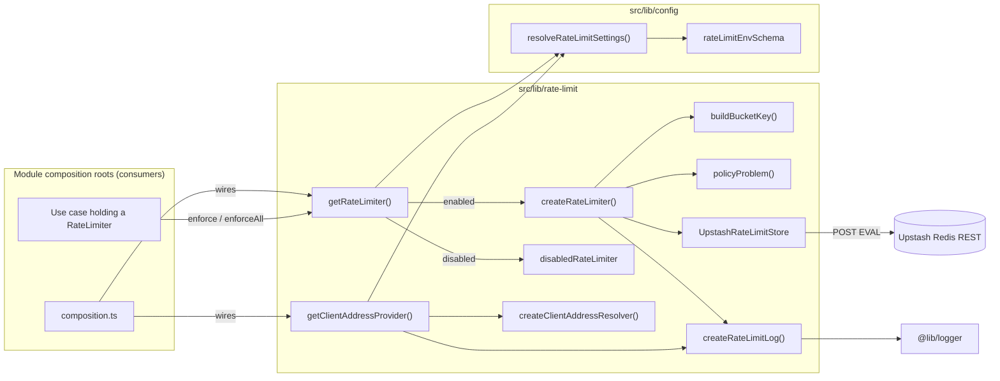
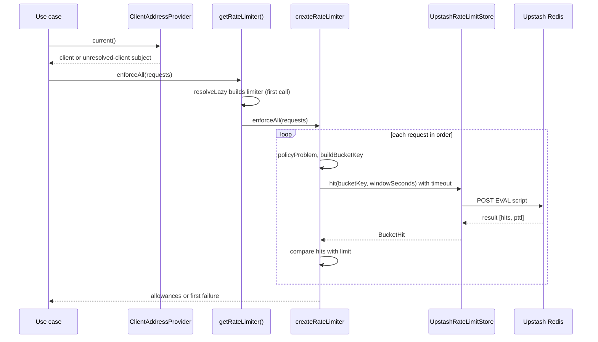

# Rate Limiting

## 1. Overview

`@lib/rate-limit` gives every module a shared way to put a budget on operations that anyone can repeat or that cost something per run (sending mail, calling an external system, and similar). A caller describes the budget as a `RateLimitPolicy`, names who is being counted as a `RateLimitSubject`, and asks a `RateLimiter` to `enforce` it. The answer is an allowance, a `rate_limited` error carrying a retry delay, or an `infrastructure` error.

Counters live in Redis, reached over HTTP through Upstash's REST API. There is deliberately no process-local backend, because it could not enforce a limit across instances. Setting `RATE_LIMIT_ENABLED=false` swaps in a limiter that allows everything and reaches no Redis; this is refused in production.

The trigger is a use case in a module that spends a budget. The expected outcome is either permission to continue or a typed failure the module maps to its own error.

Related documents: [error handling](error-handling.md), [logging](logging.md), [configuration](configuration.md). The procedure for adding a policy is [`adding-a-rate-limit.md`](../conventions/adding-a-rate-limit.md); the owning rules are [`security.md`](../rules/security.md) and [`configuration.md`](../rules/configuration.md).

## 2. Architecture and Layer Responsibilities

Rate limiting is a shared port in the lib layer, in the same family as `Clock` and `ObjectStore` (see [`boundaries.md`](../rules/boundaries.md)). Any layer may `import type` from `@lib/rate-limit`; only composition roots call the runtime functions.

| Component        | Path                                                                | Responsibility                                                                                        |
| ---------------- | ------------------------------------------------------------------- | ----------------------------------------------------------------------------------------------------- |
| Contracts        | `src/lib/rate-limit/rate-limiter.ts`                                | `RateLimiter` (`enforce`, `enforceAll`), `RateLimitRequest`, `RateLimitAllowance`, `RateLimitFailure` |
| Policy           | `rate-limit-policy.ts`                                              | `RateLimitPolicy` shape and `policyProblem` validation                                                |
| Subject and key  | `rate-limit-subject.ts`                                             | `RateLimitSubject` kinds and `buildBucketKey` (HMAC-keyed bucket name)                                |
| Limiter core     | `create-rate-limiter.ts`                                            | `createRateLimiter(deps)`: validation, store call, failure modes, log throttling                      |
| Default limiter  | `default-rate-limiter.ts`                                           | `getRateLimiter()`: lazy, cached, builds from validated settings                                      |
| Disabled limiter | `disabled-rate-limiter.ts`                                          | `disabledRateLimiter`: allows every request                                                           |
| Store port       | `rate-limit-store.ts`                                               | `RateLimitStore.hit`, `BucketHit`, `isBucketHit` guard                                                |
| Store adapter    | `upstash-rate-limit-store.ts`                                       | `UpstashRateLimitStore`: one Lua `EVAL` per attempt over `fetch`                                      |
| Client address   | `client-address.ts`, `ip-address.ts`                                | Header-to-address resolver, IP parsing, /64 reduction, trusted-proxy matching                         |
| Client provider  | `client-address-provider.ts`, `default-client-address-provider.ts`  | `ClientAddressProvider.current()` and the lazily built default                                        |
| Logging          | `rate-limit-log.ts`, `rate-limit-logger.ts`                         | `RateLimitLog` port, `createLogThrottle`, adapter over `@lib/logger`                                  |
| Configuration    | `src/lib/config/rate-limit-env-schema.ts`, `rate-limit-settings.ts` | Zod schema and cross-variable rules; `resolveRateLimitSettings`                                       |

Files marked `server-only` (`default-*`, `upstash-rate-limit-store.ts`, `rate-limit-logger.ts`) are the runtime side. The rest is plain TypeScript with injected dependencies, which is what makes `createRateLimiter` testable with a store you control. The barrel `src/lib/rate-limit/index.ts` is the only import path for consumers.

The limiter depends on `@lib/errors` (`rateLimitedError`, `infrastructureError`), `@lib/result`, `@lib/clock`, `@lib/utils` (`withTimeout`, `resolveLazy`) and `@lib/logger`. Settings come from `@lib/config/server`.

## 3. Architecture Diagram

## 4. Main Workflow

1. A module's `composition.ts` obtains `getRateLimiter()` and, for address-based policies, `getClientAddressProvider(() => headers())` and injects them into the use case. Both calls return immediately and build nothing yet.
2. The use case calls `enforce({ policy, subject })` or `enforceAll([...])`. For an address budget it first awaits `clientAddress.current()` to obtain a `client` or `unresolved-client` subject.
3. `getRateLimiter()` resolves the real limiter on first use via `resolveLazy`: it calls `resolveRateLimitSettings(serverEnv)`. If disabled it returns `disabledRateLimiter` and logs `rate_limit.disabled` once; otherwise it builds `createRateLimiter` over an `UpstashRateLimitStore`.
4. For each request, `check` validates the policy (`policyProblem`), short-circuits an `unresolved-client` subject according to `onUnresolvedClient`, builds the bucket key, and calls `store.hit(key, windowSeconds)` under `withTimeout`.
5. The store runs the Lua script (`INCR`, `EXPIRE ... NX`, `PTTL`) and returns `{ hits, retryAfterSeconds }`.
6. If `hits <= limit` the result is an allowance with `remaining = limit - hits`. Otherwise the result is `rateLimitedError('rate_limit.exceeded', ...)` with `retryAfterSeconds` rounded up to at least 1.
7. `enforceAll` checks policies sequentially; the first failure is returned and later budgets are not counted.

## 5. State and Data Flow

- **Counters** live only in Redis under `rate-limit:<policyId>:<kind>:<hmac>`. The window is set by `EXPIRE ... NX`, so the first hit starts a fixed window and later hits do not extend it. `retryAfterSeconds` is `ceil(PTTL / 1000)`.
- **Bucket key**: `buildBucketKey` takes the policy id, the subject, and the key secret. For `actor`, `client` and `identifier` subjects it computes `HMAC-SHA256(secret, kind + NUL + parts)` and stores only the hex digest, never the raw address or identifier. Identifier and client parts are NFKC-normalised, trimmed and lowercased first; actor parts are used as given. A `global` subject uses `<policyId>:global` with no hash.
- **Secret**: `effectiveSecret` uses `RATE_LIMIT_SECRET`, falling back to `AUTH_SECRET`.
- **Limiter instance**: cached on `globalThis.rateLimiter` (the hot-reload singleton pattern). A failed build is remembered by `resolveLazy` and retried only after `BUILD_RETRY_INTERVAL_MS` (5000 ms).
- **Client address**: `createClientAddressResolver(settings)` reads a header chosen by `RATE_LIMIT_CLIENT_ADDRESS_SOURCE`. IPv4-mapped IPv6 collapses to IPv4; other IPv6 addresses are reduced to their /64 and zero-padded.
- **Settings**: `RateLimitEnv` (Zod, validated once at startup) is converted by `resolveRateLimitSettings` into a discriminated `RateLimitSettings`: `{ enabled: false }` or `{ enabled: true, restUrl, restToken, keySecret, timeoutMs, clientAddress }`.

## 6. Business Rules and Invariants

Policy (`policyProblem`):

- `id` matches `^[a-z][a-z0-9-]*(\.[a-z][a-z0-9-]*)+$` (for example `module.operation`) and is at most 64 characters.
- `limit` is an integer from 1 to 100,000; `windowSeconds` is an integer from 1 to 86,400.
- `onBackendFailure` is `deny` or `allow`; `onUnresolvedClient`, if present, is `skip` or `deny`.

Subject: parts longer than 320 characters, empty parts, and parts containing the NUL separator are rejected. An `unresolved-client` subject has no counter.

Composite: `enforceAll` rejects an empty list and a list that repeats a policy id.

Client address sources:

| Source       | Header read              | Notes                                                                               |
| ------------ | ------------------------ | ----------------------------------------------------------------------------------- |
| `vercel`     | `x-vercel-forwarded-for` | exactly one address                                                                 |
| `cloudflare` | `cf-connecting-ip`       | exactly one address                                                                 |
| `azure`      | `x-azure-clientip`       | exactly one address                                                                 |
| `proxies`    | `x-forwarded-for`        | scanned from the right; first hop not in `AUTH_TRUSTED_PROXIES` wins; ports allowed |

The source has no default and no `none`. Resolution never guesses: it returns `unresolved` with a reason (`header_missing`, `header_malformed`, `ambiguous_header`, `no_untrusted_hop`, `no_request`).

Environment rules (`rateLimitEnvRules`, evaluated only while `RATE_LIMIT_ENABLED` is true, which is the default): Upstash URL (http or https) and token are required; the secret (or the `AUTH_SECRET` fallback) must be at least 32 characters; the client-address source is required; `proxies` needs `AUTH_TRUSTED_PROXIES`, each entry an IP or CIDR. `RATE_LIMIT_TIMEOUT_MS` defaults to 1500 and is bounded to 100–10,000. In `env-schema.ts`, `NODE_ENV=production` refuses `RATE_LIMIT_ENABLED=false` and an `http://` Upstash URL.

Policy declaration conventions (`application/rate-limits.ts`, `@fail-open` comments, `ROLES.<role>.rateLimitsMayFailOpen`) are described in [`adding-a-rate-limit.md`](../conventions/adding-a-rate-limit.md) and enforced by the `architecture/rate-limit-usage` lint rule and `eslint/policy/checks-rate-limits.mjs`.

## 7. Errors and Edge Cases

| Situation                                                                               | Result                                                                | Log (throttled)                       |
| --------------------------------------------------------------------------------------- | --------------------------------------------------------------------- | ------------------------------------- |
| Budget exceeded                                                                         | `rate_limited`, code `rate_limit.exceeded`, `retryAfterSeconds >= 1`  | `info rate_limit.rejected`            |
| Invalid policy or subject                                                               | `infrastructure`, `rate_limit.invalid_request`                        | `error rate_limit.invalid_request`    |
| Store timeout, HTTP error, bad shape, malformed `BucketHit`, `onBackendFailure: 'deny'` | `infrastructure`, `rate_limit.backend_unavailable`                    | `error rate_limit.backend_failed`     |
| Same, `onBackendFailure: 'allow'`                                                       | allowance with `remaining: null`, `degraded: true`                    | `warn rate_limit.failed_open`         |
| `unresolved-client`, `onUnresolvedClient: 'deny'`                                       | `infrastructure`, `rate_limit.client_unresolved`                      | `warn rate_limit.client_unresolved`   |
| `unresolved-client`, otherwise (default `skip`)                                         | allowance, `degraded: true`                                           | same warning                          |
| Limiter cannot be built                                                                 | `infrastructure`, `rate_limit.unavailable`; never treated as disabled | `error rate_limit.unavailable`        |
| Unexpected throw inside the limiter                                                     | `infrastructure`, `rate_limit.unexpected_failure`                     | `error rate_limit.unexpected_failure` |

Log lines go through `createLogThrottle`: one write per event and policy per 10 seconds, carrying a `suppressed` count when lines were dropped; at most 512 keys are tracked before the map is cleared. The failure messages are generic and safe to show; diagnostic detail travels as `cause`.

`RateLimitFailure` is an `AppError`, so it maps to HTTP through `@lib/errors` (`rate_limited` maps to 429 with a `Retry-After` header in `src/lib/errors/http-mapping.ts`). Modules are expected to translate it into their own error codes; the convention names a `fromRateLimitFailure` helper for that, see Section 10.

`getClientAddressProvider` never throws: a misconfigured resolver logs `rate_limit.client_unresolved` with reason `misconfigured` and yields `unresolved-client`. When rate limiting is disabled, the default resolver returns `unresolved-client` without logging, which is harmless because the disabled limiter ignores subjects.

## 8. Security and Access Control

- Raw addresses and identifiers are never stored or logged in counters; only keyed hashes are (`security.md`). Anonymous log events contain the policy id and a reason only.
- The client address is trusted only as far as its source: a platform header is reliable only if the application is reachable through that platform alone, otherwise a request that bypasses it can send the header itself. `x-forwarded-for` is read from the right and only through `AUTH_TRUSTED_PROXIES`, so client-supplied left-hand hops are ignored. The tests confirm that `x-forwarded-for` and `x-real-ip` are ignored for platform sources.
- The Upstash token is sent as a bearer credential; production requires an `https://` REST URL. The request uses `cache: 'no-store'` and an `AbortSignal.timeout`.
- Rate limiting does not authorize anything. Where a budget is spent after authorization (signed-in operations) is a use-case concern described in the convention.
- Authentication: `AUTH_SECRET` and `AUTH_TRUSTED_PROXIES` are borrowed from the auth env schema; authentication is documented separately, later.

## 9. Testing and Verification

All under `__tests__/src/lib/rate-limit/`:

- `create-rate-limiter.test.ts`: limits, failure modes, composites, log throttling.
- `rate-limit-policy.test.ts`, `rate-limit-subject.test.ts`: validation and bucket keys.
- `client-address.test.ts`, `client-address-provider.test.ts`: every source, spoofing, IPv6, unresolved reasons.
- `upstash-rate-limit-store.test.ts`: the REST protocol; `upstash-rate-limit.integration.test.ts` runs against a real server and is skipped unless `RATE_LIMIT_TEST_REST_URL` and `RATE_LIMIT_TEST_REST_TOKEN` are set.
- `default-rate-limiter.test.ts`, `default-wiring.test.ts`: lazy build, disabled mode, a build failure refusing the attempt instead of throwing; the retry interval of `resolveLazy` is covered by `__tests__/src/lib/utils/lazy-cell.test.ts`.
- `rate-limit-log.test.ts`, `rate-limit-env.test.ts`, `in-memory-rate-limit-store.test.ts` (a test double in `in-memory-rate-limit-store.ts`, not a backend).
- Related: `__tests__/src/lib/config/env.test.ts`, `__tests__/src/lib/errors/http-mapping.test.ts`.

Executed during this documentation pass: `npx vitest run __tests__/src/lib/rate-limit` passed (the integration file was skipped without the environment variables). No test in the repository calls the limiter from a real module, because `src/modules` is empty in this checkout. The `architecture/rate-limit-usage` ESLint rule was not run.

## 10. Extension Points and Constraints

- **New budget**: declare a `RateLimitPolicy` in the owning module and spend it from a use case; follow [`adding-a-rate-limit.md`](../conventions/adding-a-rate-limit.md). Do not call `getRateLimiter()` outside a `composition.ts`.
- **New client-address source**: extend `CLIENT_ADDRESS_SOURCES` in `rate-limit-env-schema.ts`, `PLATFORM_HEADERS` in `client-address.ts`, and the tests. Keep the rule that a source relies on a header the platform sets itself.
- **New store**: implement `RateLimitStore` (`hit` must return `hits >= 1`) and wire it in `default-rate-limiter.ts`. It must be shared across instances.
- **Constraints**: policy ids stay unique per composite; `RateLimitFailure` stays an `AppError`; settings are read only through `resolveRateLimitSettings`; `src/lib` stays at 100% coverage.
- **Observed gaps**: `fromRateLimitFailure` and the `createTestRateLimiter` helper in `__tests__/src/support/rate-limiting.ts` are named in the convention but do not exist in this checkout.
