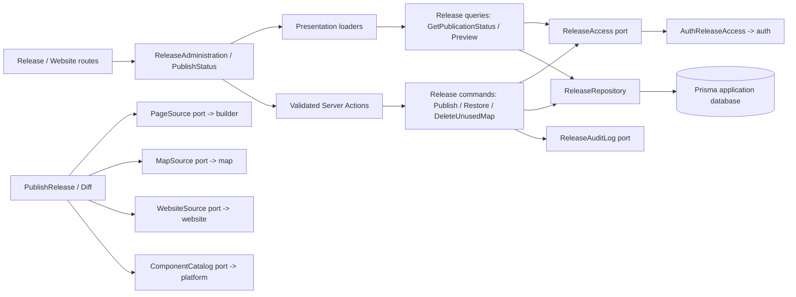
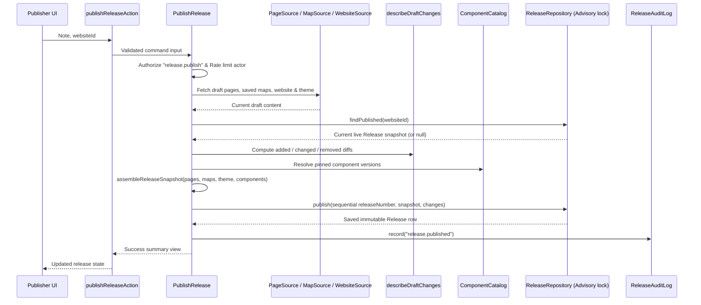
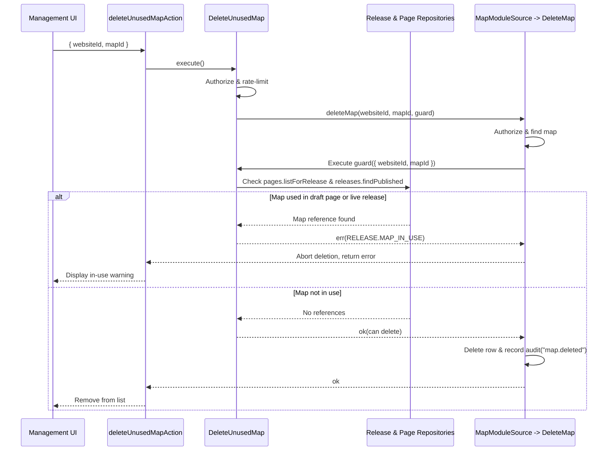

# Releases

## 1. Overview

Release owns publishing a website's pages as immutable releases, restoring an earlier one, previewing a frozen release, component updates of the live release (migrations) and the guarded deletion of data pages still show. The [builder](./builder.md) owns draft pages, the [component platform](./component-platform.md) owns component versions, the website owns its details and theme, and auth owns identity and permissions. Release reaches each of them through one port and one adapter.

## 2. Architecture and layer responsibilities

Release uses the same layers and file roles as auth, audit and website: `domain/{models,errors,ports}`, `application/{commands,queries,contracts,services}` with `release-dependencies.ts`, `release-limits.ts`, `rate-limits.ts` and `release-view-mappers.ts` at the application root, `infrastructure/`, `presentation/`, a server-only `composition.ts` and an intentional server API in `index.ts`.

- Every query and command authorizes the target website through the `ReleaseAccess` port before reading it. `AuthReleaseAccess` delegates to auth's `authorizeWebsiteAccess`, so a person who manages several websites can use any of them whichever is open.
- Domain folders are named for the concept they hold, like booking's: `models/` (ids, the release and its snapshot), `publishing/` (what can be published, assembly, draft diff, change record, preview fidelity), `migration/` (plans, three-way merge, conflict resolution, applying, stored plans, page drafts), plus `errors/` and `ports/`.
- Contracts are one file per kind and subject: `release-views`, `publication-views`, `snapshot-views`, `preview-views`, `usage-views`, `migration-views`, `screen-views` (the `ReleaseReaders` the screens read with), `release-inputs`, `migration-inputs` and `release-constraints` (the domain constants presentation may read).
- `infrastructure/source/` holds the adapters to neighbouring modules (builder pages, data sources, website, component platform); `infrastructure/prisma/` holds repositories, which publish and activate under an advisory lock and retry transient failures.
- Booking is a neighbour that a release does not freeze: a page's booking block carries only its props (`serviceId`, `category`), which the snapshot keeps with the page, while services, locations, opening hours and bookings are read live when a visitor looks (see [booking.md](./booking.md#10-extension-points-and-constraints)). A service switched off after a release was published is simply no longer offered; restoring an older release restores the block's props, not the booking setup.
- Bounded reads report truncation in their contract (`listPublishedDependencies`).

## 3. Architecture diagram

## 4. Presentation

Pages mount module Server Components backed by loaders, as audit and users do.

| Screen              | Server Component              | Loader                                     | Client islands                                                                 |
| ------------------- | ----------------------------- | ------------------------------------------ | ------------------------------------------------------------------------------ |
| Release history     | `ReleaseAdministration`       | `loadReleaseAdministration`                | `RestoreReleaseButton`                                                         |
| Component updates   | `ComponentUpdates`            | `loadReleaseAdministration`                | `MigrationPanel` (proposal and apply state), `MigrationReview`, `UpdatesCheck` |
| Release preview     | `ReleasePreview`              | `loadReleasePreview`                       | `RestoreReleaseButton`                                                         |
| Bar above a website | `PublishStatus` (page layout) | `loadPublicationStatus` (request-memoized) | `PublishButton`                                                                |

- Release history and component updates are two address-backed tabs (`?tab=updates`) of one route. There is no separate migrations route.
- Tables are Server Components that build their columns from translated text and hand only strings to client islands. `MigrationPanel` receives the static state as `children`.
- `ReleasePreview` cannot render a frozen page: that needs the builder, the component platform (see [component-platform.md](./component-platform.md)) and the website theme. The page passes `renderPage`, which returns the rendered page or `null` when its stored form cannot be read; the module shows the notice.
- Controls the actor cannot use (`mayRollback`, `mayRun`) are decided by the page from the website's permissions and passed down. They hide controls only; every action authorizes again.

## 5. Main workflow

Publishing reads the pages through `PageSource` and the saved maps through `MapSource`, resolves every component through `ComponentCatalog`, assembles and validates a snapshot (pages and maps, schema version 2; a version 1 snapshot reads as having no maps) in the domain and stores it as the next release number in one transaction. Rolling back moves the live pointer only, so the maps come back exactly as they were frozen. `DeleteUnusedData` also counts the datasets of the frozen maps that live pages place, and `DeleteUnusedMap` refuses to delete a map that a draft page or the live release still places. A migration is proposed from the live release (recorded, reviewable), then applied by writing new drafts; the live release is never touched.

### Publication and snapshot assembly

### Guarded deletion of maps and datasets

## 6. Business rules and invariants

Component-update details expand across the responsive table's full width. Editors can follow a link to a matching current draft instance through `builderRoutes.component`, selecting its node in the editor. Publication status reuses the current page read to resolve page ids and nested nodes; no extra database query is added. Ready draft trees are inspected only when the live release has component updates. Deleted instances and sources without editor ids receive no guessed links. Read-only views omit editor actions; the editor still authorizes its own target independently.

- A release is immutable; only its status and the website's pointer to the live release change.
- Whether a release may go live (`canRollback`) and whether an update needs review are decided in the application, never by the UI.
- Release numbers are sequential per website; a concurrent publish that loses the number is a retryable conflict.
- Deleting data is refused while a draft page or the live release shows it.
- Publish, rollback, propose, apply and data deletion spend a per-person rate-limit budget and fail closed.
