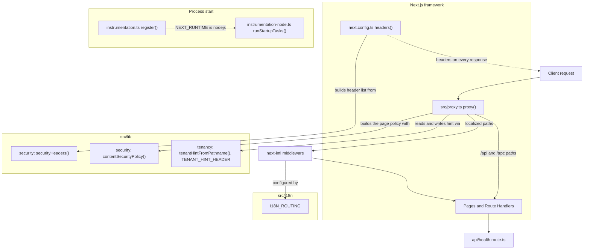
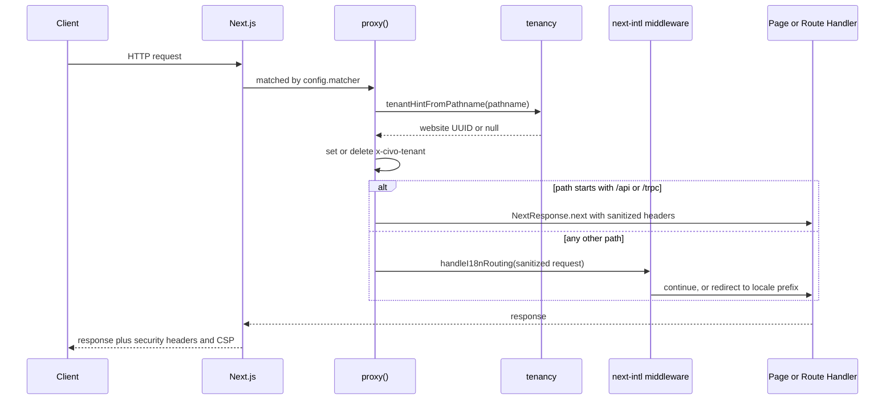

# Request Pipeline

## 1. Overview

This document traces what the application does to an incoming HTTP request before any page, Server Action or Route Handler runs, and what it does at process start. Four mechanisms cooperate:

- **Security headers**: every response carries a fixed set of defensive headers, configured in `next.config.ts` from `src/lib/security`.
- **The proxy** (`src/proxy.ts`): the one place that sees every address. It normalises the internal tenant-hint header and applies locale routing.
- **Tenant hint**: a request header (`x-civo-tenant`) that tells server code which website an admin address is about; vocabulary in `src/lib/tenancy`.
- **Health probe and startup hooks**: `GET /api/health` for liveness, and `src/instrumentation.ts` for work done once per server process.

The trigger is any inbound request, or the server starting. The outcome is a request that reaches application code with a trustworthy internal header, a locale-prefixed address (for pages), and security headers on the response.

Authentication (`src/app/api/auth`, the auth environment schema) is out of scope and is documented later; where it touches the pipeline it is noted in one line. Related: [rate limiting](rate-limiting.md), [configuration](configuration.md), [i18n and SEO](i18n-and-seo.md), [logging](logging.md).

## 2. Architecture and Layer Responsibilities

The pipeline sits at the framework boundary. Per [`nextjs.md`](../rules/nextjs.md), `proxy.ts` is for request-level concerns only, never business authorization.

| Component              | Path                                                    | Responsibility                                                                                                |
| ---------------------- | ------------------------------------------------------- | ------------------------------------------------------------------------------------------------------------- |
| Next.js config         | `next.config.ts`                                        | Applies `securityHeaders(...)` to `/:path*`; wraps the config with the next-intl plugin                       |
| Security headers       | `src/lib/security/security-headers.ts`, `index.ts`      | `securityHeaders({ isProduction })` returns the fixed list of `{ key, value }` headers                        |
| Page policy            | `src/lib/security/content-security-policy.ts`           | `contentSecurityPolicy({ isProduction, storageUrls, hasMap })` returns the CSP value                          |
| Proxy                  | `src/proxy.ts`                                          | `proxy(request)` and `config.matcher`; sets/clears the tenant hint; delegates to locale routing; sets the CSP |
| Tenant hint vocabulary | `src/lib/tenancy/tenant-hint.ts`, `index.ts`            | `TENANT_HINT_HEADER`, `isWebsiteId`, `tenantHintFromPathname`                                                 |
| Locale routing         | `src/i18n/config.ts` (`I18N_ROUTING`)                   | `localePrefix: 'always'`, locales `en`, `de`, default `en`; used through `next-intl/middleware`               |
| Health probe           | `src/app/api/health/route.ts`                           | `GET` returns `{ "status": "ok" }`, `Cache-Control: no-store`                                                 |
| Instrumentation        | `src/instrumentation.ts`, `src/instrumentation-node.ts` | `register()` runs Node-only startup tasks                                                                     |

`src/lib/security` and `src/lib/tenancy` are generic, pure lib parts with no module dependency, imported through their barrels. The proxy is a framework entry point and so may import lib and `@i18n`. The reader of the tenant hint lives in a module (the auth composition root, per `src/lib/README.md`) and is not part of this document.

## 3. Architecture Diagram

## 4. Main Workflow

1. **Matching.** Next.js evaluates `config.matcher` (`/((?!_next|_vercel|.*\\..*).*)`). Next internals and any path containing a dot (images, `sitemap.xml`, `robots.txt`) never reach `proxy()`. API routes do match, purely so the internal header is cleaned.
2. **Tenant hint.** `withTenantHint(request)` copies the request headers, then calls `tenantHintFromPathname(pathname)`. If the path is exactly `/<locale>/websites/<uuid>/...` the UUID is written to `x-civo-tenant`; otherwise the header is deleted. A value sent by the client is therefore always overwritten or removed.
3. **Branch.**
   - Path starts with `/api` or `/trpc` (regex `NON_LOCALIZED`): `NextResponse.next({ request: { headers } })` forwards the sanitised headers with no locale handling.
   - Any other path: the sanitised request goes to the next-intl middleware (`createMiddleware(I18N_ROUTING)`), which handles locale prefixing (`localePrefix: 'always'`), detection and the locale cookie.
4. **Handler runs.** The page or Route Handler executes and can read the trusted hint.
5. **Response headers.** `proxy()` sets `Content-Security-Policy` on its response, redirects included (see below). The headers from `securityHeaders(...)` are attached to every response by the `next.config.ts` rule on `/:path*`. This is configured in the framework, not in `proxy.ts`; the exact point in Next's routing order was not verified here. A second rule, listed after it so it overrides, sets `Referrer-Policy: no-referrer` on the locale-prefixed Auth pages whose URLs carry single-use secrets (`/:locale/accept-invitation`, `/email-verified`, `/sign-in`, `/reset-password`); the `:locale` segment matches every configured locale.

**Startup.** Next.js calls `register()` in `src/instrumentation.ts` once per server process. Only when `process.env.NEXT_RUNTIME === 'nodejs'` does it dynamically import `instrumentation-node.ts` and run `runStartupTasks()`, which awaits `runAuthStartup()` (authentication, documented later) and then calls `startAuditRetention()` from `@modules/audit`.

**Health.** `GET /api/health` awaits `connection()` so the answer is per request rather than prerendered, and returns `{ status: 'ok' }` with `Cache-Control: no-store`. It touches no database by design, so a database outage cannot make the platform kill a healthy web process. The Dockerfile `HEALTHCHECK`, the `app` service in `docker-compose.yml`, `.github/workflows/ci.yml` and `production.yml` all probe this path.

## 5. State and Data Flow

- **Request-scoped state only.** The proxy keeps no state. Its output is a new `NextRequest` (or a forwarded header set) with `x-civo-tenant` either present with a UUID or absent.
- **Tenant hint flow**: URL path, then `tenantHintFromPathname`, then header, then (downstream, in a module) the actor provider that re-validates with `isWebsiteId`.
- **Security headers** are computed once when `next.config.ts` is evaluated (`NODE_ENV === 'production'` toggles HSTS) and are static for the life of the build or process. The **Content-Security-Policy** is built once per server process in `proxy.ts` from the validated configuration (`serverEnv`, `publicEnv`), because it names the storage endpoint, which a container build only has as a placeholder.
- **Locale** is decided inside next-intl from the path, a locale cookie (`maxAge` one year, `sameSite: lax`) and detection (`localeDetection` follows `I18N_CONFIG.detection.enabled`, currently `true`).
- **Health** holds no state and returns a constant body.

## 6. Business Rules and Invariants

- The tenant hint is a **selector, never a credential**. It is overwritten on every request that reaches the application, including API routes. Every use case still authorizes against the server-side session.
- `tenantHintFromPathname` takes the second and third non-empty path segments: `section === 'websites'` and a candidate that matches the UUID pattern (`/^[0-9a-f]{8}-...-[0-9a-f]{12}$/i`). `/websites`, `/websites/users`, `/websites/audit`, reserved scopes such as `platform` or `unassigned`, and non-UUID values yield `null`. The first segment is not validated as a locale; deeper segments are ignored.
- The fixed security headers are: `X-Content-Type-Options: nosniff`; `X-Frame-Options: SAMEORIGIN`; `Referrer-Policy: strict-origin-when-cross-origin`; a `Permissions-Policy` that switches off every feature no page uses (`camera`, `microphone`, `geolocation`, `payment`, `usb`, `serial`, `bluetooth`, `hid`, `midi`, `accelerometer`, `gyroscope`, `magnetometer`, `display-capture`, `browsing-topics`); `Cross-Origin-Opener-Policy: same-origin`; `X-Permitted-Cross-Domain-Policies: none`; and `Strict-Transport-Security: max-age=63072000; includeSubDomains` in production only.
- The page policy is set by `proxy.ts`: `object-src 'none'`, `base-uri 'self'`, `form-action 'self'`, `frame-ancestors 'self'`, `frame-src 'none'`, `child-src` and `worker-src` `'self' blob:` (the map renderer's worker), `manifest-src 'self'`; `connect-src` with this site, the origins of `STORAGE_S3_ENDPOINT` and `STORAGE_PUBLIC_BASE_URL` (browser uploads go to a presigned address there) and, when `NEXT_PUBLIC_MAPBOX_ACCESS_TOKEN` is set, `api.mapbox.com`, `*.tiles.mapbox.com` and `events.mapbox.com`; `img-src` with this site, `data:`, `blob:`, the storage origins and `https:` (editor-supplied pictures come from any host); and `upgrade-insecure-requests` in production. Outside production `connect-src` also allows `ws:` and `wss:` for the hot-reload socket. Upstash, Neon and Resend are called by the server only, so they are not in it. There is deliberately no `script-src` or `default-src`: a script policy needs a per-request nonce, a nonce forces every page to render per request, and the partial prerendering (`cacheComponents`) these pages use cannot do that.
- `proxy.ts` must not perform business authorization (`nextjs.md`).
- The health route must stay free of database and other dependency calls.

## 7. Errors and Edge Cases

- **Non-matching paths** (`_next`, `_vercel`, anything with a dot) skip the proxy entirely, so no tenant header is cleaned for them. They run no application code according to the comment in the matcher; this was not independently verified.
- **Malformed or forged `x-civo-tenant`** from a client is removed or replaced, never forwarded.
- **Non-UUID website segment** produces no hint; the request proceeds without one.
- **Unexpected exceptions** in the proxy are not caught in `proxy.ts`; there is no error handling code in it, so behavior falls to Next.js defaults (unverified).
- **Edge runtime**: `register()` guards the Node-only import so the Edge compile drops it. Startup tasks do not run on other runtimes. A failure inside `runStartupTasks()` would reject `register()`; how it is handled is up to Next.js and the tasks themselves, and was not verified here.
- **Health failures**: the route has no failure branch; if the process cannot answer, the probe fails at the HTTP level.

## 8. Security and Access Control

- The proxy sanitises an internal trust-carrying header at the earliest trusted point, closing header-spoofing of the tenant selector.
- Header-based protections (clickjacking, MIME sniffing, referrer leakage of emailed single-use links, HSTS) follow [`security.md`](../rules/security.md). The CSP is deliberately partial: it has no script policy.
- `/api/health` is public and returns no data (`@authorization none` in its comment).
- Rate limiting is not applied in the proxy; it is spent by use cases (see [rate limiting](rate-limiting.md)). Client-address trust for it is separate from the tenant header.
- Authentication is documented later; the only touch point here is that the actor provider consumes the tenant hint and `runAuthStartup()` runs at boot.

## 9. Testing and Verification

- `__tests__/src/lib/security/security-headers.test.ts`: always-on headers, no CSP among them, HSTS in production only, the disabled features, and no repeated header.
- `__tests__/src/lib/security/content-security-policy.test.ts`: the fixed directives, `connect-src` and `img-src` per deployment (storage by origin, Mapbox only when maps are drawn, the development socket), the production-only upgrade, no script policy, and a malformed address skipped.
- `__tests__/src/proxy.test.ts`: the policy is on page, API and redirect responses and names the configured storage.
- `__tests__/src/lib/tenancy.test.ts`: header name, hint extraction for issued UUIDs, and a walk over `websiteRoutes` from `@modules/website/presentation/routes` to keep the extraction in step with the route table.
- No tests exist for `src/proxy.ts`, `src/app/api/health/route.ts`, `src/instrumentation.ts` or `src/instrumentation-node.ts`, and none for the `next.config.ts` header wiring.

Executed during this documentation pass: `npx vitest run __tests__/src/lib/security __tests__/src/lib/tenancy.test.ts`. The security test file passed. `tenancy.test.ts` **failed to load**: `@modules/website/presentation/routes` does not exist because `src/modules` is empty in this checkout, so the tenancy behavior is currently unverified by tests. Nothing else in this document was run.

## 10. Extension Points and Constraints

- **Add a request-level concern** (a request ID; a CSP nonce is not an option while pages are partially prerendered): compose it inside `proxy()` around the i18n handler, as its comment anticipates. Keep it free of business authorization and Node-only imports.
- **Add or change a response header**: edit `securityHeaders` and its test. Adding a `script-src` requires a per-request nonce and therefore a proxy change, not a static header.
- **Add a website-scoped route**: keep `tenantHintFromPathname` in step with the route table (`/<locale>/websites/<uuid>/...`); the existing test walks `websiteRoutes` for this.
- **Add a non-localized API prefix**: update `NON_LOCALIZED` in `proxy.ts`, and remember `config.matcher` still matches it so the tenant header is cleaned.
- **Add a startup task**: add it to `runStartupTasks()` in `instrumentation-node.ts`; keep Node-only code out of `instrumentation.ts`.
- **Constraints**: the header name `x-civo-tenant` is shared by writer (proxy) and reader (a module); change both together. The health route must stay dependency-free. `src/lib` parts must not import modules (the tenancy comment mentions `modules/website` only as a test target).
- **Observed gaps**: `src/lib/README.md` and the `tenant-hint.ts` comment link to `docs/architecture/route-protection.md`, which does not exist. `src/modules` is empty here, so `instrumentation-node.ts` imports (`@modules/audit`, `@modules/auth`) do not resolve in this checkout.
