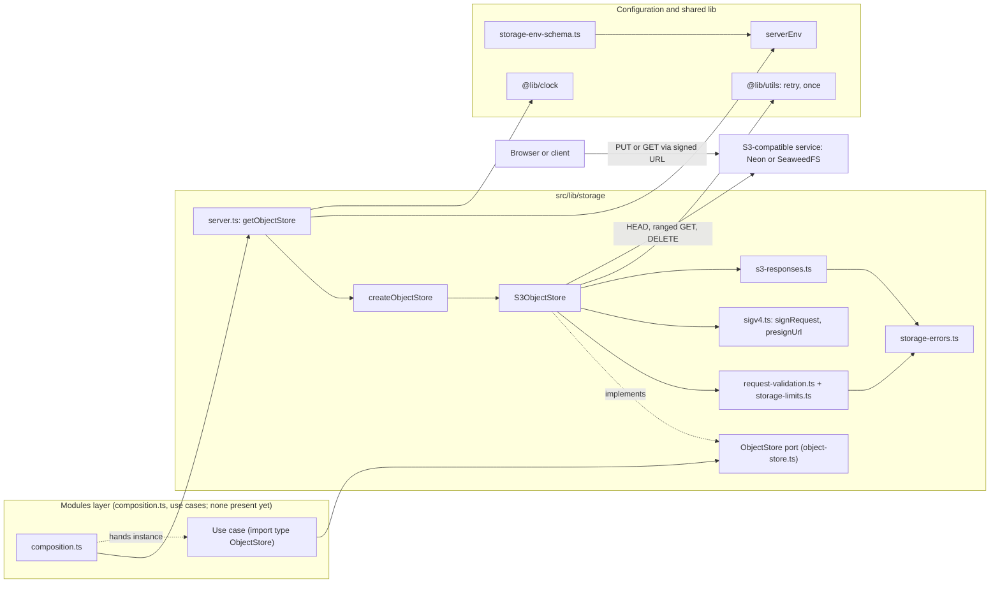
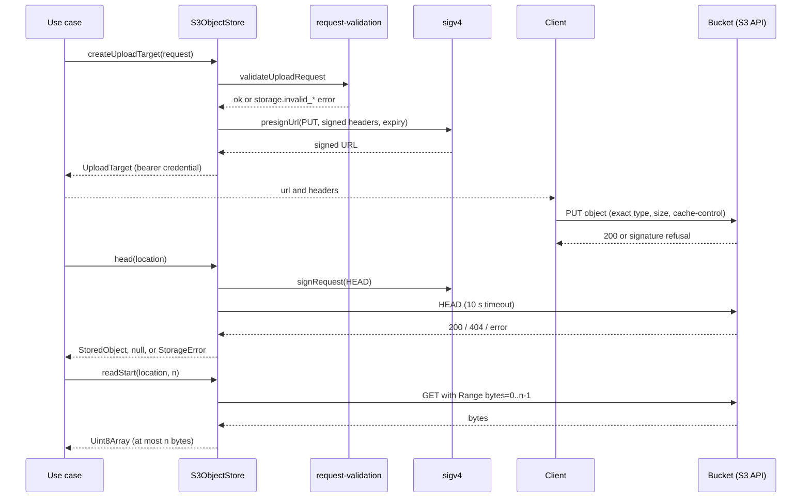

# Object Storage (`@lib/storage`)

## 1. Overview

`@lib/storage` is the shared object-storage layer for uploaded files. It exposes one port, `ObjectStore`, and one adapter, `S3ObjectStore`, which speaks the S3 protocol directly with its own AWS Signature Version 4 implementation (no SDK, no extra dependency). Production targets Neon Object Storage; local development uses the SeaweedFS container from `docker-compose.yml`.

The design goal is that files travel **directly between the client and the bucket**. The server only issues short-lived signed permissions (an upload target or a read URL) and inspects what was stored (`head`, `readStart`, `delete`). The primary actor is a module's use case, which derives an object key from trusted data and asks the store for a permission or a fact. Outcomes are always `AppResultAsync<T, StorageError>`.

Storage is **mandatory**, like the database: there is no off switch and no in-memory or alternate-provider fallback. A store that fails reports the failure.

Current state: `src/modules` is empty, so no production code calls `getObjectStore()` yet. The only consumers in the repository are tests. The intended wiring (from `src/lib/README.md` and [`docs/rules/boundaries.md`](../rules/boundaries.md)) is that use cases `import type { ObjectStore }` and receive an instance from a `composition.ts` file, the only place that calls `getObjectStore()`.

## 2. Architecture and Layer Responsibilities

All code is in the shared library layer (`src/lib`, alias `@lib`), which never imports a module. `@lib/storage` is a pure barrel; `@lib/storage/server` is `server-only`.

| Concern          | Path                                     | Responsibility                                                                                                                                                      |
| ---------------- | ---------------------------------------- | ------------------------------------------------------------------------------------------------------------------------------------------------------------------- |
| Port and types   | `src/lib/storage/object-store.ts`        | `ObjectStore`, `ObjectVisibility` (`public` / `private`), `ObjectLocation`, `UploadRequest`, `UploadTarget` (`kind: 'http-put'`), `StoredObject`, `ReadUrlRequest`. |
| Barrel           | `src/lib/storage/index.ts`               | Exports the port types, `OBJECT_VISIBILITIES`, error codes and constructors. Exports no adapter.                                                                    |
| Server entry     | `src/lib/storage/server.ts`              | `getObjectStore`: lazy `once` singleton from `serverEnv` and `systemClock`.                                                                                         |
| Factory          | `src/lib/storage/create-object-store.ts` | `createObjectStore(env, { clock })` returns `S3ObjectStore`; region defaults to `auto`; omits unset buckets and public base URL.                                    |
| Adapter          | `src/lib/storage/s3-object-store.ts`     | Addressing, validation, signing, requests, retry, error mapping.                                                                                                    |
| Signing          | `src/lib/storage/sigv4.ts`               | `signRequest` (header auth) and `presignUrl` (query auth) using `node:crypto`.                                                                                      |
| Response parsing | `src/lib/storage/s3-responses.ts`        | The one file that knows S3 response shapes; classifies transient vs. rejected failures; bounded body reads.                                                         |
| Validation       | `src/lib/storage/request-validation.ts`  | Key, content type, size, cache-control, lifetime and read-length checks.                                                                                            |
| Limits           | `src/lib/storage/storage-limits.ts`      | Constants such as `MAX_OBJECT_KEY_LENGTH` (1024), `MAX_SIGNED_URL_TTL_SECONDS` (3600), `MAX_UPLOAD_BYTES` (5 GiB), `MAX_READ_START_BYTES` (65 536).                 |
| Errors           | `src/lib/storage/storage-errors.ts`      | `StorageError`, `STORAGE_ERROR_CODES`, constructors, `isRetryableStorageError`.                                                                                     |
| Configuration    | `src/lib/config/storage-env-schema.ts`   | Zod schema, `StorageEnv`, cross-variable rules; composed into `serverEnvSchema`.                                                                                    |

Authorization is explicitly **not** a storage concern: the store never decides who may touch which key. Callers resolve ownership first and pass a key they derived (`docs/rules/security.md`).

## 3. Architecture Diagram

## 4. Main Workflow

The adapter supports three paths. The first is the core use case; the others reuse the same building blocks.

**Upload and verify.**

1. The use case validates and authorizes the request, derives a key from trusted IDs, and calls `createUploadTarget({ location, contentType, byteSize, cacheControl, expiresInSeconds })`.
2. The adapter validates the request, builds `endpoint/bucket/key` (path style), and calls `presignUrl` for `PUT`. Content type, content length and cache-control are signed, so the bucket refuses an upload that differs in any of them. No network call is made.
3. The use case returns the `UploadTarget` (`url`, the `headers` the client must send, `expiresAt`) to the client, which uploads straight to the bucket.
4. Later the use case calls `head` to confirm existence and size, and `readStart(location, n)` to read the first bytes for a file-signature check.

**Private download.** `createReadUrl({ key, expiresInSeconds })` presigns a `GET` for the private bucket only; it does not check that the object exists. Public objects use `publicUrl(key)`, which does no I/O.

**Delete.** `delete(location)` sends a signed `DELETE`; success and 404 both return `ok`.

## 5. State and Data Flow

- **Configuration** (`StorageEnv`) is the only persistent state in the layer. `getObjectStore` builds one `S3ObjectStore` per process on first use. Credentials are explicit constructor options; the ambient AWS credential chain is never used.
- **Bucket per visibility.** `public` and `private` map to `STORAGE_S3_PUBLIC_BUCKET` and `STORAGE_S3_PRIVATE_BUCKET`. The same key in each visibility is a different object. `supports(visibility)` reports whether a bucket is configured.
- **Public URL** is `STORAGE_PUBLIC_BASE_URL` (trailing slash stripped) plus `/` plus the key. It is `null` when no public bucket and base URL exist, or when the key is invalid.
- **Object metadata** flows out as `StoredObject`: `byteSize` (0 if the header is missing or malformed), `contentType`, `etag`, `lastModified` (`null` if unparsable). Raw provider responses never leave `s3-responses.ts`.
- **Time** comes from the injected `Clock`, which makes signatures and `expiresAt` deterministic in tests.
- **File content** does not pass through the server except for the bounded `readStart` peek. There is no database interaction here; recording the file row is the caller's job (`docs/rules/security.md`: create the row before authorizing upload). See [persistence.md](./persistence.md).

## 6. Business Rules and Invariants

- **Keys:** non-empty, at most 1024 characters, segments of `[A-Za-z0-9._-]` joined by `/`, no empty segment, no segment of only dots (blocks traversal). Applied to every operation, including `publicUrl`.
- **Upload requests:** content type is a lower-case `type/subtype` without parameters (at most 127 characters); `byteSize` is an integer from 1 to 5 368 709 120; cache-control matches `[A-Za-z0-9=, -]+` (at most 128 characters); lifetime is an integer from 1 to 3600 seconds.
- **Read-start length:** integer from 1 to 65 536. Reads stop at that count even if the server ignores `Range` (`readAtMost`).
- **Signed terms:** content type, content length and cache-control are signed headers for uploads; the returned `headers` omit `Content-Length`, which the client's HTTP stack derives from the body.
- **Idempotency:** `delete` is idempotent; `head` returns `null` for a missing object, while `readStart` returns `storage.object_not_found`. An empty object yields an empty array (HTTP 416 is mapped to success).
- **Environment rules** (`storage-env-schema.ts`, `env-schema.ts`): endpoint, access key and secret are always required; bucket names follow the 3 to 63 character pattern; at least one bucket must be set; the private bucket must differ from the public one; `STORAGE_PUBLIC_BASE_URL` is required with a public bucket, forbidden without one, and must contain no credentials, query or fragment; in production the endpoint and public base URL must be `https`.
- **Out of scope by design:** listing, copying, server-side writes and multipart upload.

## 7. Errors and Edge Cases

`StorageError` is `ValidationAppError | NotFoundAppError | InfrastructureAppError`. Codes (`STORAGE_ERROR_CODES`):

| Code                                             | Meaning                                                                                          | Retryable                                                  |
| ------------------------------------------------ | ------------------------------------------------------------------------------------------------ | ---------------------------------------------------------- |
| `storage.invalid_key`, `storage.invalid_request` | Caller input failed validation; the field is named in the error details.                         | No                                                         |
| `storage.object_not_found`                       | `readStart` on a missing object.                                                                 | No                                                         |
| `storage.unavailable`                            | Network failure, timeout, 408/425/429, or 5xx.                                                   | Yes (`isRetryableStorageError` is true only for this code) |
| `storage.rejected`                               | Other non-2xx: credentials, policy, missing bucket; also an unexpected throw inside the adapter. | No                                                         |
| `storage.visibility_unavailable`                 | No bucket for the requested visibility.                                                          | No                                                         |

Behavior to know:

- `head`, `readStart` and `delete` are retried via `retry` with doubling pauses (default 3 attempts, 200 ms base) only while the outcome is `storage.unavailable`. `createUploadTarget` and `createReadUrl` perform no I/O and are not retried. Each request has a 10 s `AbortSignal.timeout`.
- A response body cut off after headers arrive is classified as a transport failure and is retried.
- The provider error becomes a `cause` that carries only the operation, status and S3 `<Code>`; for thrown values only the error name. URLs, signatures and secrets are kept out of every error (tests assert this).
- `settle()` wraps every operation so an unexpected exception becomes `storage.rejected` with a generic cause, never a rejected promise.
- Errors travel as `Result` values to the caller; mapping to user-facing messages belongs to the module. See [error-handling.md](./error-handling.md).

## 8. Security and Access Control

- **Bearer credentials.** An `UploadTarget` and any signed read URL grant access until they expire; callers must not log or persist them. Lifetimes are capped at one hour.
- **Defence in depth.** `request-validation.ts` is the last line against traversal-like keys and header injection; callers still validate their own input first.
- **Isolation by bucket.** Private objects can never be served from the public origin because each visibility is its own bucket and the config rejects identical names.
- **Transport.** Production requires `https` for the endpoint and public base URL, because signed URLs and credentials otherwise cross the network in the clear.
- **Secrets.** `STORAGE_S3_ACCESS_KEY_ID` and `STORAGE_S3_SECRET_ACCESS_KEY` live in `serverEnv` only; `@lib/storage/server` is `server-only`. The secret is used only inside `sigv4.ts` to derive the signature and never appears in a URL.
- **Authorization** is out of the layer's scope; see the caller-side rules in `docs/rules/security.md` and [configuration.md](./configuration.md) for how env is validated.

## 9. Testing and Verification

Under `__tests__/src/lib/storage/`:

| File                                                                  | Covers                                                                                                                                                                             |
| --------------------------------------------------------------------- | ---------------------------------------------------------------------------------------------------------------------------------------------------------------------------------- |
| `sigv4.test.ts`                                                       | Reproduces the presigned `GET` and ranged `GET` examples published by AWS; header and query ordering; no secret leakage.                                                           |
| `s3-object-store.test.ts`                                             | Path-style addressing, public URLs, signed upload pinning, read URLs, `head`, `readStart`, `delete`, retry and failure classification, malformed keys, unexpected failures.        |
| `storage-contract.test.ts`                                            | Error helpers, validation limits, `createObjectStore` wiring and region default, and the boundary check that the layer imports no module and the port does not import the adapter. |
| `support/object-store-contract.ts`                                    | Shared contract suite (`describeObjectStoreContract`), run against the in-memory store and the real S3 service.                                                                    |
| `in-memory-object-store.test.ts`, `support/in-memory-object-store.ts` | Test double that enforces the signed terms and supports failure injection.                                                                                                         |
| `server.test.ts`                                                      | `getObjectStore` builds once and lazily.                                                                                                                                           |
| `s3-object-store.integration.test.ts`                                 | The contract against a real S3-compatible service (SeaweedFS), using `STORAGE_TEST_*` variables; skipped when unconfigured; excluded from the default run in `vitest.config.ts`.   |

Configuration: `__tests__/src/lib/config/storage-env.test.ts` (schema, rules, production rules).

Execution on this documentation pass: `npx vitest run` on the storage directory plus `storage-env.test.ts` and `env.test.ts` **passed** (one combined run with the mail tests: 12 of 13 files passed, 226 tests passed; the one failing file was the mail test `email-brand.test.ts`, see [mail.md](./mail.md)). The integration test was **not run**, since it is excluded by default and needs a local SeaweedFS.

## 10. Extension Points and Constraints

- **New operation:** add it to `ObjectStore` only when a real workflow needs it (the port deliberately omits listing, copying and multipart). Implement it in `S3ObjectStore`, validate inputs in `request-validation.ts`, extend `object-store-contract.ts` and the in-memory double so both stay in step.
- **New provider:** write another class implementing `ObjectStore`, keep its response parsing in its own file, and choose it in `createObjectStore`. The `UploadTarget` union (`kind`) exists so another upload mechanism can be added without breaking callers that switch on `kind`; callers handling only `http-put` must be reviewed then.
- **New limit or error code:** add to `storage-limits.ts` or `STORAGE_ERROR_CODES`; keep codes stable because callers branch on them.
- **New variable:** follow [`docs/conventions/adding-an-environment-variable.md`](../conventions/adding-an-environment-variable.md) and add a row to `storageEnvRules`.
- **Constraints:** `@lib/storage` must not import a module; the barrel must not export the adapter; only `composition.ts` files may call `getObjectStore()`; keep keys derived from trusted IDs; do not widen error causes with URLs or provider text; path-style addressing is required (Neon serves nothing else); retries only for idempotent calls.
- Related: [configuration.md](./configuration.md), [error-handling.md](./error-handling.md), [persistence.md](./persistence.md), [mail.md](./mail.md).
