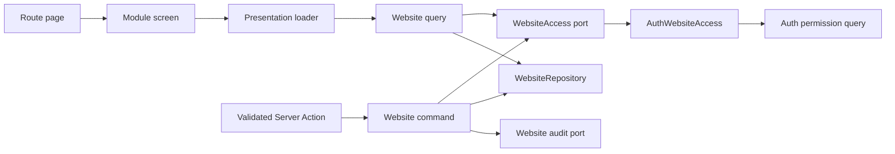
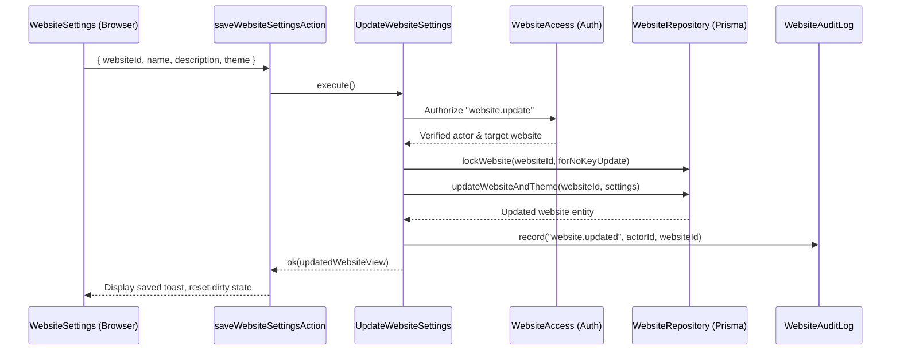

# Website management

## 1. Overview

Website owns website details, themes, template selection and initial home-page provisioning. Auth owns identities and target permissions; audit owns trail reads and retention. Website continues to emit its own events through an audit port.

## 2. Architecture and layer responsibilities

The module follows the same structure as auth and audit: domain models/errors/ports, application commands/queries/contracts/services, infrastructure adapters, presentation components/hooks/loaders/schemas/actions, `composition.ts` and intentional server/browser APIs.

- `CreateWebsite`, `UpdateWebsite` and `UpdateWebsiteTheme` remain separate commands. Each has a production Server Action; none is dead code.
- Website-owned queries read one website, a paginated authorized listing or a public website by slug.
- Website's `infrastructure/access/auth-website-access.ts` delegates to auth; the application service `findWebsite` only loads and checks the already authorized record.
- Website no longer owns wrappers around audit queries or duplicate name/selector queries. Consumers use auth's accessible website queries and audit's readers directly.
- `website-limits.ts` owns table pagination limits. Auth owns the bounds and truncation signals for website selectors.

## 3. Architecture diagram

## 4. Main workflow

`composition.ts` constructs repositories, dependencies and use cases lazily with `once`, like auth and audit. `getWebsiteQueries()` and `getWebsiteCommands()` expose the factories. The existing `websiteQueries` facade retains website-owned reads. The obsolete website audit/name query members and their unused classes were removed; audit and auth are their owning APIs.

`WebsitesAdministration` loads an authorized page through `loadWebsitesAdministration` and renders `WebsitesTable` using `DataPanel` and `ResponsiveTable`. `/websites` serves every actor with readable memberships, independently of their currently selected tenant. Each row has one "Open" action; the website's audit log and people are reached through its own navigation. The list has no search: the repository pages an allowlist without a name filter. Platform authority sees a header action "Create website" (and the same call to action in the empty state) that opens `/websites/new` (`websiteRoutes.create`): `CreateWebsiteWizard` walks through basics (name, slug derived from the name until edited), template and a review step, keeps the step in `?step=` through `useWizardSteps`, guards unsaved entries with its own `UnsavedChangesProvider`, routes a taken slug back to its field and step, and on success replaces the wizard with the new website's overview, whose checklist names the next steps. `WebsiteSettings` loads its website through `loadWebsiteSettings`, mounts general/theme forms and coordinates their unsaved-work state. Route pages compose these screens and their dedicated skeletons.

`WebsiteOverview` owns the website overview's responsive framing, heading and website facts; it uses the shared `AdminPage` frame and `AdminPageHeader`, whose `meta` slot carries the address and the live badge. The application boundary supplies authorized capability tiles, publication controls, onboarding and activity as server-rendered slots. Each capability keeps its own reads, vocabulary and permissions; slots stream through separate Suspense boundaries. Top to bottom the overview shows publication state, one row of `OverviewTile` figures (pages, files, maps, data, booking, people: each module's tile is the link into its area), then "Activity & publication": the audit activity chart and latest entries beside onboarding, release history and the website's own facts. Website's request-cached `loadWebsite` read is shared by metadata and screens. Auth owns member-name enrichment; component platform owns translating catalog labels.

Platform pages live under the `(platform)` route group inside `/websites`; its navigation layout does not wrap `[websiteId]`. URLs stay unchanged. Website screens have their own section bar, website switcher and publication status. The switcher includes the website list even when only one website is available. Navigation starts compact until its available width is measured, preventing overflow before hydration.

Builder owns page addresses through `builderRoutes`: the list is `/websites/[websiteId]/builder`, the "new page" wizard is `/builder/new`, and an editor adds its page id. Website navigation and the overview's checklist use that same route helper. Website does not define a competing `/pages` address.

Navigation paths and cache targets have different contracts. `revalidateLocalizedPath` invalidates each locale of a concrete page URL. `websiteRoutes.layout` is the authored `/[locale]/(protected)/websites/[websiteId]` layout pattern, used with `revalidatePath(..., 'layout')`. Builder retains the same parent-layout target without introducing a dependency back to website; a route-contract test keeps both declarations equal and verifies that the layout exists. Layout invalidation covers every website and locale under that pattern; concrete page invalidation remains scoped to the changed website.

## 5. State and data flow

An explicit website operation starts with `access.authorizeWebsite(permission, rawId)`. The adapter authenticates before parsing the id, asks auth's existing target-permission query, and returns the actor id and authorized website/tenant pair. It captures no request identity. `findWebsite` matches both identifiers and refuses missing or inconsistent records. Audit events and writes use this authorized target, independently of the actor's currently selected website.

The listing address is parsed with the shared `pageParamsSchema` (`@lib/pagination`); pagination is bounded and clamped in the application query, and `pageHrefOf` builds the page links. Page links use the query's resolved page size. Form hooks live in `presentation/hooks`; components compose fields and panels rather than owning mutation workflows.

## 6. Business rules and invariants

- A website is its own tenant. Storage reads and writes remain keyed by website and tenant.
- Only platform authority creates websites or lists all websites. Other actors list the websites where auth grants `website.read`; the repository applies this allowlist before both counts and pagination. Single-website operations use current target memberships through auth.
- The slug remains immutable. No-op detail edits write nothing and emit no success event.
- Website creation still provisions its home page through the builder port (see [builder.md](./builder.md)). Provisioning failure compensates by deleting the website; the original provisioning error wins if cleanup also fails.
- Theme updates keep their existing transaction and lock the website with `forNoKeyUpdate` before upserting the theme. `retryTransient` retries the whole database transaction; audit events and home-page provisioning stay outside the retry.
- Selectors supplied by auth retain `isTruncated`. `WebsiteSwitcher` displays a status warning for partial lists. Website pages use exact totals within their authorized reach; `isWebsitesTruncated` warns when auth capped the membership allowlist. Platform name-selector truncation does not narrow the platform's website table.

## 7. Errors and edge cases

Expected failures remain typed results. A denied target is not read or written. Invalid ids, missing records, infrastructure failures and foreign records have explicit outcomes. The presentation boundary maps refused reads to not-found behavior and leaves infrastructure failures visible to the owning error boundary.

General and theme forms share one dirty-form registry. Saving one does not clear the other's unsaved state. The existing unload/navigation guards handle leaving; confirmed navigation is replayed once. Browser back/forward remains outside the existing navigation guard's documented coverage.

## 8. Security and access control

Display flags control form visibility only. Save commands authorize their own targets independently. `requireActor()` alone is insufficient: lint recognizes the explicit access-port authorization chain and rejects actor-only, missing-permission and read-before-authorization patterns. The adapter uses auth's permission vocabulary rather than duplicating roles.

All presentation strings use website-owned keys. Locale assembly includes the implemented modules; missing modules do not receive placeholder catalogs. Color picker validation uses the existing parser, and theme previews retain the existing readable foreground/copy color utilities.

## 9. Testing and verification

Unit coverage combines the real auth target query and website use cases with port fakes. It protects cross-website access, denial-before-read, revocation, invalid input, no-op edits, foreign-record refusal, error propagation and audit placement. Presentation tests cover settings, loaders, responsive table contents, onboarding progress and selector truncation. Shared tests cover clipboard feedback and coordinated unsaved forms. Authorization-rule tests protect the delegated pattern.

Browser preview checks exercise the real table, navigation disclosure, progress primitive, clipboard control and theme preview at desktop and narrow widths. The preview substitutes request translations and example records; it is not an authenticated database-backed end-to-end test.

The real PostgreSQL suite includes concurrent theme updates, allowlist pagination and foreign-tenant refusal. Contract generation now succeeds with a Windows-safe glob, Prisma 8 generator/SQL syntax and obsolete `BookingResource` inverse fields removed. Running database integration tests still requires configured databases with migrations applied; builder/component-platform integration sources remain absent from this checkout.

## 10. Extension points and constraints

Add website behavior to the owning existing command or query; reuse auth for permission decisions and audit for trail reads. Add shared UI only for generic presentation: `field`, `select-field`, `data-panel`, `overview-panel` and `process-steps` already own the common groups. The checklist and instructional step list share `process-steps.tsx`; the checklist uses the styled Radix/Shadcn `Progress` primitive.

Restoring absent integration modules requires separate work. Contract syntax repairs preserve the authored SQL expressions and existing models; no database migration or dependency upgrade is performed. Creation compensation and best-effort audit recording retain their existing operational limits.
